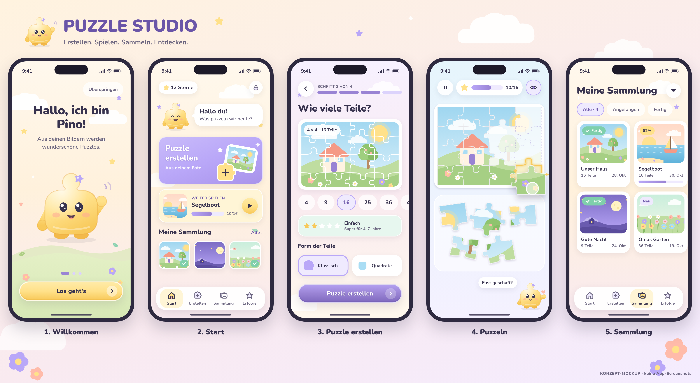

# PUZZLE STUDIO

Kindgerechte Puzzle-App für iOS und Android: aus eigenen Fotos werden Puzzles – erstellen, spielen, sammeln, entdecken.


<sub>Konzept-Mockup – noch keine implementierte App.</sub>

## Projektstand

**Phase 0 – Analyse & Konzept abgeschlossen.** Vorhanden: Design-Tokens (`packages/ui`), Design-System-Doku, Maskottchen-Konzept, Konzept-Mockups, Architektur- und Produktdoku. Die Expo-App folgt in Phase 1 nach Freigabe.
Aktueller Bericht: [docs/previews/milestone-reports/2026-11-01-milestone-00-analysis-and-concept.md](docs/previews/milestone-reports/2026-11-01-milestone-00-analysis-and-concept.md)

## Struktur

```text
packages/ui/              Design-Tokens (Single Source of Truth)
scripts/design-preview/   Renderer für die Konzept-Mockups
docs/                     Produkt, Architektur, Design, Engine, Datenschutz, Entwicklung, Previews
```

## Voraussetzungen

Node.js ≥ 22.18, pnpm 10 (`corepack enable`). Für die App ab Phase 1 zusätzlich: EAS CLI, Expo-Konto, Android Studio (Emulator). iOS-Builds laufen über EAS Cloud Build (kein Xcode nötig). Details: [docs/development/setup.md](docs/development/setup.md).

## Befehle

```bash
pnpm install          # Abhängigkeiten
pnpm typecheck        # TypeScript (strict)
pnpm test             # Tests (ab Phase 1/4)
pnpm design:preview   # Konzept-Mockups neu rendern (Playwright + Chromium nötig)
```

Build- und Testbefehle für die App (EAS, Development Builds, TestFlight, Android APK/AAB) werden in Phase 1 ergänzt: [docs/development/setup.md](docs/development/setup.md), [docs/development/testing.md](docs/development/testing.md).

## Dokumentation

[PROJECT_BRIEF.md](PROJECT_BRIEF.md) · [CLAUDE.md](CLAUDE.md) · [Architektur](docs/architecture/overview.md) · [Design System](docs/design/design-system.md) · [Roadmap](docs/product/roadmap.md) · [Datenschutz](docs/security/privacy.md)
