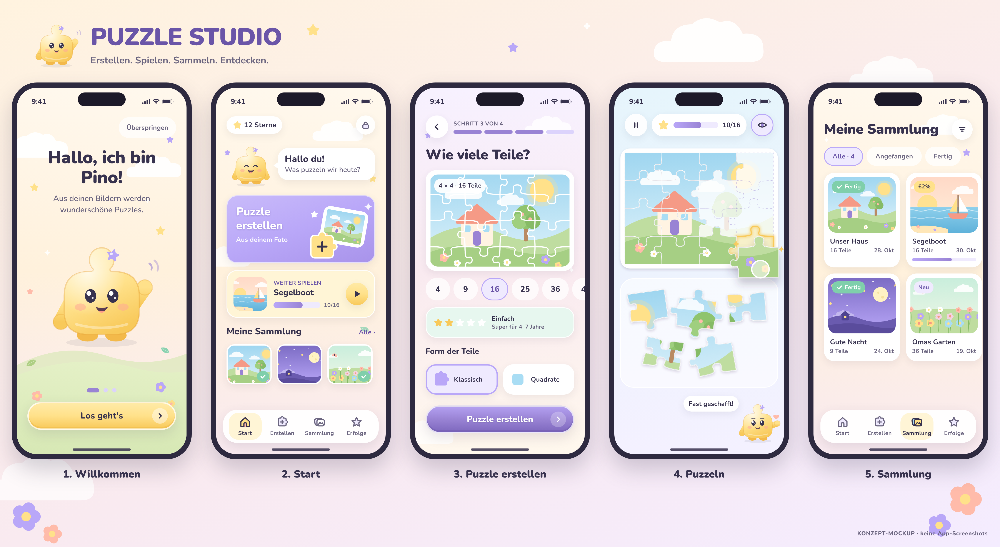
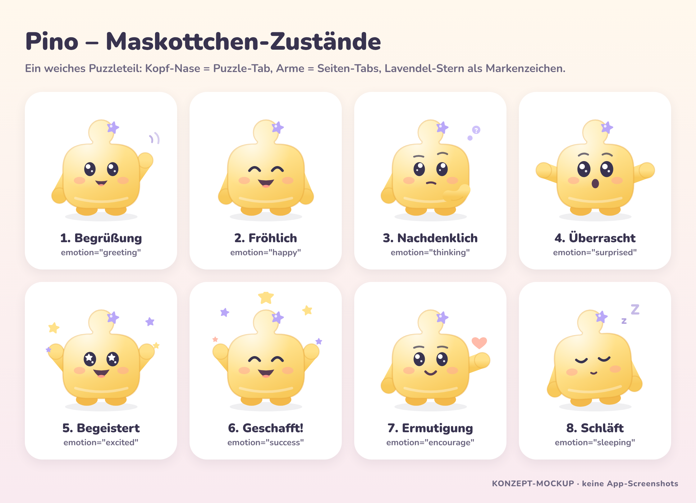
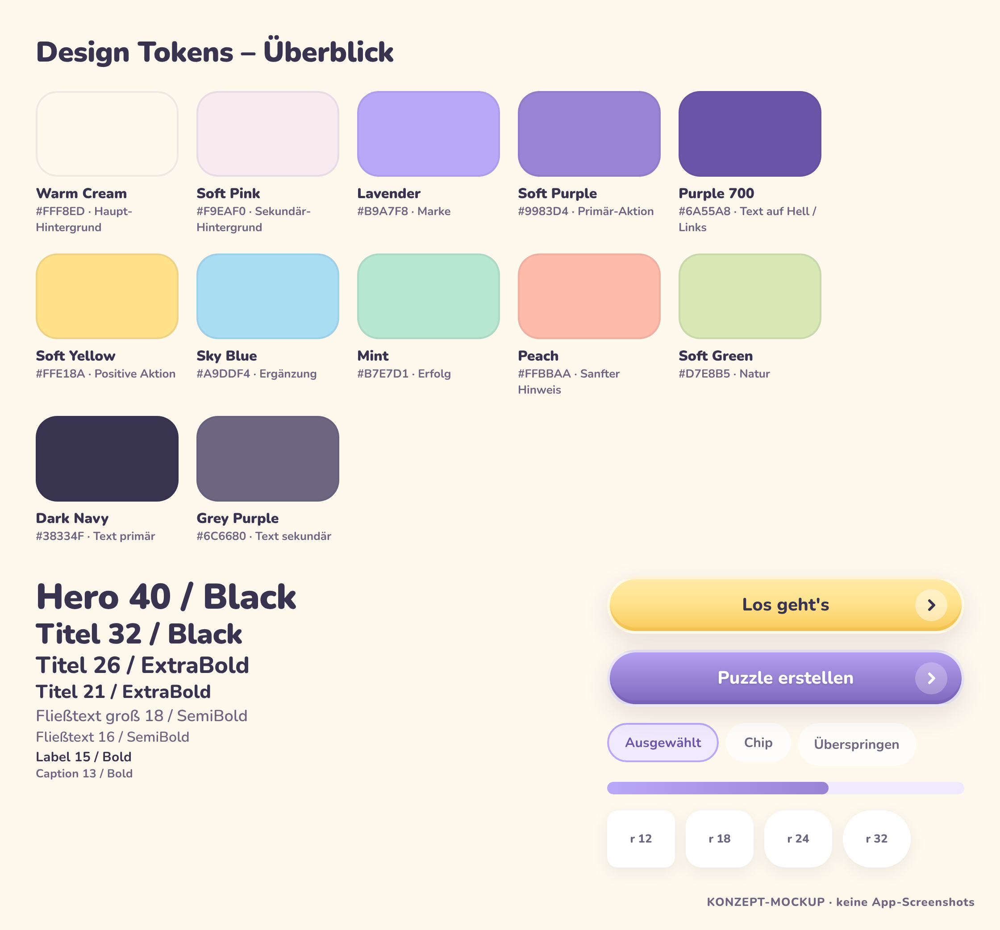

# Milestone 00 – Analyse, Designkonzept & Foundation-Planung

**Datum:** 2026-11-01 · **Phase:** 0 · **Status:** abgeschlossen, **wartet auf Freigabe**

> Dieser Meilenstein enthält **keine lauffähige App**. Alle Bilder sind **Konzept-Mockups** (gerendert aus HTML/SVG mit den echten Design-Tokens), keine App-Screenshots.

## 1. Repository-Analyse

| Repo | Befund |
|---|---|
| `prynz/PUZZLE-STUDIO` | Leer: keine Commits, keine Branches auf dem Remote. Nichts zu erhalten, keine Konflikte. |
| `prynz/PLAYVERSE` | Ebenfalls leer. Nicht Teil dieses Auftrags, daher **unverändert**. |

Fehlende Grundlagen (jetzt angelegt oder geplant): Workspace-Konfiguration ✅, TS-Basis ✅, Design-Tokens ✅, Dokumentation ✅, Expo-App ⏳ (Phase 1), Lint/Test/CI ⏳ (Phase 1).

## 2. Neu angelegt

```text
pnpm-workspace.yaml · package.json · tsconfig.base.json · .gitignore
packages/ui/src/tokens.ts            Design-Tokens (typisiert, typecheck grün)
scripts/design-preview/*.mjs         Mockup-Renderer (Mascot, Dekor, Szenen, Kanten-Prototyp, Screens)
docs/design/reference/visual-style-reference.png
docs/design/{reference-analysis, design-system, component-library, mascot-guidelines}.md
docs/design/concept/*.png            8 Konzept-Mockups
docs/{architecture, product, puzzle-engine, security, development}/*.md
CLAUDE.md · PROJECT_BRIEF.md · README.md
```

## 3. Designkonzept – Kernentscheidungen

| Entscheidung | Begründung |
|---|---|
| Palette aus dem Brief + Tonstufen 100/200/600/700 | Referenz gemessen und abgeglichen; Stufen für Flächen und gedrückte Zustände |
| Text sekundär `#6C6680` statt `#77718A` | WCAG AA (4,41 → 5,17 : 1 auf Creme) |
| Weiß auf Lila nur für fette Labels ≥ 19 px | 3,2 : 1 reicht nur für Large Text |
| Nur Nunito (600–900), kein Inter | eine Familie genügt; weniger Ladezeit, ruhigeres Bild |
| Maskottchen **Pino**: gelbes Puzzleteil mit Lavendel-Stern | klar eigenständig gegenüber der Referenzfigur (Farbe, Silhouette, Accessoire), thematisch passend |
| Gelb = „Los/Spielen“, Lila = „Weiter/Erstellen“ | entspricht der Referenz (gelber Welcome-, lila Continue-Button) |
| Hintergrund-Presets statt freier Deko | Konsistenz, Dekoration stört nie die Bedienung |
| Fehler in Peach statt Rot | kindgerecht, kein Alarm |
| Form „Quadrate“ zusätzlich zu „Klassisch“ | 2–4-Jährige |

## 4. Geplante Screens

Onboarding (3) · Home · Creator (Quelle → Zuschnitt → Teile/Form → Vorschau) · Gameplay (+ Pause, Abschluss) · Sammlung (+ Detail) · Erfolge · Elternbereich (+ Eltern-Schranke, Einstellungen, Speicher, Datenschutz). Informationsarchitektur: [product-concept.md](../../product/product-concept.md).

## 5. Erste visuelle Vorschau (MOCKUPS)





Selbstkritische Design-QA der Mockups:
- ✅ Pastellwelt, Rundungen, weiche Schatten, Wolken/Sterne/Wiese entsprechen der Referenz.
- ✅ Eine Hauptaktion pro Screen, große Touch-Flächen.
- ⚠️ Der Stil von Pino ist eine gute Vektor-Basis, erreicht aber noch nicht den „gemalten“ Illustrationsgrad der Referenz → Feinschliff (ggf. Illustrator:in) vor Release; Geometrie bleibt Vektor.
- ⚠️ Gameplay: Ablagebereich bei 100+ Teilen braucht ein Scroll-/Stapelkonzept (wird in Phase 5 entworfen).
- ⚠️ Die Schritt-Anzeige im Creator (4 Schritte) fasst „Bild wählen“ und „Foto/Galerie“ zusammen – bewusst, um den Ablauf für Kinder kurz zu halten.

## Technische Risiken

| Risiko | Auswirkung | Gegenmaßnahme |
|---|---|---|
| Skia-Performance bei 256 Teilen (Clip + Shader pro Teil) | Ruckeln auf älteren Android-Geräten | Teile als vorgerenderte `SkImage`/Picture cachen, nur gezogenes Teil live zeichnen; früher Benchmark-Spike in Phase 4 |
| Speicher bei großen Fotos (12–48 MP) | Abstürze (OOM) | Sofort nach Auswahl auf ≤ 2048 px verkleinern, Spielbild ≤ 1536 px, Textur-Größe begrenzen |
| pnpm + Metro (Symlinks) | Build-/Resolver-Fehler | `node-linker=hoisted` oder Expo-Monorepo-Vorgaben, in Phase 1 als erstes verifiziert |
| iOS ohne Mac | langsamer Feedback-Zyklus | EAS Development Build + registriertes Gerät; Maestro-Flows für Screenshots über EAS-Workflows |
| Echte Screenshots aus dieser Cloud-Umgebung | Hier läuft kein iOS-Simulator/Android-Emulator | Screenshots für Milestones auf dem Windows-Rechner (Android-Emulator) bzw. per EAS/Gerät erzeugen; alternativ Expo Web nur als **gekennzeichnete** Hilfsansicht |
| Gesten-Konflikte (Pan vs. Scroll im Ablagebereich, Zoom) | Fehlbedienung durch Kinder | Ein zentraler Gesture-Handler auf dem Canvas, Engine entscheidet per Hit-Test |
| Store-Richtlinien Kids Category / Families | Ablehnung | keine Dritt-SDKs, keine externen Links ohne Eltern-Schranke, Datenschutzangaben früh vorbereiten |
| Wiederherstellung nach Engine-Änderung | Geometrie passt nicht mehr | `engineVersion` pro Puzzle, alte Algorithmen bleiben erhalten (siehe serialization.md) |

## 6. Qualitätsprüfung dieses Meilensteins

- `pnpm typecheck` ✅ (packages/ui)
- Lint/Tests: noch nicht eingerichtet (Phase 1) – keine Logik außer Tokens vorhanden.
- Mockups mit `pnpm design:preview` reproduzierbar erzeugt ✅

## 7. Vorgeschlagener nächster Schritt: Phase 1 – Foundation

1. Expo-App `apps/mobile` (SDK 58, Expo Router, TypeScript strict) im Monorepo anlegen, pnpm/Metro-Monorepo-Setup verifizieren.
2. Native Module installieren (Skia, Reanimated, Gesture Handler, SQLite, Image Picker/Manipulator, File System) via `npx expo install`.
3. Nunito einbinden, `packages/ui` an die App anbinden (Tokens → erstes `Text` + `PrimaryButton` als Smoke-Test).
4. ESLint + Prettier, Vitest (Pakete) + Jest (App), GitHub-Actions-CI (typecheck, lint, test).
5. `eas.json` mit Profilen development/preview/production; erster Android-Dev-Build, iOS-Dev-Build über EAS.
6. Milestone-Report 01 mit echten Screenshots (Android-Emulator/Gerät).

**Bitte um Freigabe** von Designrichtung (insbesondere Pino) und Architektur, bevor Phase 1 startet.
