# Milestone 01 – Technische Foundation (Phase 1)

**Datum:** 2026-11-01/02 · **Phase:** 1 · **Status:** umgesetzt, **wartet auf Review durch den PO**

> Alle Screenshots in diesem Bericht stammen aus der **tatsächlich laufenden App**: iOS-Simulator und Android-Emulator (GitHub Actions, Maestro) sowie die Web-Variante (Chromium). Es sind **keine Mockups**. Konzept-Mockups liegen getrennt unter `docs/design/concept/`.

## 1. Ergebnis gegen die Abnahmekriterien

| Erwartung (PO)                          | Status | Nachweis                                                                                                                                        |
| --------------------------------------- | ------ | ----------------------------------------------------------------------------------------------------------------------------------------------- |
| Funktionsfähige Expo-Grundstruktur      | ✅     | `apps/mobile` – Expo SDK 58, RN 0.88 (New Architecture), Expo Router, pnpm-Workspace; läuft auf iOS-Simulator, Android-Emulator und Web         |
| Erfolgreiche TypeScript-Prüfung         | ✅     | `pnpm typecheck` (strict, TS 6.0) lokal + CI grün                                                                                               |
| ESLint- und Testkonfiguration           | ✅     | ESLint 9 (expo flat config + Designsystem-Regeln), Prettier, Vitest (33 Tests), Jest + RNTL (13 Tests)                                          |
| CI-Workflow                             | ✅     | `ci.yml`: Typecheck · Lint · Format · Tests · expo-doctor · Metro-Bundle Android + iOS – grün                                                   |
| EAS-Konfiguration                       | ✅     | `apps/mobile/eas.json` (development, development-simulator, preview, production) + `app.config.ts`-Varianten                                    |
| Funktionierende Android-Development-App | ✅\*   | Development-APK (Dev-Client) und Preview-APK werden in `android.yml` nativ mit Gradle gebaut; Preview-APK läuft auf dem Emulator (API 34)       |
| Erster iOS-Build                        | ✅\*\* | Nativer iOS-Build (xcodebuild, Simulator, unsigniert) in `ios.yml`, App läuft auf dem iOS-26.5-Simulator. **EAS-iOS-Build: ausstehend** (s. u.) |
| Aktualisierte Dokumentation             | ✅     | README, CLAUDE.md, setup, testing, architecture, data-model, privacy, component-library, roadmap                                                |
| Report 01 mit echten Screenshots        | ✅     | dieser Bericht                                                                                                                                  |

\* Die Development-APK verbindet sich mit einem lokalen Metro-Server – der Start auf einem echten Android-Gerät muss auf Ihrer Seite erfolgen (Artefakt `puzzle-studio-development-apk`).
\*\* Ein **EAS**-Build (Gerät/TestFlight) braucht ein Expo-Konto und Apple-Zugangsdaten. Beides liegt mir nicht vor, und `api.expo.dev` ist aus meiner Entwicklungsumgebung nicht erreichbar. Als Ersatz-Nachweis kompiliert `ios.yml` die App nativ auf macOS. Die EAS-Schritte für Sie stehen in [setup.md §4](../../development/setup.md).

## 2. Umgesetzte PO-Vorgaben aus der Freigabe

| Vorgabe                                     | Umsetzung                                                                                                                                                                                                                                               |
| ------------------------------------------- | ------------------------------------------------------------------------------------------------------------------------------------------------------------------------------------------------------------------------------------------------------- |
| 1. Originale nicht destruktiv überschreiben | Konzept in [data-model.md](../../architecture/data-model.md): bytegleiches Original (read-only), Zuschnitt/Drehung als **Parameter**, Engine nutzt nur abgeleitete, metadatenfreie Arbeitsversionen. Implementierung in Phase 3.                        |
| 2. Engine-Performance früh mit 256 Teilen   | **256-Teile-Test** in der App (Skia, echte Puzzle-Konturen, Picture-Cache + Drag auf dem UI-Thread, fps-Messung). Simulator: 60 fps, Aufbau ~14 ms. **Messung auf echten Geräten steht aus** (Protokoll in [testing.md](../../development/testing.md)). |
| 3. Kompatibilität zuerst prüfen             | Spike vor allem anderen: `expo install` SDK-58-Versionen → Metro-Bundles Android/iOS/Web → native Builds. Ergebnis und Entscheidungen in [setup.md §5](../../development/setup.md).                                                                     |
| 4. Designsystem zentral                     | Alle Werte aus `packages/ui` (Tokens + Komponenten). **ESLint verbietet Roh-Farben** in `app/` und `features/`; Vitest prüft WCAG-Kontraste der Tokens.                                                                                                 |
| 5. Android und iOS parallel                 | Jeder Push baut Android nativ und testet auf dem Emulator; iOS-Simulator-Build per Klick. Beide Plattformen sind in diesem Bericht dokumentiert.                                                                                                        |

## 3. Was in der App funktioniert

- **Start-Screen** (ehrlich als Phase-1-Stand gekennzeichnet) mit Pino, Nunito, Token-Buttons.
- **Systemcheck**: prüft echt auf dem Gerät Plattform/Architektur, Schriften, **SQLite** (Abfrage in einer In-Memory-DB), **Dateisystem** (Schreiben/Lesen/Löschen), **Skia**-Rendering, **Gesten + Reanimated** (Teil ziehen), **Bildauswahl + Bildverarbeitung** (System-Picker → 256-px-Vorschau, nichts wird gespeichert).
- **256-Teile-Test**: 16 × 16 Teile mit Tabs/Blanks, Mischen, Ziehen, Zähler für fps / min. fps / Züge.

Ergebnisse auf den Plattformen (Systemcheck):

| Prüfung            | iOS 26.5 (Simulator) | Android 14 (Emulator) | Web (Chromium)            |
| ------------------ | -------------------- | --------------------- | ------------------------- |
| New Architecture   | ✅                   | ✅                    | –                         |
| Schrift Nunito     | ✅ 4/4               | siehe Screenshot      | ✅ 4/4                    |
| SQLite             | ✅ 3.53.3            | siehe Screenshot      | bewusst nicht unterstützt |
| Dateispeicher      | ✅                   | siehe Screenshot      | bewusst nicht unterstützt |
| Skia               | ✅                   | siehe Screenshot      | ✅ (CanvasKit)            |
| Gesten & Animation | ✅ (Maestro-Swipe)   | siehe Screenshot      | ✅ (Playwright-Drag)      |
| Bildauswahl        | manuell (System-UI)  | manuell (System-UI)   | manuell                   |

## 4. Screenshots (echt)

### iOS-Simulator (iPhone, iOS 26.5) – Maestro in GitHub Actions

| Start                                                        | Systemcheck                                                         | Systemcheck nach Drag                                                            | 256-Teile-Test                                                       | nach Drag                                                                   |
| ------------------------------------------------------------ | ------------------------------------------------------------------- | -------------------------------------------------------------------------------- | -------------------------------------------------------------------- | --------------------------------------------------------------------------- |
| 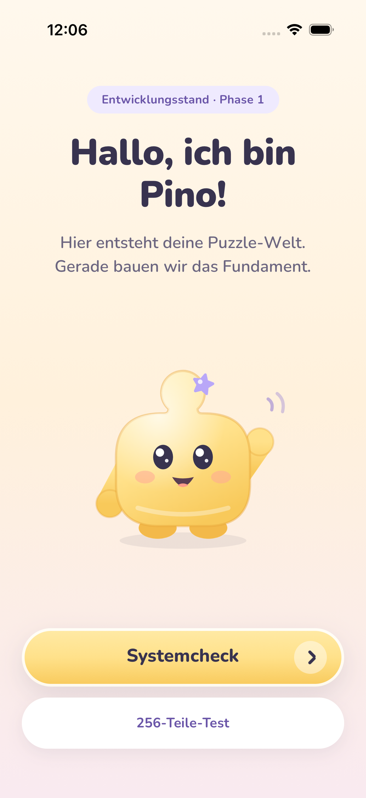 | 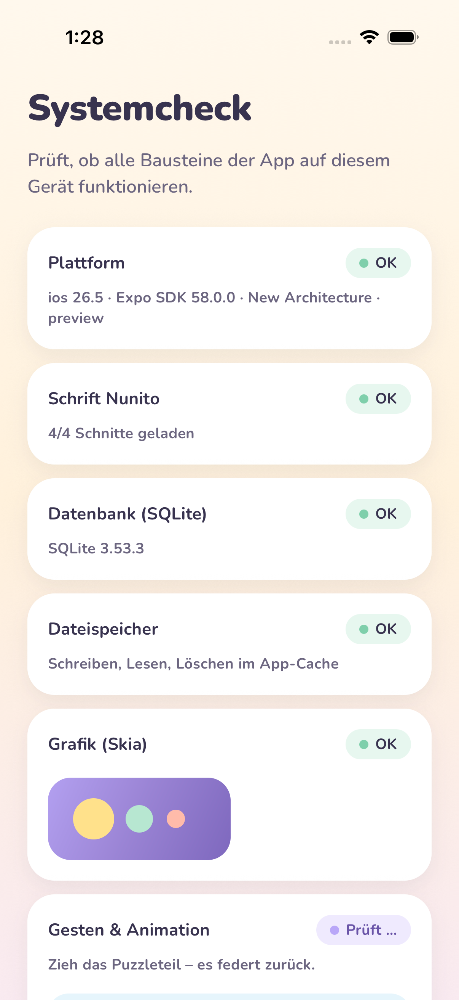 | 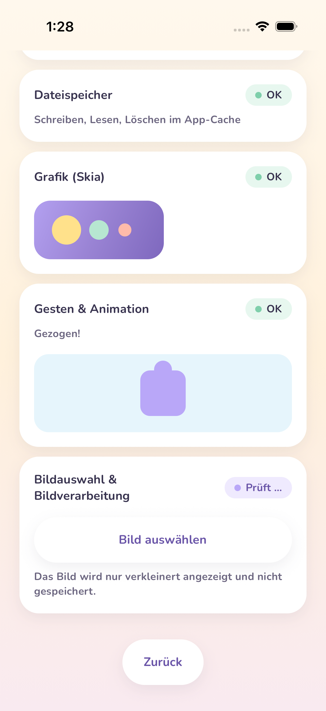 | 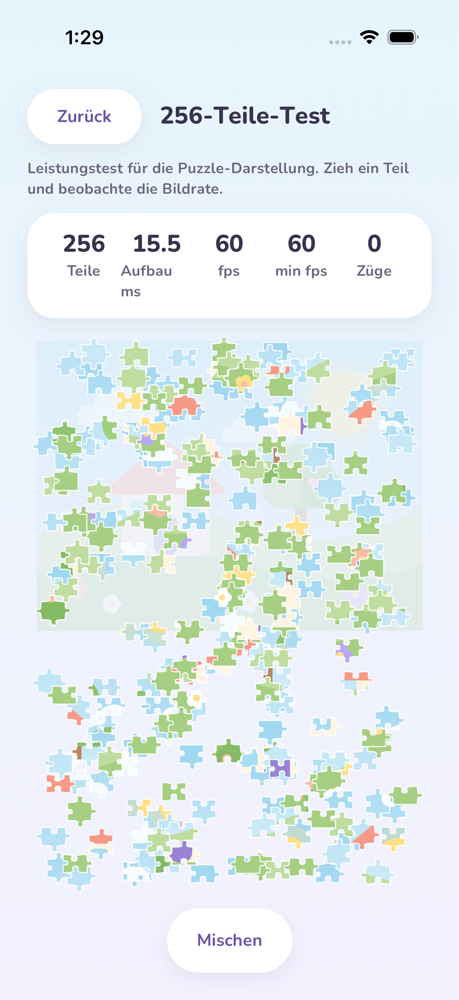 | 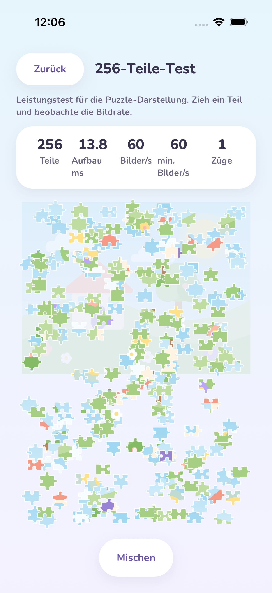 |

### Android-Emulator (Pixel 6, API 34) – Maestro in GitHub Actions

| Start                                                            | Systemcheck                                                             | Systemcheck nach Drag                                                                | 256-Teile-Test                                                           | nach Drag                                                                       |
| ---------------------------------------------------------------- | ----------------------------------------------------------------------- | ------------------------------------------------------------------------------------ | ------------------------------------------------------------------------ | ------------------------------------------------------------------------------- |
| 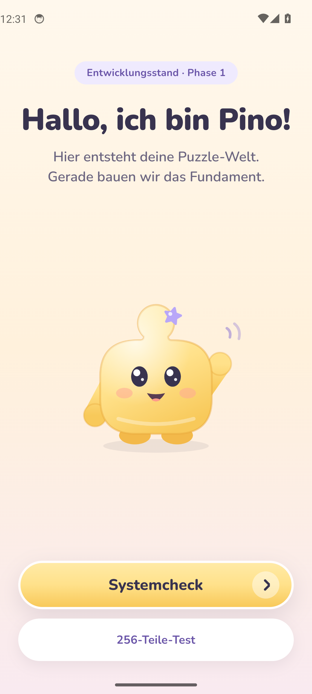 | 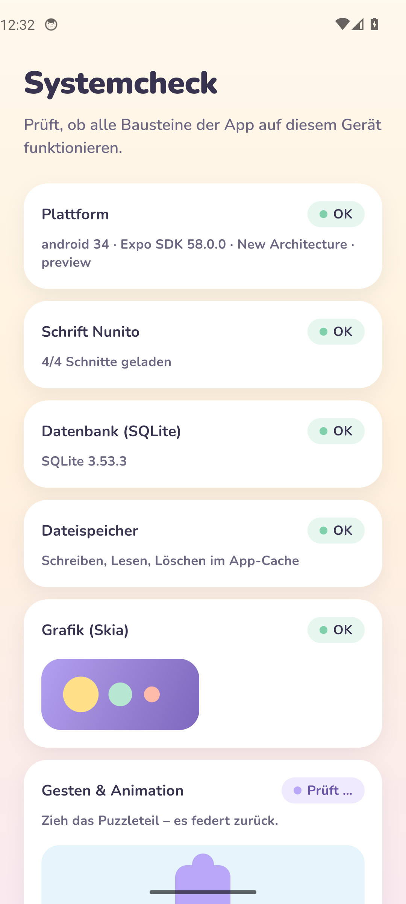 | 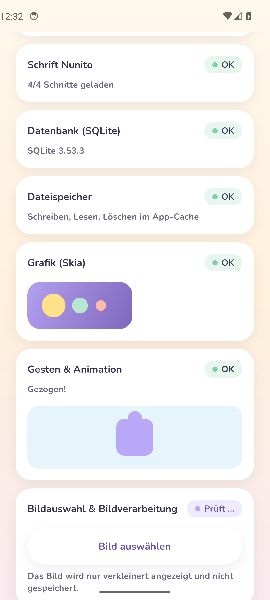 | 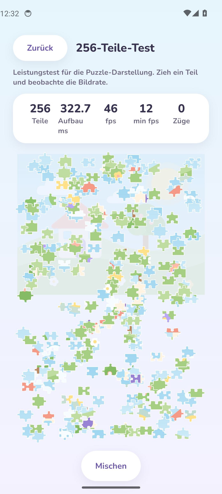 | 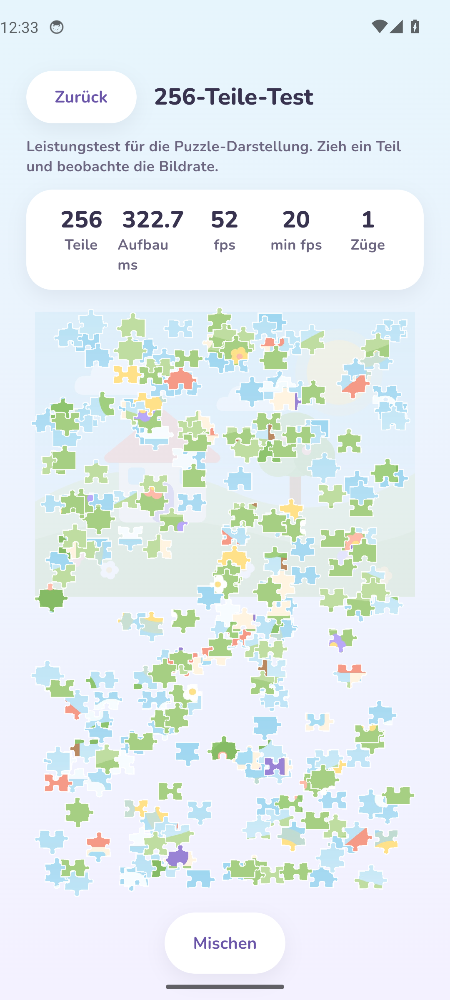 |

### Web (Chromium, 390 × 844) – Playwright

| Start                                                        | Systemcheck                                                         | Drag läuft                                                                   | 256-Teile-Test                                                       | nach 3 Zügen                                                                 |
| ------------------------------------------------------------ | ------------------------------------------------------------------- | ---------------------------------------------------------------------------- | -------------------------------------------------------------------- | ---------------------------------------------------------------------------- |
| 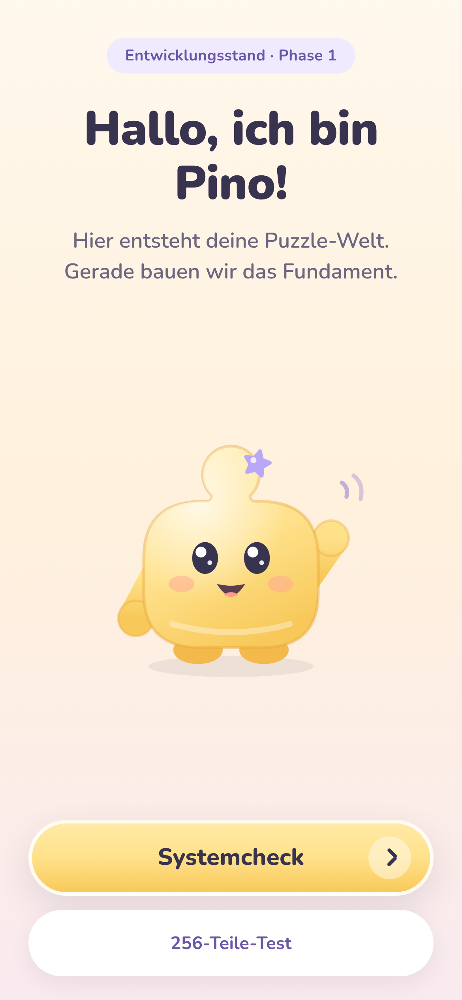 | 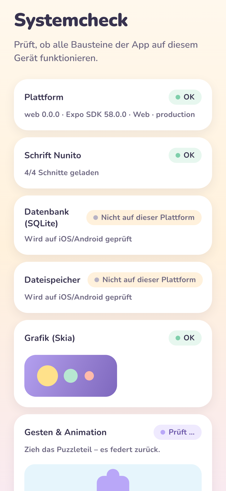 | 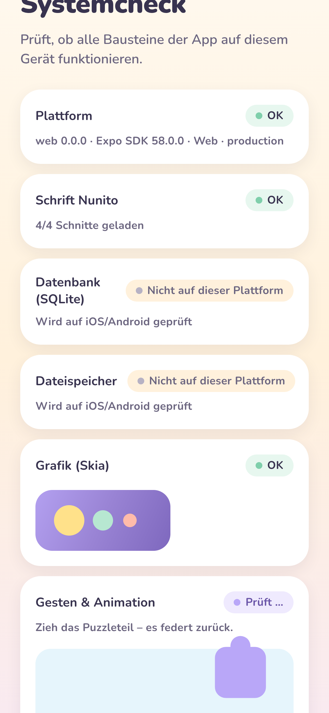 | 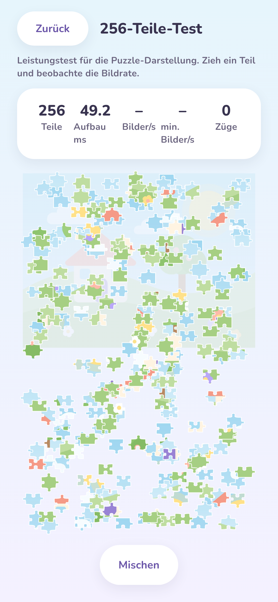 | 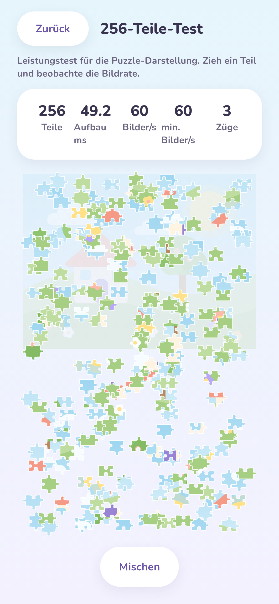 |

## 5. Design-QA dieses Meilensteins

- ✅ Farben, Schrift, Radien, Schatten kommen ausschließlich aus Tokens; Start-Screen entspricht der Referenzstimmung (Creme-Verlauf, gelber CTA, Pino zentral).
- ✅ **Gefunden und behoben** (aus den iOS-Screenshots): Scrollende Inhalte liefen unter die Statusleiste; Kennzahl-Labels im Benchmark brachen um. Fix in `Screen` (Safe-Area außerhalb der ScrollView) und kürzere Labels; Screenshots danach neu erzeugt.
- ⚠️ Systemcheck und Benchmark sind **Entwicklerwerkzeuge**, keine Kinder-Screens – sie bekommen keine Dekoration und werden vor Release hinter den Elternbereich/Dev-Build verschoben.
- ⚠️ Pino ist auf dem Start-Screen noch eine statische PNG-Grafik (Splash-Asset). Die `Mascot`-Komponente mit allen 8 Emotionen folgt in Phase 2.

## 6. Bekannte Punkte & Risiken

| Punkt                                                | Bewertung / nächster Schritt                                                                                                                                         |
| ---------------------------------------------------- | -------------------------------------------------------------------------------------------------------------------------------------------------------------------- |
| 256-Teile-Leistung auf **echten Geräten** ungemessen | Simulator/Emulator nutzen kein echtes GPU-Profil. Bitte Preview-APK bzw. EAS-Build auf 1 Mittelklasse-Android + 1 iPhone messen (5-Minuten-Protokoll in testing.md). |
| Picture-Neuaufzeichnung bei Drag-Start/Drop          | Im Web (Software-Rendering) sichtbare Ruckler beim Aufnehmen. Auf Geräten messen; Ausweichstrategie (Kachel-Pictures) ist dokumentiert.                              |
| Erster App-Start auf dem CI-Emulator teils > 30 s    | Einmal aufgetreten (Software-Emulator). Timeout auf 90 s erhöht; kein App-Fehler (JS lief, keine Exceptions).                                                        |
| EAS-Projekt nicht verknüpft                          | Benötigt Ihr Expo-Konto: `eas init` → `projectId`; danach `eas build --profile development`.                                                                         |
| Bundle-ID `com.puzzlestudio.app`                     | Vor dem ersten Production-Build bestätigen (nicht mehr änderbar).                                                                                                    |
| Repository ist **öffentlich**                        | Aktuell unkritisch (keine Secrets, keine Nutzerdaten). Vor Store-Release über Sichtbarkeit entscheiden; macOS-CI-Minuten sind nur bei öffentlichen Repos kostenlos.  |
| Artefakt-Download in meiner Umgebung gesperrt        | Deshalb committen manuelle CI-Läufe Screenshots selbst (`commit_screenshots`). APKs laden Sie direkt in GitHub Actions herunter.                                     |
| GitHub-Actions-Warnung „Node 20 deprecated“          | Nur Warnung; Actions-Versionen bei Gelegenheit anheben.                                                                                                              |

## 7. Was Sie jetzt tun können

1. **Android-App testen:** GitHub → Actions → „Android build & emulator screenshots“ → letzter Lauf → Artefakt `puzzle-studio-preview-apk` laden und auf dem Gerät installieren (Systemcheck + 256-Teile-Test).
2. **EAS einrichten** (für iOS-Gerät/TestFlight): `cd apps/mobile && eas init`, dann `eas build --profile development --platform ios`.
3. **Freigabe Phase 2** (Designsystem-Komponenten, Mascot-Komponente, Hintergrund-Presets, Onboarding, Home, Navigation).

## 8. Vorschlag nächster Schritt – Phase 2

`Mascot`-Komponente (8 Emotionen aus der freigegebenen Geometrie) · `DecorativeBackground`-Presets · restliche Basiskomponenten · Onboarding (3 Screens) · Home · Tab-Navigation · erste echte Screenshots der designten Screens auf beiden Plattformen.
