# Milestone 03 – Image Workflow (Phase 3)

**Datum:** 2026-11-02 · **Phase:** 3 · **Status:** umgesetzt, **wartet auf Review durch den PO**

> Alle Screenshots stammen aus der **laufenden App** (iOS-Simulator und Android-Emulator via GitHub Actions/Maestro, Web via Chromium). Konzept-Mockups liegen getrennt unter `docs/design/concept/`.

## 1. Umgesetzt

| Bereich                     | Ergebnis                                                                                                                                                                                                                                     |
| --------------------------- | -------------------------------------------------------------------------------------------------------------------------------------------------------------------------------------------------------------------------------------------- |
| **Puzzle-Atelier** (Tab)    | Drei Quellen: **Foto aufnehmen**, **Aus der Galerie**, **Beispielbilder**. Darunter „Meine Bilder · N“ mit Vorschaubildern; Löschen nur nach Rückfrage (Pino-Dialog).                                                                        |
| **Bildquellen**             | System-Photo-Picker (keine Medien-Berechtigung nötig). Kamera-Berechtigung wird **erst beim Tippen** angefragt; Ablehnung wird freundlich erklärt. Vier eigene, offline mitgelieferte Beispielbilder.                                        |
| **Zuschnitt & Drehen**      | Formate Quer 4:3 · Quadrat · Hoch 3:4, Verschieben mit einem Finger, Zoomen mit zwei Fingern **und** über große ± Tasten (bis 4×), Drehen in 90°-Schritten. Das Bild deckt den Rahmen immer ganz ab (keine leeren Ränder).                   |
| **Nicht-destruktiv** (PO 1) | Das **Original wird byte-genau kopiert und nie verändert**. Daraus wird eine Arbeitsversion (max. 1536 px, JPEG) und ein Vorschaubild (512 px) **abgeleitet**. Zuschnitt/Drehung werden als Parameter gespeichert → jederzeit neu ableitbar. |
| **Speicherung**             | Dateien unter `documents/images/<id>/`, Metadaten in **SQLite** (Migration v2). In der DB stehen nur Dateinamen, keine Pfade. Halb geschriebene Bilder werden bei Fehlern wieder entfernt.                                                   |
| **Datenschutz**             | Neu-Kodierung entfernt EXIF/GPS aus der Arbeitsversion; Dateiendung nur aus dem MIME-Typ, Nutzer-Dateinamen werden nie gelesen. Fehlerprotokolle enthalten keine Pfade (Pfade werden durch `<path>` ersetzt).                                |
| **Farbgruppen** (Schalen)   | Paket `@puzzle-studio/image-processing`: deterministische Farbgruppierung mit kindgerechten Namen („Blau“, „Grün“ …) und sprechenden Namen nur wenn eindeutig („Himmel“ oben, „Wiese“ unten).                                                |

**Hinweis Farbgruppen:** Der Algorithmus ist fertig und getestet. Die Farbwerte **pro Teil** entstehen erst mit den Puzzleteilen (Phase 4/5); dann werden sie aus der Arbeitsversion abgetastet. In der App ist deshalb noch keine Schale sichtbar – bewusst keine Attrappe.

## 2. Qualität

| Prüfung                               | Ergebnis                                                                                                           |
| ------------------------------------- | ------------------------------------------------------------------------------------------------------------------ |
| TypeScript strict / ESLint / Prettier | ✅                                                                                                                 |
| Vitest `packages/image-processing`    | ✅ 21 Tests (Zuschnitt-Mathematik, Drehung, Pixel-Rundung, Hash, Farbgruppen & Namen, Determinismus)               |
| Vitest `packages/ui`                  | ✅ 48 Tests                                                                                                        |
| Jest `apps/mobile`                    | ✅ 25 Tests (u. a. leeres Atelier, Kamera-Ablehnung erklärt, Löschen erst nach Bestätigung, Fehlertext ohne Pfade) |
| Metro-Bundle Android + iOS            | ✅                                                                                                                 |
| Native Builds + Maestro               | siehe Abschnitt 4                                                                                                  |

## 3. Design-QA

- ✅ Große, illustrierte Kacheln (≥ 128 dp), alle Bedienelemente ≥ 56 dp, Hauptaktion „Bild übernehmen“ 64 dp.
- ✅ Zoom auch ohne Zwei-Finger-Geste (± Tasten) – wichtig für kleine Kinder.
- ✅ Nur Tokens/Komponenten aus `packages/ui` (neu: `Chip`, `ActionTile`, `ConfirmDialog`, `LoadingState`, Icons Mülleimer/Plus/Minus).
- ✅ Freundliche Fehler- und Wartezustände („Pino legt das Bild bereit …“).
- ⚠️ EXIF-Ausrichtung von Kamerafotos muss noch auf einem **echten Gerät** geprüft werden (Simulator/Emulator liefern keine gedrehten Kamerafotos).

## 4. Screenshots (echt)

### Web (Chromium, 390 × 844)

| Atelier (leer)                                                       | Beispielbilder                                                 | Zuschnitt                                                   | Gedreht                                                             | Ein Bild gespeichert                                               | Löschen?                                                              |
| -------------------------------------------------------------------- | -------------------------------------------------------------- | ----------------------------------------------------------- | ------------------------------------------------------------------- | ------------------------------------------------------------------ | --------------------------------------------------------------------- |
| 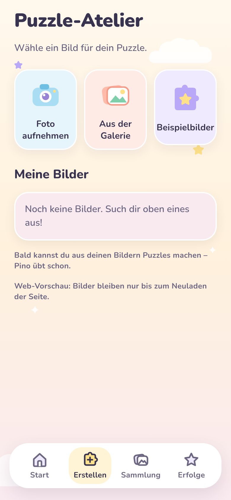 | 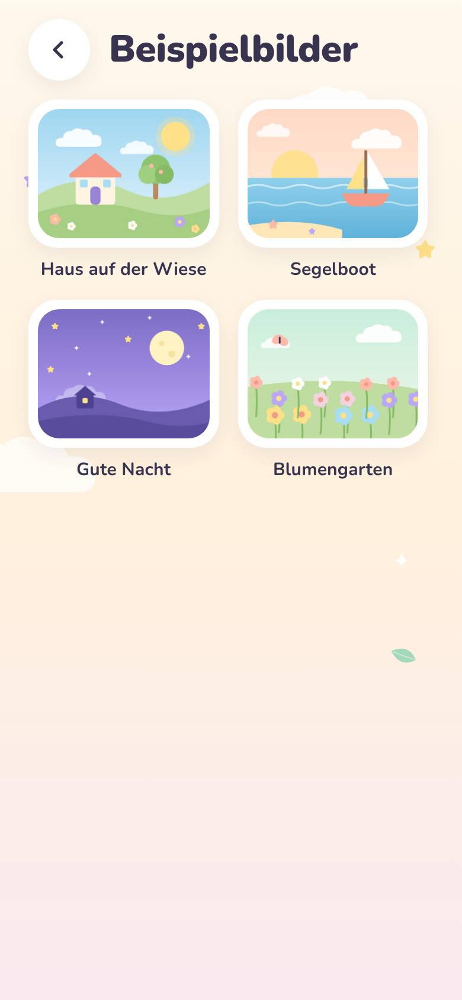 | 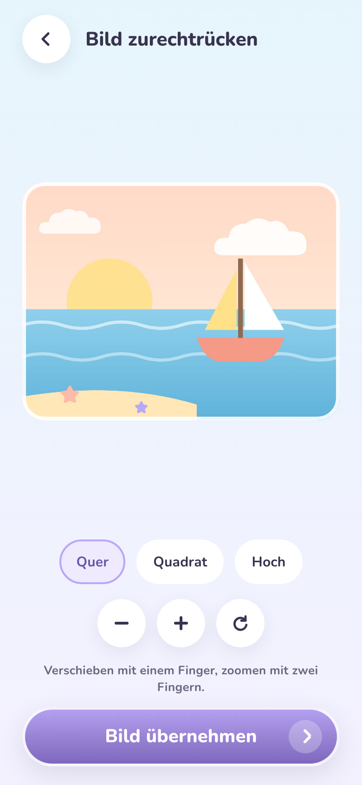 | 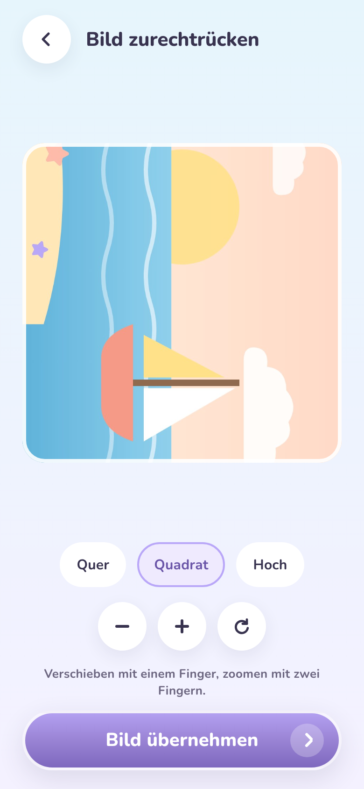 | 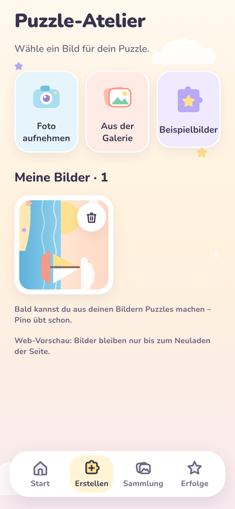 | 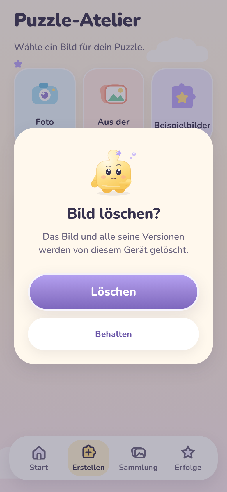 |

Web-Screenshots entstanden vor der Silbentrennungs-Korrektur (Abschnitt 5).

### iOS-Simulator – Maestro in GitHub Actions

| Atelier                                                        | Beispielbilder                                                 | Zuschnitt                                                   | Quadrat, gezoomt, gedreht                                                  | Gespeichert                                                                |
| -------------------------------------------------------------- | -------------------------------------------------------------- | ----------------------------------------------------------- | -------------------------------------------------------------------------- | -------------------------------------------------------------------------- |
| 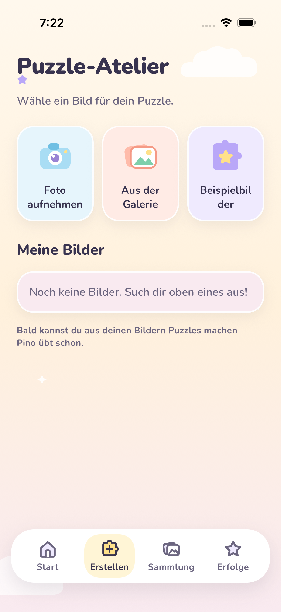 | 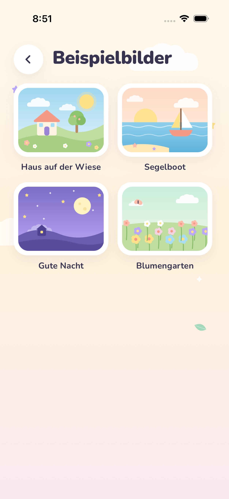 | 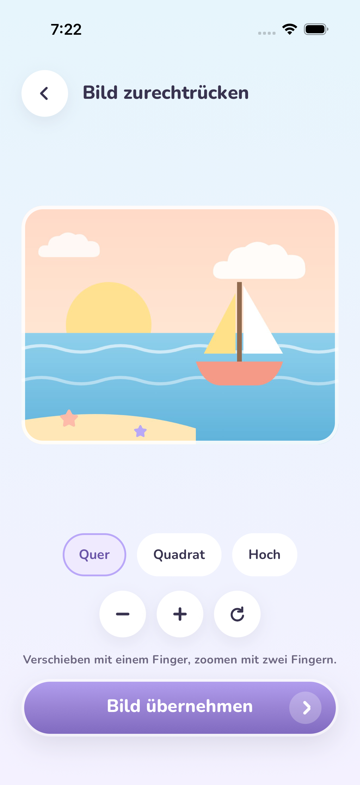 | 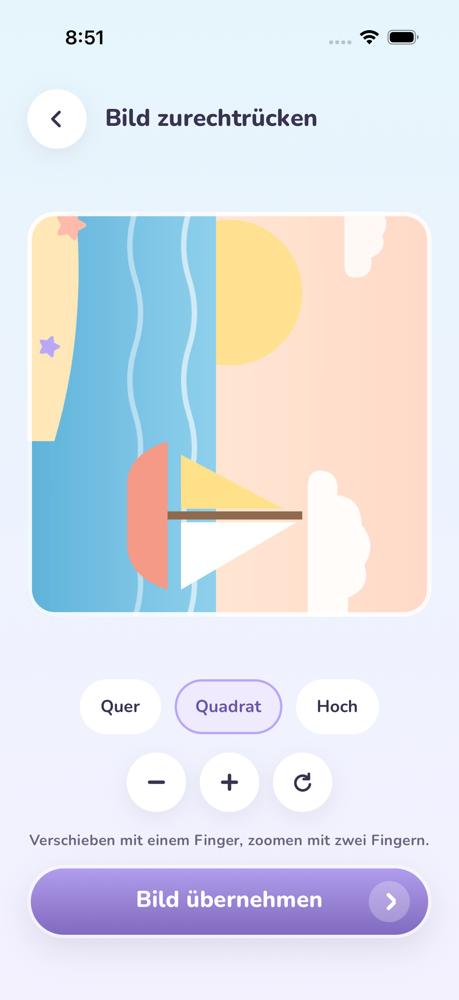 | 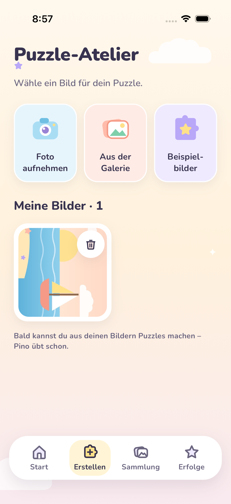 |

| Nach Neustart: Profil                                                              | Nach Neustart: Bild noch da                                                      |
| ---------------------------------------------------------------------------------- | -------------------------------------------------------------------------------- |
| 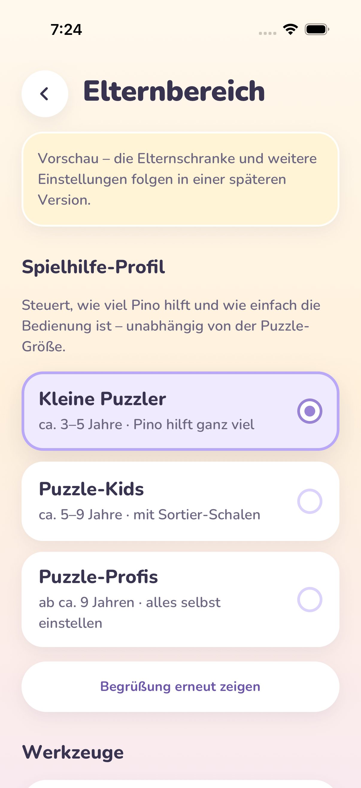 |  |

### Android-Emulator (Pixel 6, API 34) – Maestro in GitHub Actions

> Stand beim Schreiben: Android-Lauf mit der Korrektur aus Abschnitt 5 läuft noch; die Bilder werden vom CI-Lauf ergänzt und dieser Hinweis danach entfernt.

| Atelier                                                            | Beispielbilder                                                     | Zuschnitt                                                       | Quadrat, gezoomt, gedreht                                                      | Gespeichert                                                                    |
| ------------------------------------------------------------------ | ------------------------------------------------------------------ | --------------------------------------------------------------- | ------------------------------------------------------------------------------ | ------------------------------------------------------------------------------ |
| 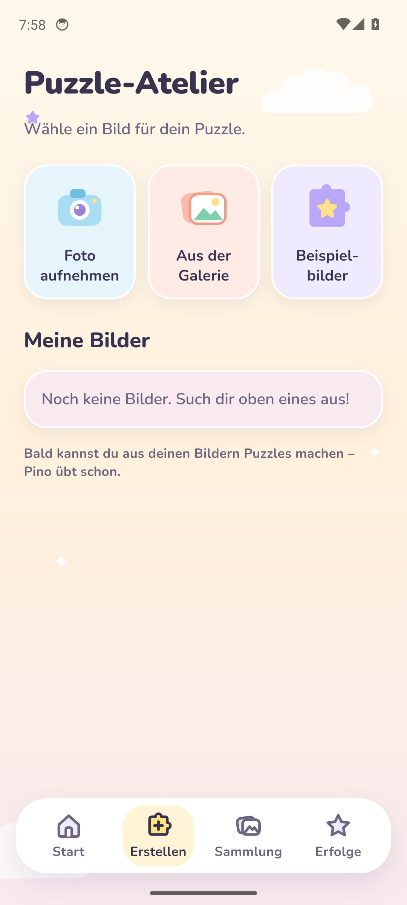 | 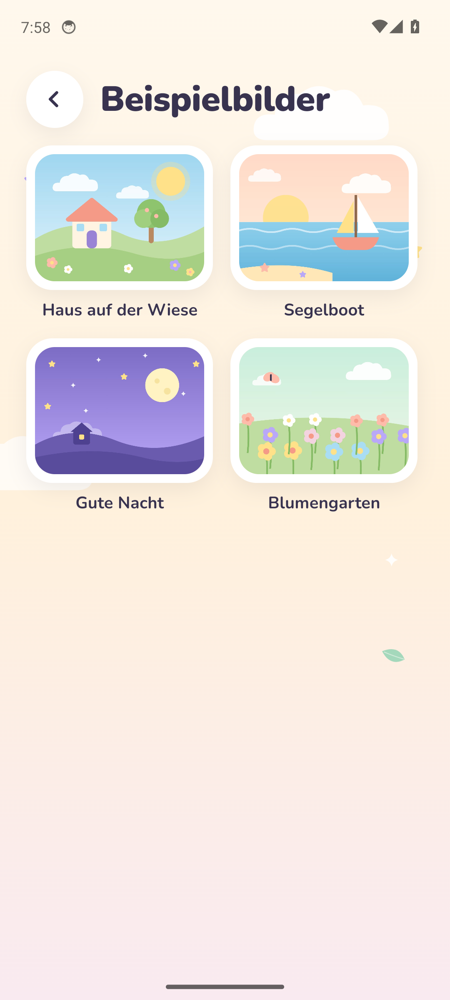 | 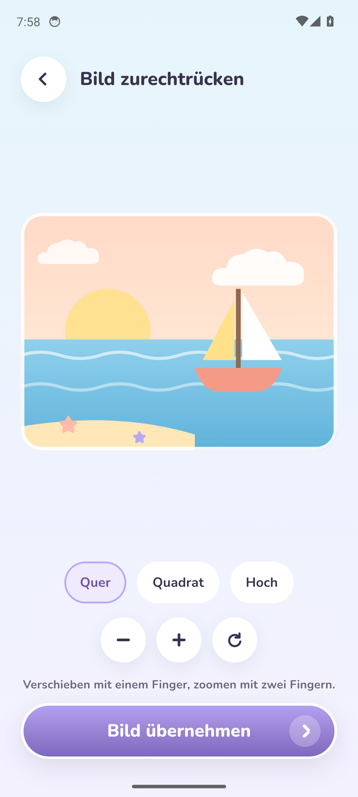 | 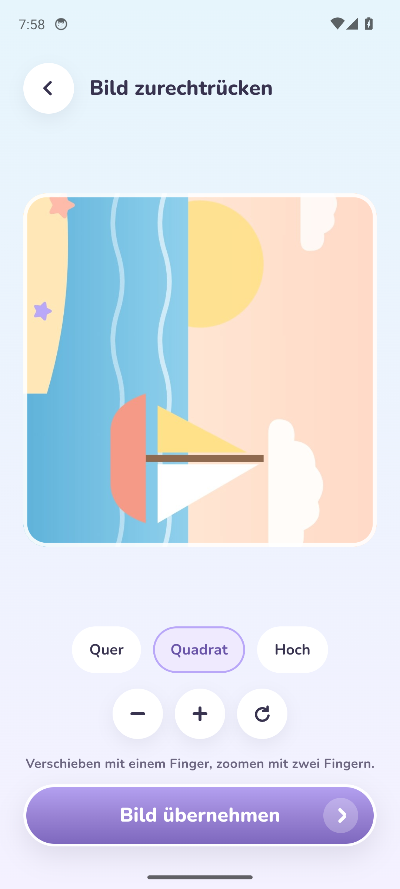 |  |

| Nach Neustart: Profil                                                                  | Nach Neustart: Bild noch da                                                          |
| -------------------------------------------------------------------------------------- | ------------------------------------------------------------------------------------ |
| 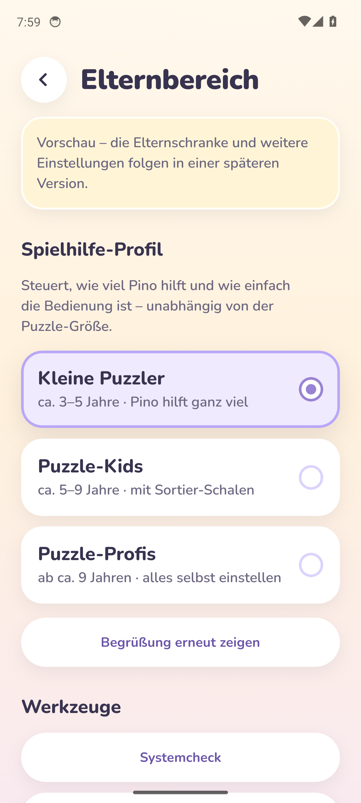 | 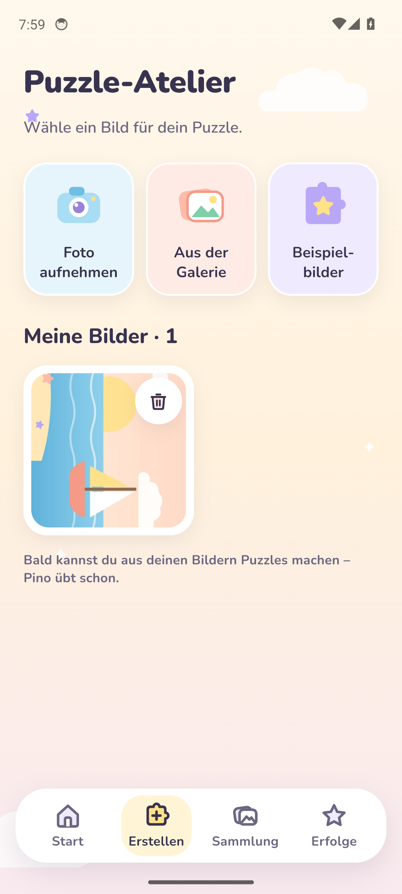 |

Beide Plattformen durchlaufen denselben Flow: Beispielbild wählen → Quadrat → zoomen → verschieben → drehen → speichern → App-Neustart → Bild ist weiterhin in „Meine Bilder“ (Dateien + SQLite). Onboarding, Elternbereich und Systemcheck (01–04, 10–11) wurden mitgeprüft und liegen im selben Ordner.

## 5. In diesem Meilenstein gefundene und behobene Fehler

| Fehler                                                                                                                                                                                                                    | Gefunden durch            | Behebung                                                                                                                                                                  |
| ------------------------------------------------------------------------------------------------------------------------------------------------------------------------------------------------------------------------- | ------------------------- | ------------------------------------------------------------------------------------------------------------------------------------------------------------------------- |
| **Android:** Speichern eines Beispielbilds schlug fehl („Das hat nicht geklappt“). Android-Release-Builds liefern mitgelieferte Bilder als Ressourcennamen statt als Datei – Anzeige klappt, Bildbearbeitung/Kopie nicht. | Android-Emulator in CI    | Beispielbild wird vorher in den Cache kopiert. Zusätzlich: Zuschnitt rechnet mit der tatsächlich dekodierten Bildgröße; Speicherfehler werden (ohne Pfade) protokolliert. |
| Kachel-Beschriftung brach als „Beispielbil-der“ um                                                                                                                                                                        | iOS-Screenshot            | Weiches Trennzeichen im Text („Beispiel-bilder“), zentral in `ActionTile` unterstützt; Screenreader liest das Wort ungetrennt.                                            |
| Vorschaubilder im Web zu hoch bzw. zu niedrig                                                                                                                                                                             | Web-Vorschau (Playwright) | `ImageTile` misst seine Breite und setzt die Höhe selbst.                                                                                                                 |
| `StyleSheet.absoluteFillObject` existiert in RN 0.88 nicht mehr                                                                                                                                                           | Typecheck                 | Explizite Positionierung.                                                                                                                                                 |

## 6. Offen / Hinweise für den PO

- EXIF-Ausrichtung von Kamerafotos auf echtem iPhone/Android-Gerät prüfen (gehört zum Gerätetest, zusammen mit der 256-Teile-Messung).
- Web-Vorschau speichert Bilder nur bis zum Neuladen (wird im Atelier angezeigt) – die echte Speicherung gibt es auf iOS/Android.
- Weiter offen von früher: 256-Teile-Messung auf echten Geräten, EAS-Projekt/Bundle-ID bestätigen.

## 7. Nächster Schritt – Phase 4 (Puzzle Engine)

Reines TypeScript, seed-basiert und vollständig getestet: Raster für 12–256 Teile passend zum gewählten Format, Teilekanten (Nasen/Buchten), Hit-Test, Einrasten (Teile bleiben danach fest), Spielstand-Serialisierung – Grundlage für das Spielbrett in Phase 5.
