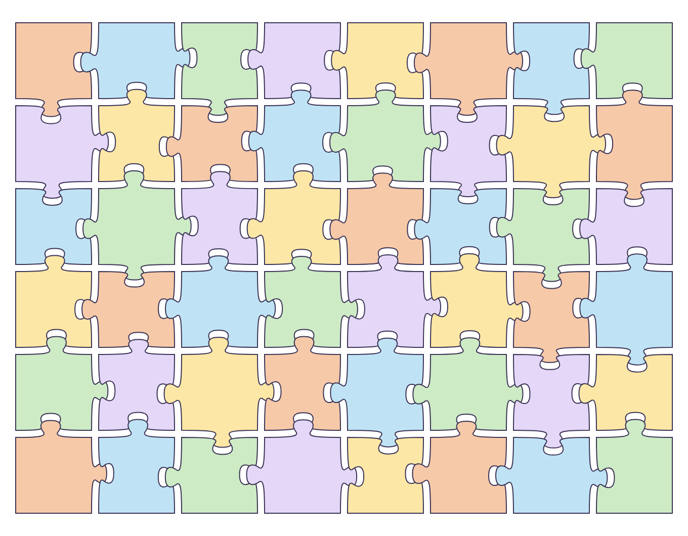
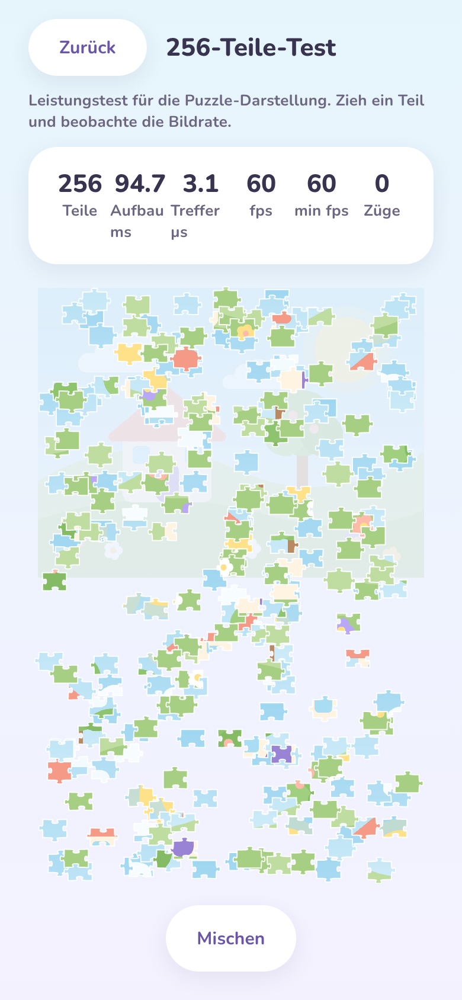
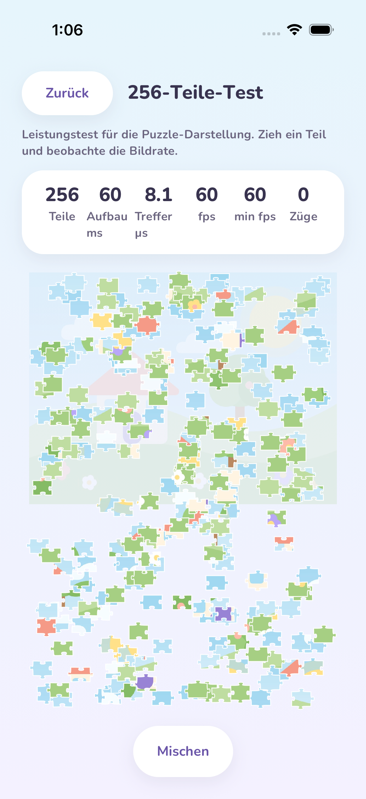
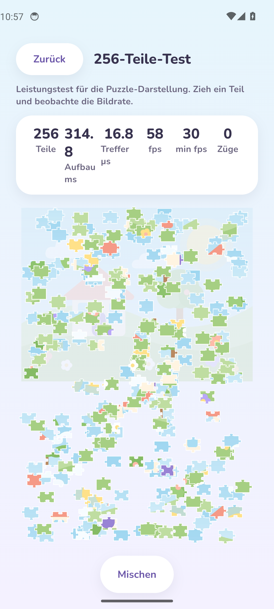

# Milestone 04 – Puzzle Engine (Phase 4)

**Datum:** 2026-11-02 · **Phase:** 4 · **Status:** umgesetzt, **wartet auf Review durch den PO**

> Phase 4 ist das „Gehirn“ des Spiels: reines TypeScript ohne Bildschirm. Sichtbar wird es in dieser Phase nur im **256-Teile-Test**, der jetzt aus der echten Engine gebaut wird. Das eigentliche Spielbrett mit Ablage, Schalen und Pino-Tipps entsteht in Phase 5.
> App-Screenshots stammen aus der laufenden App (iOS-Simulator/Android-Emulator via GitHub Actions, Web via Chromium). Das Engine-Bild in Abschnitt 2 ist eine **Testausgabe der Engine-Geometrie** (eingefärbt, auseinandergezogen) – kein App-Screenshot.

## 1. Umgesetzt (`packages/puzzle-engine`)

| Baustein                              | Ergebnis                                                                                                                                                                                                                                       |
| ------------------------------------- | ---------------------------------------------------------------------------------------------------------------------------------------------------------------------------------------------------------------------------------------------- |
| **Raster**                            | Passend zum Bildformat für 4–256 Teile (z. B. 16 Teile bei 4:3 → 4 × 4, bei 16:9 → 3 × 5). Teile werden nie extrem schmal.                                                                                                                     |
| **Puzzle-Kanten**                     | Runde Nasen und Buchten, per Zufallszahl (Seed) erzeugt. Gleicher Seed → exakt gleiches Puzzle. Nachbarn teilen **dieselbe** Kante → keine Lücken, keine Überlappung (per Flächen-Test bewiesen). Rand gerade. Form „eckig“ für die Kleinsten. |
| **Bildzuordnung**                     | Jedes Teil zeigt genau seinen Ausschnitt der Arbeitsversion (das Original bleibt unberührt, PO-Vorgabe 1).                                                                                                                                     |
| **Antippen (Hit-Test)**               | Erkennt das oberste Teil unter dem Finger anhand des **echten Umrisses**: die Nase gehört zum Teil, die Lücke daneben nicht. Läuft direkt im Bildschirm-Thread.                                                                                |
| **Einrasten (PO-Vorgabe)**            | Nahe am Zielplatz losgelassen → gleitet exakt hinein und ist danach **fest**: nicht mehr greifbar, nicht verschiebbar, nicht in Schalen. Nur „Puzzle neu starten“ (Phase 5) löst es.                                                           |
| **Falsch gelegt (PO-Entscheidung)**   | „Liegen lassen + ausweichen“: Das Teil gleitet zum nächsten freien Platz in der Nähe – überlappt weder eingerastete noch lose Teile und landet nie auf seinem eigenen Zielplatz. Alternative „zurück in die Ablage“.                           |
| **Spielhilfe-Profile (PO-Vorgabe 6)** | Eine zentrale Regel-Tabelle `assistFor(Profil, Teilezahl)`: Einrast-Toleranz, Verhalten bei falsch gelegten Teilen, Häppchen, Schalen, Ablage-Reihen, Tipp-Angebot. Das Profil bestimmt die Bedienung, die Teilezahl nur die Menge.            |
| **Pino-Tipp**                         | Schlägt ein Teil vor: zuerst eines, das an schon gelegte Teile passt; sonst Rahmen zuerst (Ecken, dann Ränder); bei Gleichstand das Teil, das das Kind zuerst sieht.                                                                           |
| **Häppchen-Modus (Kleinkind)**        | Ab 25 Teilen wird das Bild in kleine Bereiche mit 4–9 Teilen geteilt, Rahmen zuerst (im Uhrzeigersinn), dann nach innen. Die Ablage zeigt höchstens 4 Teile des aktiven Häppchens.                                                             |
| **Schalen**                           | Umbenennen, eigene Reihenfolge, bis zu 3 „Meine Schale“ (ab 144 Teilen, nicht im Kleinkind-Profil) – als Spielstand-Daten.                                                                                                                     |
| **Spielstand**                        | Speichern/Laden geräteunabhängig, mit Versionsnummer. Beschädigte Daten führen **nie** zu einem Absturz – das Puzzle startet dann frisch. Eingerastete Teile sitzen beim Laden immer exakt auf ihrem Platz.                                    |

## 2. Engine-Ausgabe (Testrender, kein App-Screenshot)

48 Teile (6 × 8), Seed 7, zur Sichtprüfung eingefärbt und leicht auseinandergezogen:

Nach der ersten Sichtprüfung habe ich die Nasen runder und den Hals schmaler gemacht, damit Kinder die Form besser erkennen.

## 3. Qualität & Messwerte

| Prüfung                               | Ergebnis                                                                                                                                                                                                                                          |
| ------------------------------------- | ------------------------------------------------------------------------------------------------------------------------------------------------------------------------------------------------------------------------------------------------- |
| TypeScript strict / ESLint / Prettier | ✅ (Engine ohne React/React-Native/Expo-Importe – per ESLint erzwungen)                                                                                                                                                                           |
| Vitest `packages/puzzle-engine`       | ✅ **87 Tests** – Determinismus, gemeinsame Kanten, Flächensumme = Bildfläche, Raster für alle Presets × 5 Formate, Hit-Test an Nase/Bucht, Einrasten/Sperre, Ausweichen, Profile, Tipps, Häppchen, Speichern/Laden inkl. 16 Arten kaputter Daten |
| Abdeckung Engine (Ziel ≥ 95 %)        | ✅ **100 % Zeilen**, 99,5 % Anweisungen, 100 % Funktionen, 94,6 % Zweige – wird bei jedem `pnpm test` erzwungen                                                                                                                                   |
| Übrige Tests                          | ✅ 21 (image-processing) · 48 (ui) · 21 (App, Jest)                                                                                                                                                                                               |
| Metro-Bundle Android + iOS            | ✅                                                                                                                                                                                                                                                |
| Hit-Test-Tempo (Node)                 | deutlich unter 0,05 ms pro Berührung bei 256 Teilen (Test-Grenze; Ziel auf Mittelklasse-Android: < 0,5 ms)                                                                                                                                        |
| Hit-Test-Tempo Web-Vorschau           | **3,1 µs** pro Berührung bei 256 Teilen (Chromium)                                                                                                                                                                                                |
| Aufbau 256 Teile Web-Vorschau         | 95 ms (Geometrie + Skia-Pfade), 60 fps beim Ziehen                                                                                                                                                                                                |

### 256-Teile-Test in CI (Simulator/Emulator, ohne Grafikkarte – echte Geräte sind schneller)

| Plattform                     | Aufbau 256 Teile | Treffer (Hit-Test) | fps | min fps |
| ----------------------------- | ---------------- | ------------------ | --- | ------- |
| iOS-Simulator (iPhone 17 Pro) | 60 ms            | **8,1 µs**         | 60  | 60      |
| Android-Emulator (Pixel 6)    | 53 ms            | **14,2 µs**        | 60  | 60      |
| Web-Vorschau (Chromium)       | 95 ms            | 3,1 µs             | 60  | 60      |

Ziel für den Hit-Test auf Mittelklasse-Android: < 500 µs – in CI liegt er 35- bis 60-mal darunter. Der Test zeigt die Werte direkt an („Treffer µs“); damit lässt sich PO-Vorgabe 2 auf **echten Geräten** ablesen.

## 4. Screenshots (echt)

### Web (Chromium, 390 × 844) – 256-Teile-Test mit Engine-Teilen

### iOS-Simulator und Android-Emulator – Maestro in GitHub Actions

| iOS                                                                  | Android                                                                  |
| -------------------------------------------------------------------- | ------------------------------------------------------------------------ |
|  |  |

Der komplette Ablauf (Onboarding, Atelier, Zuschnitt, Speichern, Elternbereich, Systemcheck, 256-Teile-Test, Neustart mit erhaltenem Profil und Bild) lief auf beiden Plattformen erneut durch; alle Bilder `2026-11-02-milestone-04-*` liegen in `docs/previews/screenshots/`.

## 5. In diesem Meilenstein gefundene und behobene Fehler

| Fehler                                                                                                             | Gefunden durch              | Behebung                                                                                                                                                               |
| ------------------------------------------------------------------------------------------------------------------ | --------------------------- | ---------------------------------------------------------------------------------------------------------------------------------------------------------------------- |
| Testablauf fand den „Zurück“-Knopf im Systemcheck nicht (liegt unterhalb des sichtbaren Bereichs)                  | iOS + Android in CI         | Knopf hat eine feste Kennung, der Test scrollt vorher dorthin. Kein App-Fehler.                                                                                        |
| Speichern des Bildes dauerte im iOS-Simulator teils > 30 s (CI ohne Grafikkarte, stark schwankend: 6 s bis > 30 s) | iOS in CI                   | Bild wurde korrekt gespeichert; der Test wartet jetzt bis 120 s. Die App protokolliert die Dauer der Speicher-Schritte (nur Millisekunden). Auf echten Geräten prüfen. |
| Aufbauzeit „314.8“ brach in der schmalen Spalte um                                                                 | Android-Screenshot          | Anzeige ohne Nachkommastelle.                                                                                                                                          |
| Nasen der Teile wirkten schmal und flach                                                                           | Sichtprüfung Engine-Ausgabe | Rundere Nase, schmalerer Hals (weiterhin ≤ 25 % Teilhöhe).                                                                                                             |

## 6. Entscheidungen in dieser Phase (dokumentiert)

| Thema                          | Entscheidung                                                                                                                                                                                                          |
| ------------------------------ | --------------------------------------------------------------------------------------------------------------------------------------------------------------------------------------------------------------------- |
| Falsch gelegt je Profil        | Kind und Profi: dein Standard „liegen lassen + ausweichen“ (umschaltbar). Kleinkind: immer „zurück in die Ablage“ – die einfachste Logik. Eine ältere Tabellenzeile im Konzept („Kind: zurück“) habe ich angeglichen. |
| Einrast-Toleranz               | Kleinkind 35 %, Kind 26 %, Profi 18 % der kürzeren Teilseite.                                                                                                                                                         |
| Teilarten Ecke/Rand/Innen      | Aus der Position im Raster (stimmt auch bei der eckigen Form ohne Nasen).                                                                                                                                             |
| Häppchen                       | Zunächst nach Geometrie (Blöcke). Motiv-Häppchen („das Segelboot“) folgen, sobald in Phase 5 die Farbwerte pro Teil vorliegen.                                                                                        |
| Nachbar-Gruppen                | Post-MVP – deshalb bewusst nicht angelegt.                                                                                                                                                                            |
| Neue Entwicklungs-Abhängigkeit | `@vitest/coverage-v8` misst die Testabdeckung. Nur Entwicklung, nicht in der App.                                                                                                                                     |

## 7. Offen / Hinweise für den PO

- **Messung auf echten Geräten** (PO-Vorgabe 2): Elternbereich → „256-Teile-Test“, ein paar Teile ziehen, Werte „fps“, „min fps“ und „Treffer µs“ notieren.
- **Speichern eines Bildes auf einem echten iPhone** kurz beobachten: Es sollte etwa eine Sekunde dauern. Im CI-Simulator schwankt es stark.
- Der Test ist weiterhin der „Worst Case“ mit allen Teilen gleichzeitig lose. In Phase 5 kommt die echte Spielsituation dazu: Brett, Ablage und ein gezogenes Teil.

## 8. Nächster Schritt – Phase 5 (Gameplay)

Das Spielbrett: Puzzle aus einem gespeicherten Bild starten (Teilezahl wählen), Skia-Darstellung, Ablage, Sortier-Schalen mit Farbgruppen, Ziehen und Einrasten mit Feder-Animation, Pino-Tipps, Häppchen-Modus für Kleinkinder, Vorlage, Fortschritt, automatisches Speichern und eine kleine Feier am Ende.
