# Milestone 05 – Gameplay (Phase 5)

**Datum:** 2026-11-03 · **Phase:** 5 · **Status:** umgesetzt, **wartet auf Review durch den PO**

> Ab jetzt kann man **wirklich puzzeln**: Jedes gespeicherte Bild wird mit einem Tippen zum Puzzle.
> Alle Screenshots stammen aus der **laufenden App** (iOS-Simulator und Android-Emulator via GitHub Actions/Maestro, Web via Chromium).

## 1. So läuft ein Puzzle ab

1. **Atelier → Bild antippen → „Neues Puzzle“**: Teilezahl wählen (4, 9, 16, 25, 36, 49, 64, 100, 144, 196, 256 – man bekommt genau diese Zahl) und Form (Puzzleteile oder eckig). Angefangene Puzzles erscheinen dort als „Weiterpuzzeln · 12 von 36“.
2. **Spieltisch**: oben das Brett mit blasser Vorlage und feinen Zielumrissen, darunter die Ablage, darunter die Sortier-Schalen.
3. **Teil ziehen** und loslassen. Nahe am Zielplatz **rastet es ein** (kurze Gleit-Animation) und ist danach fest. Daneben gelegt: Es gleitet zum nächsten freien Platz (Kind/Profi) bzw. zurück in die Ablage (Kleinkind).
4. **Oder tippen statt ziehen**: Teil antippen, dann aufs Brett tippen – hilft kleinen Händen.
5. **Pino-Tipp** (Glühbirne): Pino wählt ein passendes Teil aus, hebt es in der Ablage hervor und lässt den Zielplatz gelb pulsieren.
6. **Fertig**: Pino feiert „Geschafft!“ – ohne Zeit, ohne Punkte. „Nochmal puzzeln“ oder „Zum Atelier“.

Der Spielstand wird **automatisch gespeichert** (kurz nach jedem Zug und beim Verlassen der App) und beim nächsten Öffnen wiederhergestellt.

## 2. Spielhilfe-Profile im Spiel (PO-Vorgabe 6)

|                  | Kleinkind                                                  | Kind                                | Profi                                                          |
| ---------------- | ---------------------------------------------------------- | ----------------------------------- | -------------------------------------------------------------- |
| Große Puzzles    | **Häppchen-Modus** ab 25 Teilen: Brett zoomt aufs Häppchen | Ablage + Schalen                    | Ablage + Schalen + Zoom                                        |
| Ablage           | 3–4 sehr große Teile, nie blättern                         | 1–2 Reihen, blätterbar              | 2 Reihen, blätterbar                                           |
| Schalen          | keine (die App sortiert unsichtbar nach Häppchen)          | Alle, Ränder, Ecken, Farben (ab 64) | dazu umbenennen, umsortieren, bis zu 3 „Meine Schale“ (ab 144) |
| Falsch gelegt    | zurück in die Ablage                                       | weicht zum freien Platz aus         | weicht zum freien Platz aus                                    |
| Einrast-Toleranz | sehr groß                                                  | groß                                | normal                                                         |
| Fortschritt      | Balken ohne Zahlen, Pino jubelt nach jedem Häppchen        | „12/36“                             | „12/36“                                                        |

## 3. Screenshots (echt)

### Web (Chromium, 390 × 844)

| Neues Puzzle                                                      | Kind, 36 Teile                                                      | Pino-Tipp                                                          | Schale „Ränder“                                                            |
| ----------------------------------------------------------------- | ------------------------------------------------------------------- | ------------------------------------------------------------------ | -------------------------------------------------------------------------- |
| 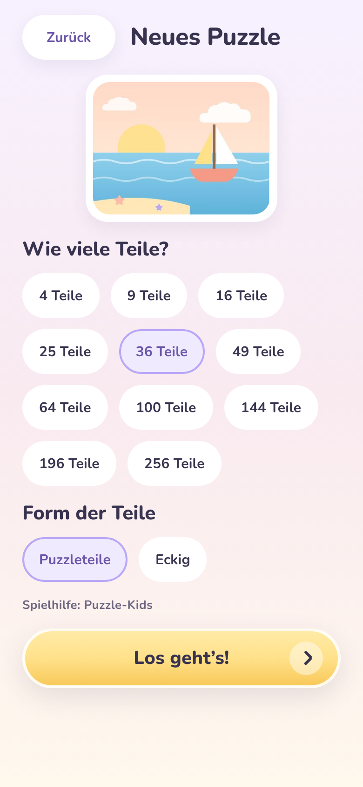 | 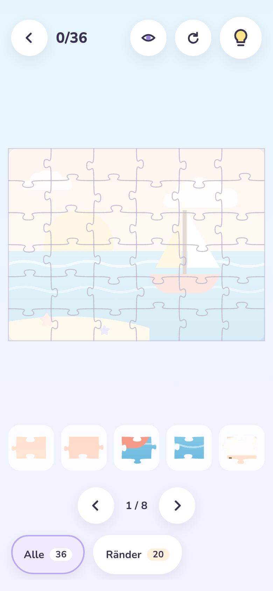 | 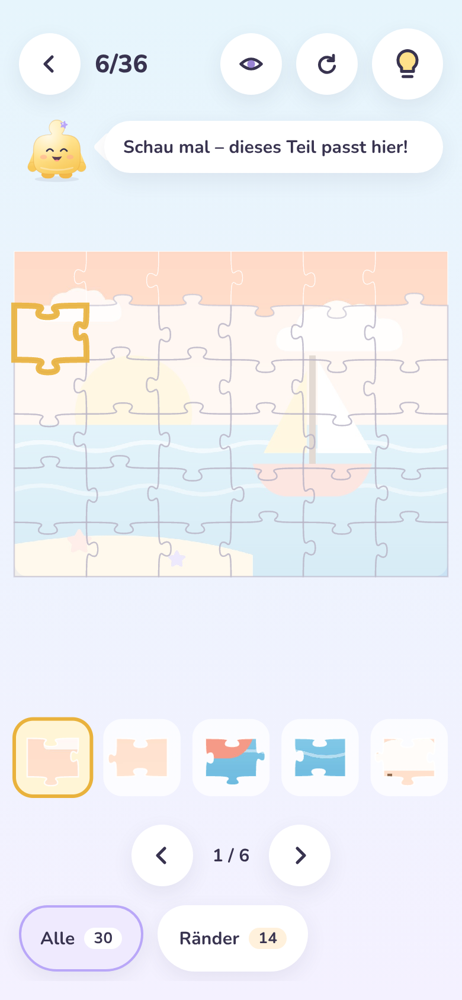 | 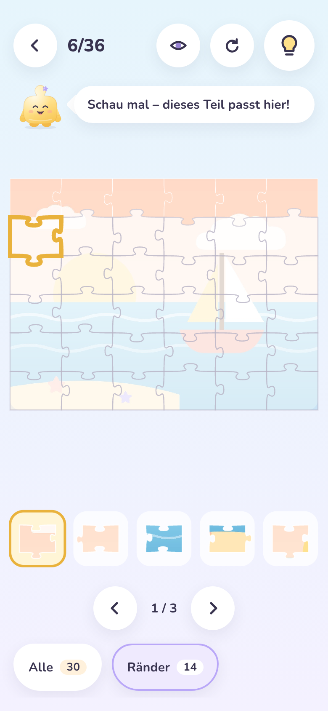 |

| Profi, 100 Teile                                               | Profi, gezoomt                                                      | Kleinkind: Häppchen 1                                                  | Kleinkind: nächstes Häppchen                                                | Geschafft!                                                  |
| -------------------------------------------------------------- | ------------------------------------------------------------------- | ---------------------------------------------------------------------- | --------------------------------------------------------------------------- | ----------------------------------------------------------- |
| 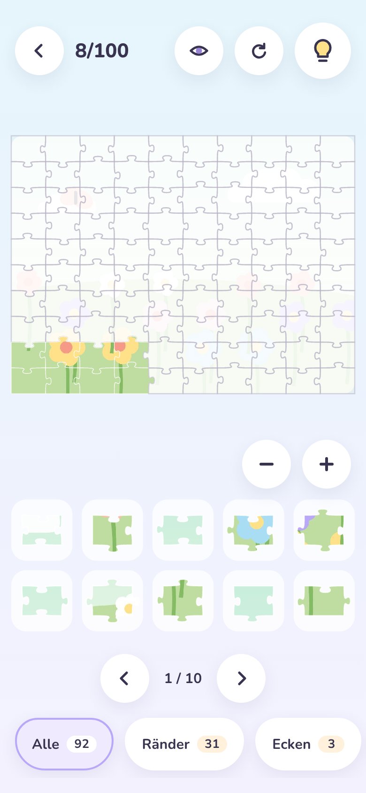 | 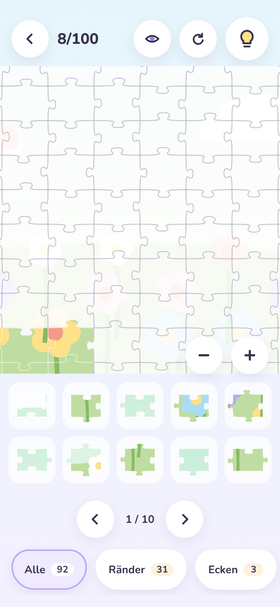 | 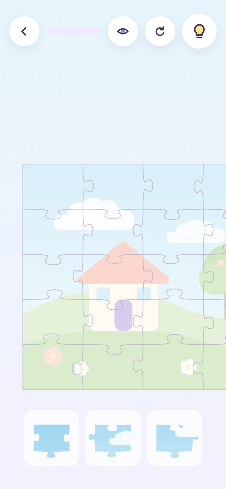 | 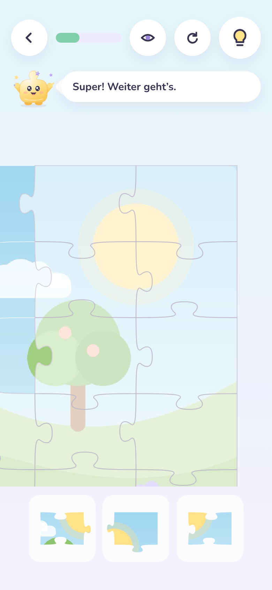 | 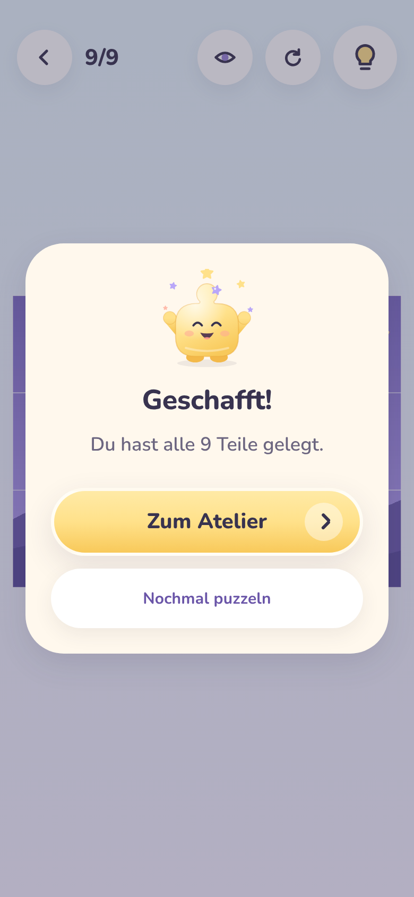 |

### iOS-Simulator und Android-Emulator – Maestro löst ein 4-Teile-Puzzle mit Pino-Tipps

> Stand beim Schreiben: Die Geräte-Läufe laufen noch; die Bilder werden vom CI-Lauf ergänzt und dieser Hinweis danach entfernt.

| Plattform | Neues Puzzle                                                          | Spieltisch                                                      | Pino-Tipp                                                       | Geschafft!                                                             |
| --------- | --------------------------------------------------------------------- | --------------------------------------------------------------- | --------------------------------------------------------------- | ---------------------------------------------------------------------- |
| iOS       | 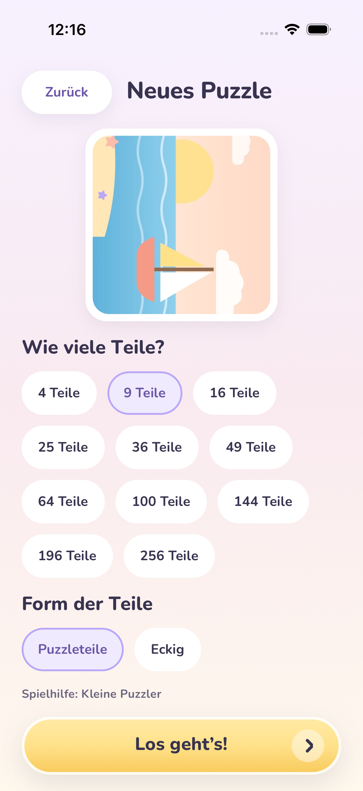     | 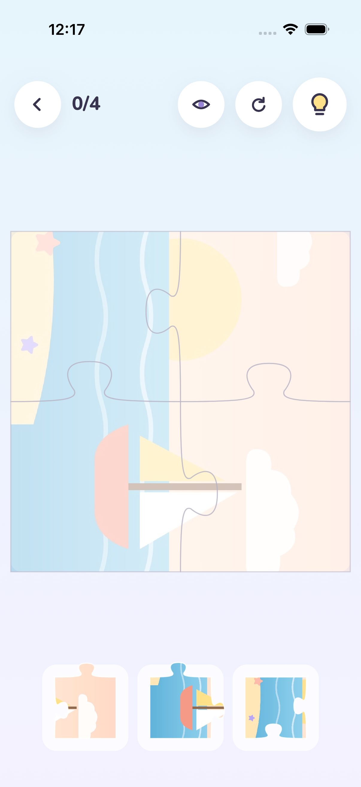     | 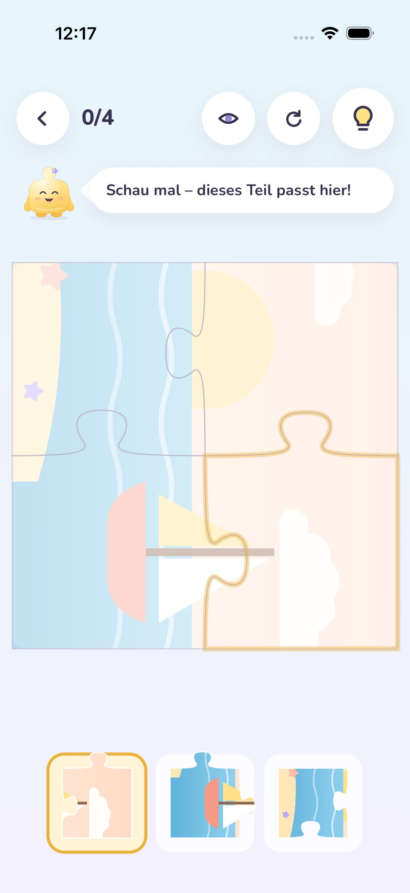     | 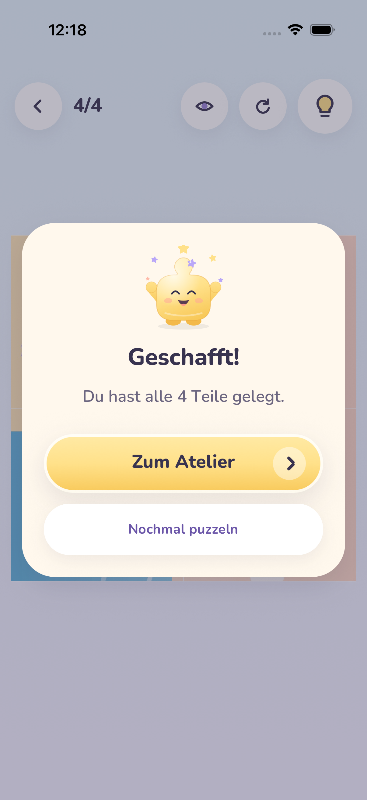     |
| Android   | 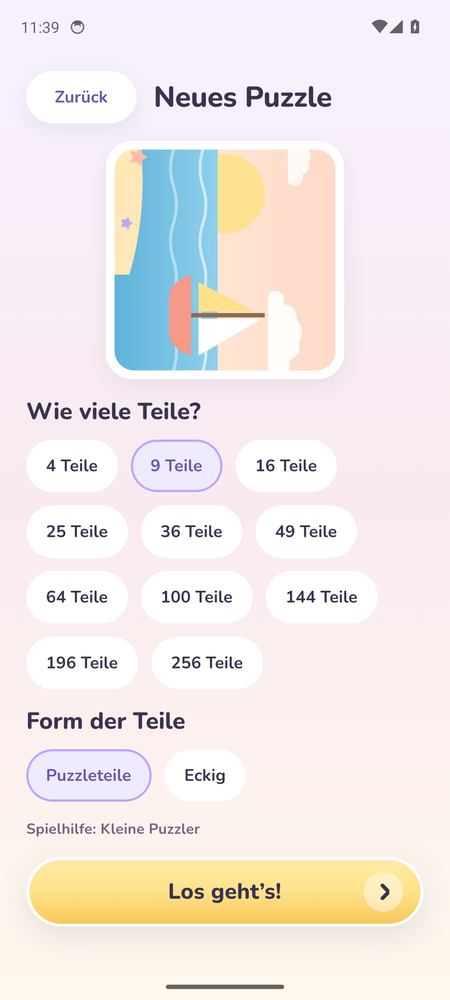 | 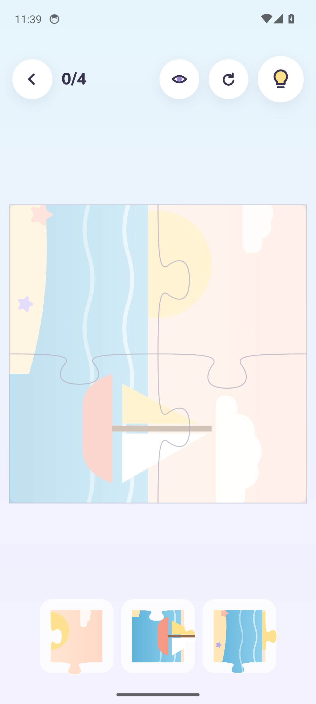 | 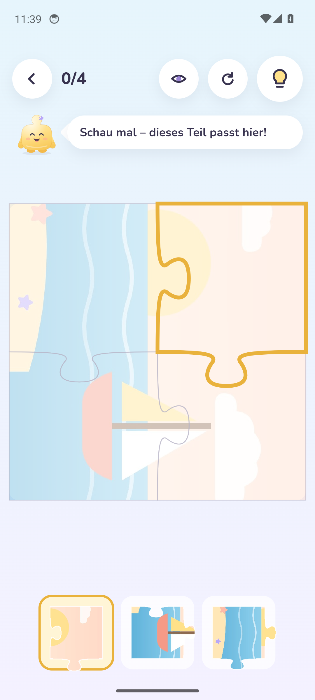 | 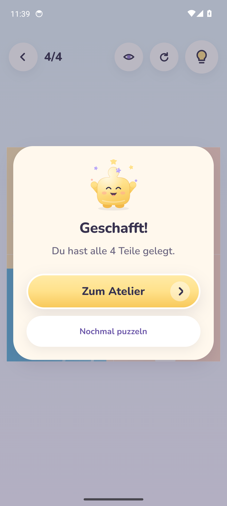 |

Der Ablauf im Test ist derselbe wie für ein Kind: Pino-Tipp antippen, dann auf den leuchtenden Zielplatz tippen – viermal, bis Pino „Geschafft!“ sagt. Danach prüft der Test weiter Elternbereich, Systemcheck, 256-Teile-Test und den Neustart der App.

## 4. Qualität

| Prüfung                               | Ergebnis                                                                                                                                                                                                                                            |
| ------------------------------------- | --------------------------------------------------------------------------------------------------------------------------------------------------------------------------------------------------------------------------------------------------- |
| TypeScript strict / ESLint / Prettier | ✅                                                                                                                                                                                                                                                  |
| Vitest Engine                         | ✅ 89 Tests, 100 % Zeilen (neu: exakte Teilezahlen)                                                                                                                                                                                                 |
| Vitest UI / image-processing          | ✅ 48 / 21                                                                                                                                                                                                                                          |
| Jest App                              | ✅ 34 Tests – u. a. Tipp + Ablegen rastet ein bis „fertig“, Ausweichen vs. zurück je Profil, Speichern nach 500 ms und Wiederherstellen, beschädigter Spielstand, Häppchen, Schalen, Speicher-Migration, „Neues Puzzle“ legt das richtige Raster an |
| Metro-Bundle Android + iOS            | ✅                                                                                                                                                                                                                                                  |
| Web-Vorschau (Playwright)             | ✅ 4, 9, 25 (Kleinkind), 36 (Ziehen + falsch legen), 100 (Profi, Zoom, Farbschalen) – ohne Fehlermeldungen                                                                                                                                          |

## 5. In diesem Meilenstein gefundene und behobene Fehler

| Fehler                                                                                      | Gefunden durch | Behebung                                                                                       |
| ------------------------------------------------------------------------------------------- | -------------- | ---------------------------------------------------------------------------------------------- |
| „64 Teile“ ergab 63 (7 × 9), „100“ ergab 99                                                 | Web-Test       | Engine nimmt jetzt die exakte Zahl, solange die Teile nahezu quadratisch bleiben (≤ 1 : 1,45). |
| Gezoomtes Brett / Häppchen ragte in die Ablage                                              | Web-Screenshot | Brett-Ebene wird oberhalb der Ablage beschnitten.                                              |
| Fortschritt „8/100“ abgeschnitten, Spieltisch nutzte nicht die volle Breite                 | Web-Screenshot | `Screen` hat jetzt `gutter={false}` für randlose Spielflächen (Sicherheitsabstände bleiben).   |
| Kopfzeile zu breit im Kleinkind-Modus (Seite seitlich verschiebbar)                         | Web-Messung    | Fortschritt schrumpft mit, Kleinkinder sehen einen Balken statt Punkte.                        |
| Pinos Sprechblase verschob das Brett                                                        | Web-Screenshot | Sprechblase liegt jetzt über dem Brett.                                                        |
| Kleinkinder mussten auf schmalen Handys blättern (4 große Teile passen nicht nebeneinander) | Web-Screenshot | Es werden so viele große Teile gezeigt, wie passen – nie blättern.                             |

## 6. Bewusste Abweichungen vom Konzept (dokumentiert in gameplay-concept.md)

- Reihenfolge **Brett → Ablage → Schalen** (Ziehen braucht eine zusammenhängende Fläche).
- Auch kleine Puzzles nutzen die Ablage (neben dem Brett ist im Hochformat kein Platz).
- Schalen umsortieren per Langdruck → „Nach links/rechts“ statt Ziehen.
- Der Schalter „Falsch gelegte Teile“ kommt mit dem Elternbereich (Phase 7); bis dahin gilt der Standard je Profil.

## 7. Offen / Hinweise für den PO

- **Bitte auf echten Geräten spielen**: Atelier → Bild antippen → z. B. 36 Teile. Im Web unter https://prynz.github.io/PUZZLE-STUDIO/ (Bilder bleiben dort nur bis zum Neuladen).
- Noch nicht drin: Töne/Vibration beim Einrasten, Vorschau eines Teils per Langdruck, Motiv-Häppchen, der 256-Teile-Test in der echten Spielsituation.
- Sammlung, Erfolge und Belohnungen folgen in Phase 6, Elternbereich mit Schranke und Einstellungen in Phase 7.

## 8. Nächster Schritt – Phase 6 (Sammlung & Progression)

Galerie aller Puzzles (angefangen / fertig), Filter und Sortierung, Erfolge und kleine Belohnungen (Sterne, Rahmen, Sticker) – ohne Druck, ohne Zeitmessung.
