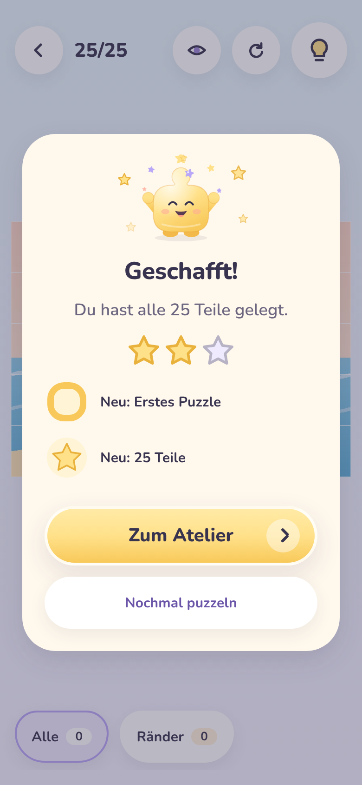
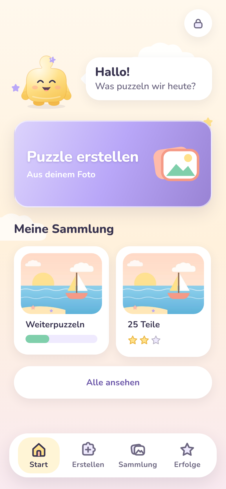
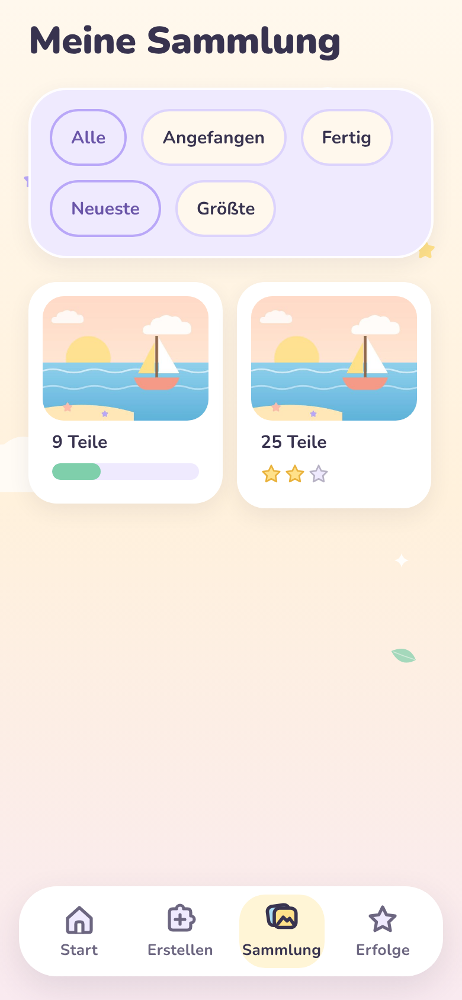
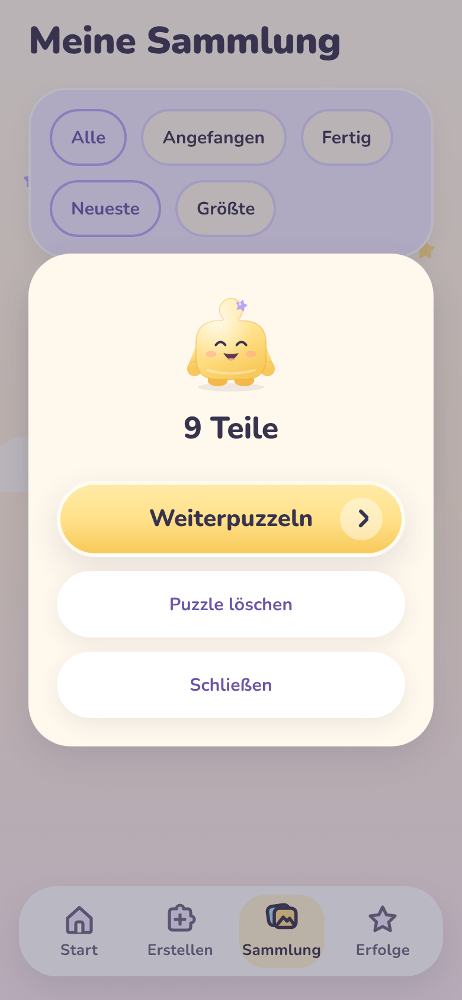
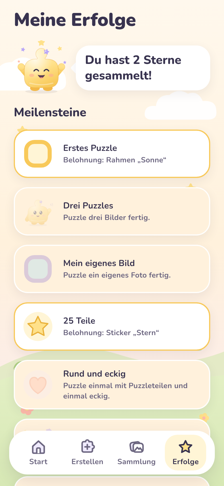
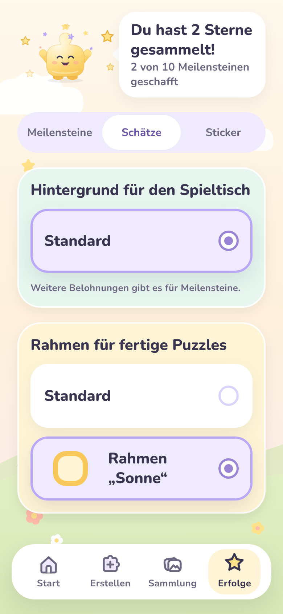
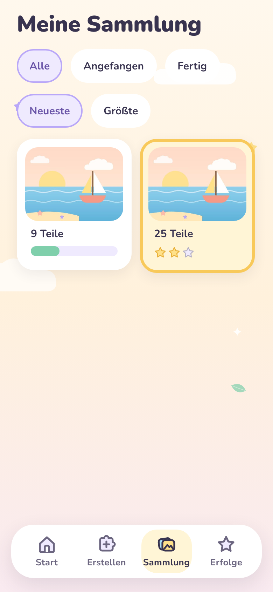
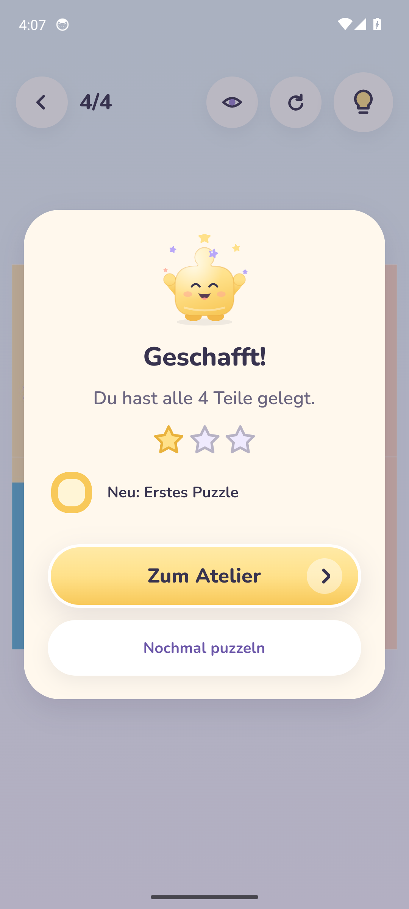
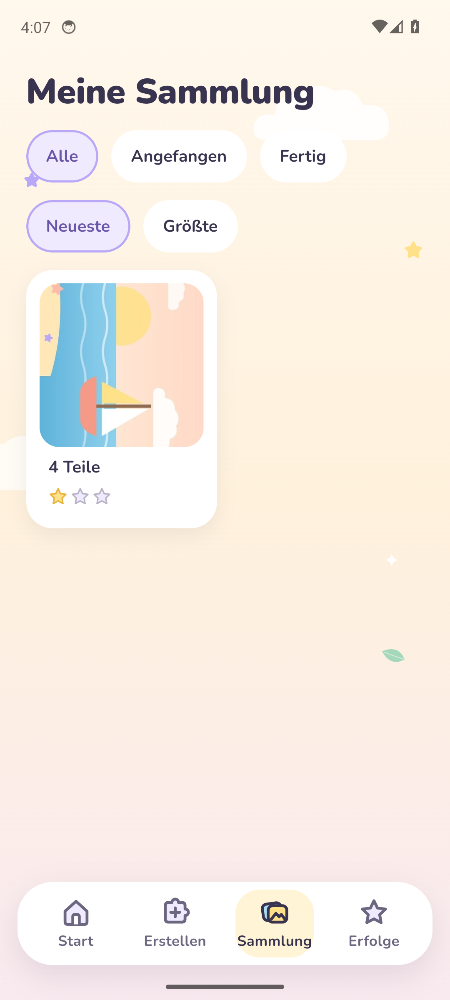
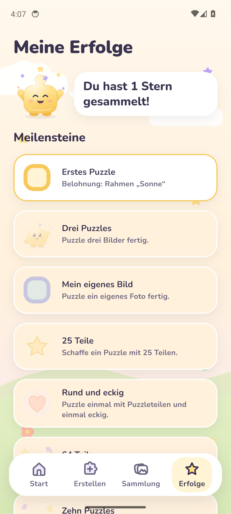

# Milestone 06 – Sammlung & Progression (Phase 6)

**Datum:** 2026-11-03 · **Phase:** 6 · **Status:** umgesetzt, **wartet auf Review durch den PO**

> Alle Screenshots stammen aus der **laufenden App** (iOS-Simulator und Android-Emulator via GitHub Actions/Maestro, Web via Chromium).

## 1. Umgesetzt

| Bereich               | Ergebnis                                                                                                                                                                                                                                                   |
| --------------------- | ---------------------------------------------------------------------------------------------------------------------------------------------------------------------------------------------------------------------------------------------------------- |
| **Sammlung** (Tab)    | Alle Puzzles als Karten mit Bild, Teilezahl und **Fortschritt** (angefangen) bzw. **Sternen** (fertig). Filter: Alle · Angefangen · Fertig. Sortierung: Neueste · Größte. Antippen → Weiterpuzzeln / Nochmal puzzeln / Löschen (mit Rückfrage).            |
| **Erfolge** (Tab)     | Pino zeigt die gesammelten Sterne. Zehn **Meilensteine** – erreichte mit ihrer Belohnung, offene ruhig und grau mit „So schaffst du es“. **Belohnungen anwenden**: Hintergrund für den Spieltisch, Rahmen für fertige Puzzles; dazu ein **Sticker-Album**. |
| **Sterne**            | Pro fertigem Puzzle nach Größe: bis 16 Teile ⭐, bis 64 ⭐⭐, darüber ⭐⭐⭐ – **nie nach Tempo**.                                                                                                                                                         |
| **Feier**             | Zeigt jetzt die Sterne für das Puzzle und was **neu freigeschaltet** wurde (z. B. „Neu: Erstes Puzzle“).                                                                                                                                                   |
| **Startseite**        | Statt „bald“: die letzten Puzzles – angefangene zuerst, mit einem Tippen **weiterpuzzeln**.                                                                                                                                                                |
| **Fair & ohne Druck** | Alles kommt aus einem Protokoll fertiger Puzzles. „Nochmal puzzeln“ und Löschen nehmen **nie** etwas weg; ein Puzzle zählt nur einmal. Keine Zeit, keine Serien, keine Käufe.                                                                              |
| **Reines TS-Paket**   | `packages/game-progression` – Sterne, Meilensteine, Belohnungen; deterministisch, 10 Tests, 100 % Abdeckung.                                                                                                                                               |

Details und Liste aller Meilensteine: [progression.md](../../product/progression.md).

## 2. Screenshots (echt)

### Web (Chromium, 390 × 844)

| Feier mit Sternen + Neu                                            | Start: Weiterpuzzeln                                                 | Sammlung                                                          | Puzzle antippen                                                         |
| ------------------------------------------------------------------ | -------------------------------------------------------------------- | ----------------------------------------------------------------- | ----------------------------------------------------------------------- |
|  |  |  |  |

| Erfolge                                                       | Belohnung wählen                                                      | Rahmen „Sonne“ angewendet                                               |
| ------------------------------------------------------------- | --------------------------------------------------------------------- | ----------------------------------------------------------------------- |
|  |  |  |

### iOS-Simulator und Android-Emulator – Maestro

> Stand beim Schreiben: Die Geräte-Läufe laufen noch; die Bilder werden vom CI-Lauf ergänzt und dieser Hinweis danach entfernt.

| Plattform | Geschafft!                                                             | Sammlung                                                              | Erfolge                                                           |
| --------- | ---------------------------------------------------------------------- | --------------------------------------------------------------------- | ----------------------------------------------------------------- |
| iOS       |      |      |      |
| Android   |  |  |  |

Der Test löst wie in Phase 5 ein 4-Teile-Puzzle mit Pino-Tipps, prüft danach, dass es in der Sammlung liegt und der Meilenstein „Erstes Puzzle“ freigeschaltet ist, und läuft dann weiter durch Elternbereich, Systemcheck, 256-Teile-Test und den Neustart der App.

## 3. Qualität

| Prüfung                               | Ergebnis                                                                                                                                                                                                                                       |
| ------------------------------------- | ---------------------------------------------------------------------------------------------------------------------------------------------------------------------------------------------------------------------------------------------- |
| TypeScript strict / ESLint / Prettier | ✅                                                                                                                                                                                                                                             |
| Vitest                                | ✅ game-progression 10 (100 %), Engine 89 (100 % Zeilen), UI 48, image-processing 21                                                                                                                                                           |
| Jest App                              | ✅ 43 Tests – neu u. a.: Filter/Sortierung, Löschen nur nach Rückfrage, Weiterpuzzeln, Sterne + Meilensteine beim Fertigwerden, gleiches Puzzle nochmal bringt nichts doppelt, Belohnung anwenden, Feier zeigt „Neu: …“, Start „Weiterpuzzeln“ |
| Metro-Bundle Android + iOS            | ✅                                                                                                                                                                                                                                             |
| Web-Vorschau (Playwright)             | ✅ 25-Teile-Puzzle lösen → Feier mit 2 Sternen und 2 Meilensteinen, zweites Puzzle angefangen, Sammlung, Erfolge, Rahmen anwenden – ohne Fehlermeldungen                                                                                       |

## 4. Entscheidungen in dieser Phase

| Thema                        | Entscheidung                                                                                                                                             |
| ---------------------------- | -------------------------------------------------------------------------------------------------------------------------------------------------------- |
| Fortschritt nicht verlierbar | Abschluss-Protokoll statt Status am Puzzle: Neustart oder Löschen eines Puzzles nimmt keine Sterne/Meilensteine weg.                                     |
| Ein Puzzle zählt einmal      | Dasselbe Puzzle 20-mal lösen bringt keine 20-fachen Sterne – fair, aber ohne Druck (nichts geht verloren).                                               |
| Belohnungen                  | Fest an Meilensteine gebunden (keine Zufallsbelohnungen, keine „Lootboxen“). Jede Belohnung ist **wirklich nutzbar**: Hintergrund, Rahmen, Album.        |
| Tabelle `reward_unlock`      | Entfällt – Belohnungen werden aus den Meilensteinen abgeleitet (eine Quelle der Wahrheit).                                                               |
| Grafiken                     | Rahmen, Sticker und Hintergründe sind Interims-Grafiken – zentral austauschbar in `illustrations/rewards.ts` (Maskottchen/Styles sind noch nicht final). |
| Platzhalter                  | Die „bald“-Bildschirme für Sammlung und Erfolge sind entfernt.                                                                                           |

## 5. Offen / Hinweise für den PO

- Bitte die **Meilensteine und Belohnungen** prüfen (Liste in progression.md) – Texte, Anzahl und Reihenfolge lassen sich leicht anpassen.
- Finale Grafiken für Rahmen, Sticker und Hintergründe fehlen noch (wie beim Maskottchen).
- Weiter offen: Töne/Vibration, Messung auf echten Geräten, EAS/TestFlight für echte iPhones.

## 6. Nächster Schritt – Phase 7 (Elternbereich)

Eltern-Schranke (kindersicher, ohne Text-Lesen), Einstellungen (Spielhilfe-Profil, „Falsch gelegte Teile“, Vorlage, Tipps), Speicherverwaltung (Bilder/Puzzles verwalten, Platzbedarf, alles löschen), Datenschutz-Info und Backup-Hinweise.
