# Milestone 07 – Elternbereich (Phase 7)

**Datum:** 2026-11-03 · **Phase:** 7 · **Status:** umgesetzt, **wartet auf Review durch den PO**

> Alle Screenshots stammen aus der **laufenden App** (Android-Emulator und iOS-Simulator via GitHub Actions/Maestro, Web via Chromium).

## 1. Umgesetzt

| Bereich                       | Ergebnis                                                                                                                                                                                                                         |
| ----------------------------- | -------------------------------------------------------------------------------------------------------------------------------------------------------------------------------------------------------------------------------- |
| **Eltern-Schranke**           | „Nur für Erwachsene“: drei Zahlen **als Wörter** („sieben · zwei · fünf“) auf einem großen Ziffernfeld tippen. Falsche Ziffer → freundlich neue Aufgabe, keine Sperre. Jedes neue Öffnen fragt wieder.                           |
| **Reiter „Spiel“**            | Spielhilfe-Profil · **Falsch gelegte Teile** (wie im Profil / rutscht zur Seite / zurück in die Leiste – bei Kleinkindern fest „zurück“) · **Vorlage anzeigen** · **Pino bietet Tipps an** · **Bewegung reduzieren** (ganze App) |
| **Reiter „Daten“**            | Anzahl Bilder, Puzzles, fertige Puzzles, **Speicherplatz der Bilder** · Wege zum Aufräumen (Atelier, Sammlung) · **Alle lokalen Daten löschen** mit Rückfrage → App startet wie neu                                              |
| **Reiter „Info“**             | Datenschutz in einfachen Worten · **Sicherung** (Backup-Verhalten Android/iOS) · Werkzeuge (Systemcheck, 256-Teile-Test, Begrüßung)                                                                                              |
| **Pino fragt von selbst**     | Nach einer Weile ohne neues Teil (Kleinkind 20 s, Kind 45 s, Profi nie): „Soll ich dir ein Teil zeigen?“ – **Ja, bitte / Nein, danke**. Nur ein Angebot.                                                                         |
| **Kein automatischer Upload** | Android: automatische Google-Sicherung für die App **ausgeschaltet** (`allowBackup: false`).                                                                                                                                     |

Details: [parents-area.md](../../product/parents-area.md) · [privacy.md](../../security/privacy.md)

## 2. Screenshots (echt)

### Web (Chromium, 390 × 844)

| Pino bietet Hilfe an                                              | Eltern-Schranke                                                    | Falsche Ziffer → neue Aufgabe                                            | Reiter „Spiel“                                                      |
| ----------------------------------------------------------------- | ------------------------------------------------------------------ | ------------------------------------------------------------------------ | ------------------------------------------------------------------- |
| 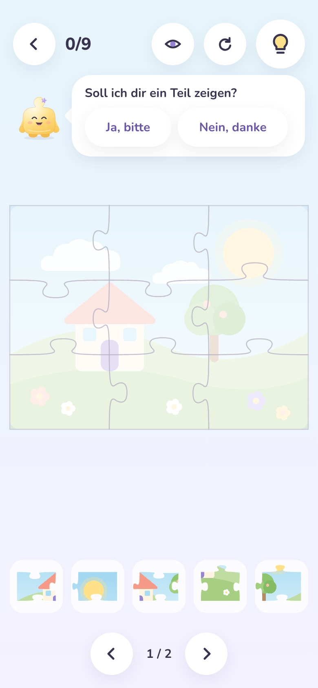 | 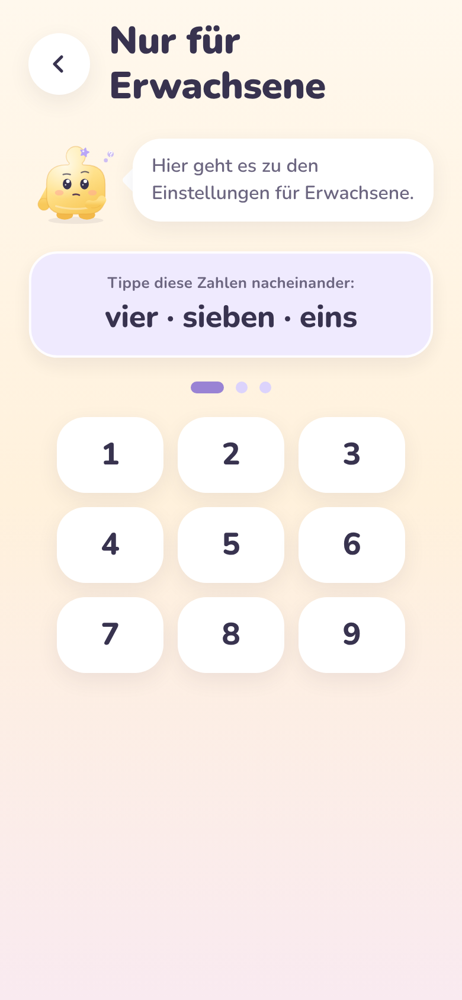 | 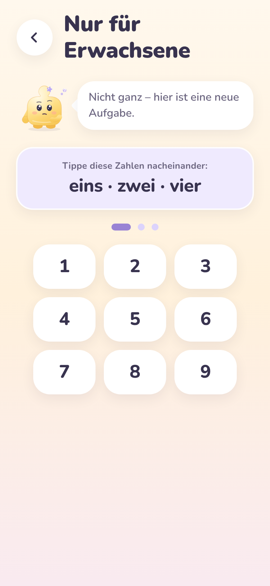 | 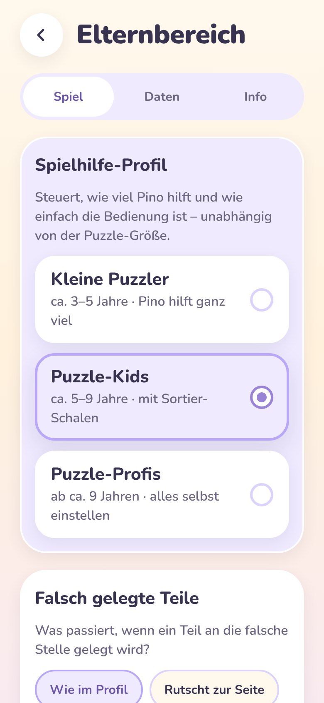 |

| Reiter „Daten“                                                      | Alles löschen? (Rückfrage)                                                  | Reiter „Info“                                                       | Nach dem Löschen: wie neu                                                    |
| ------------------------------------------------------------------- | --------------------------------------------------------------------------- | ------------------------------------------------------------------- | ---------------------------------------------------------------------------- |
| 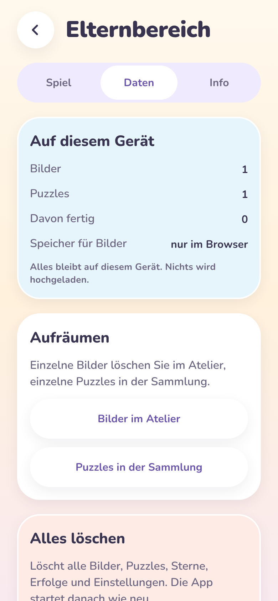 | 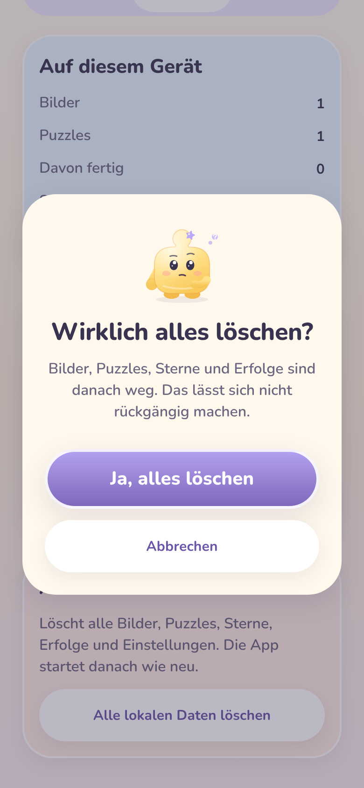 | 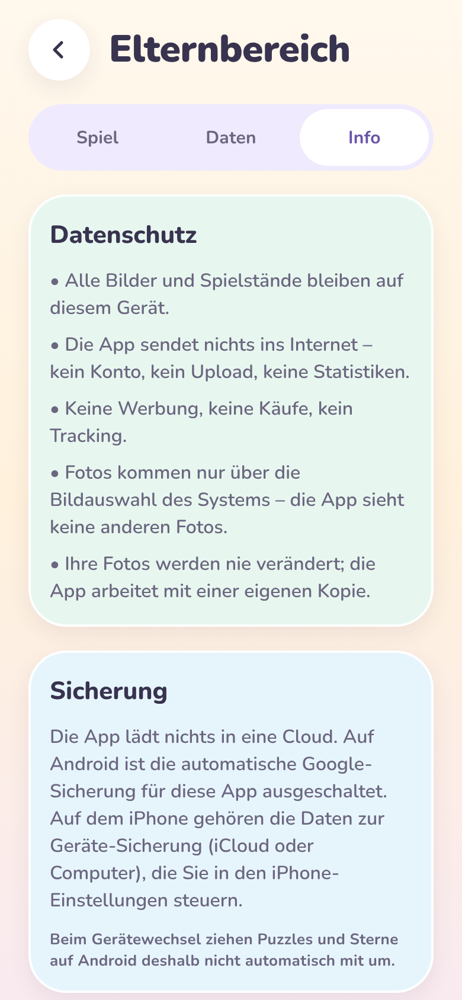 | 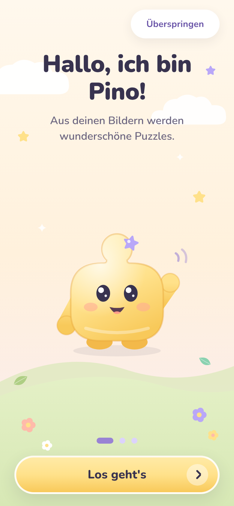 |

Im Web zeigt „Speicher für Bilder“ „nur im Browser“ – die Web-Vorschau hält Bilder nur im Arbeitsspeicher; auf Geräten wird der echte Platzbedarf gemessen.

### Android-Emulator und iOS-Simulator – Maestro

> **Stand:** Android-Emulator ✅ (Lauf 41705280175, alle 23 Bilder). iOS-Simulator: Die App wurde gebaut und installiert (Lauf 41705284731), aber Maestros iOS-Testtreiber startete auf dem GitHub-Rechner nicht rechtzeitig („iOS driver not ready in time“) – ein Problem der Testumgebung, kein App-Fehler. Ein neuer iOS-Lauf ist gestartet; die Bilder werden nachgereicht.

| Eltern-Schranke                                                        | Reiter „Spiel“ (Kleinkind)                                              | Reiter „Daten“ (echter Speicher)                                        | Reiter „Info“                                                           | Nach Neustart: Profil erhalten                                                         |
| ---------------------------------------------------------------------- | ----------------------------------------------------------------------- | ----------------------------------------------------------------------- | ----------------------------------------------------------------------- | -------------------------------------------------------------------------------------- |
| 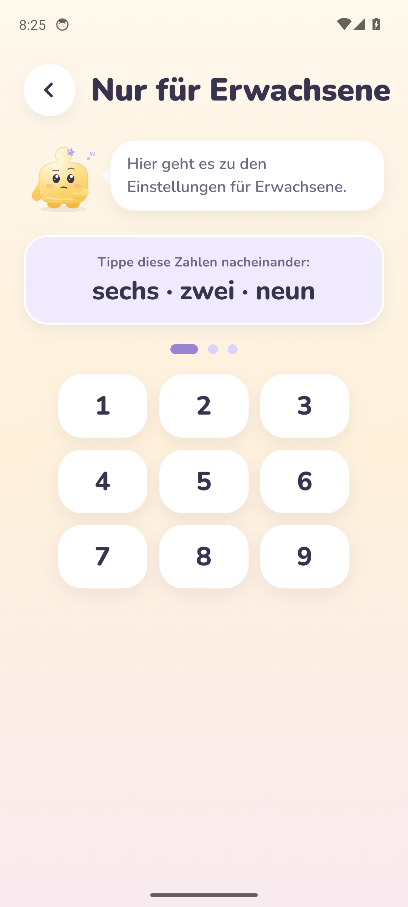 | 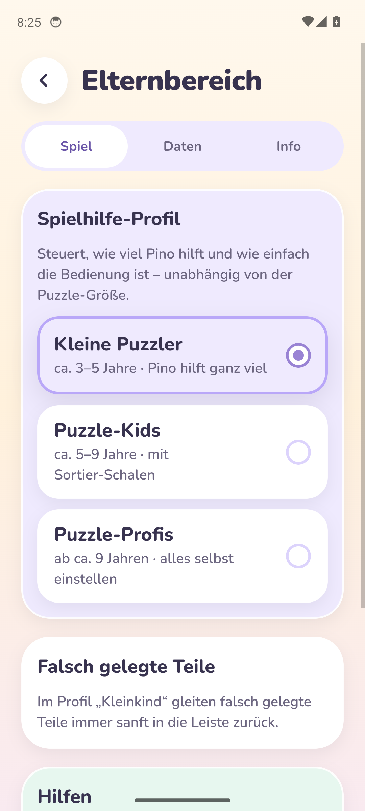 | 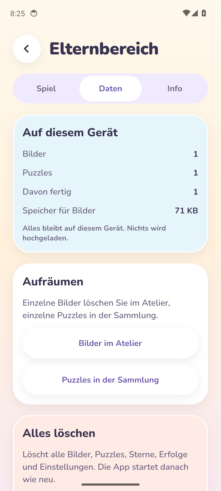 | 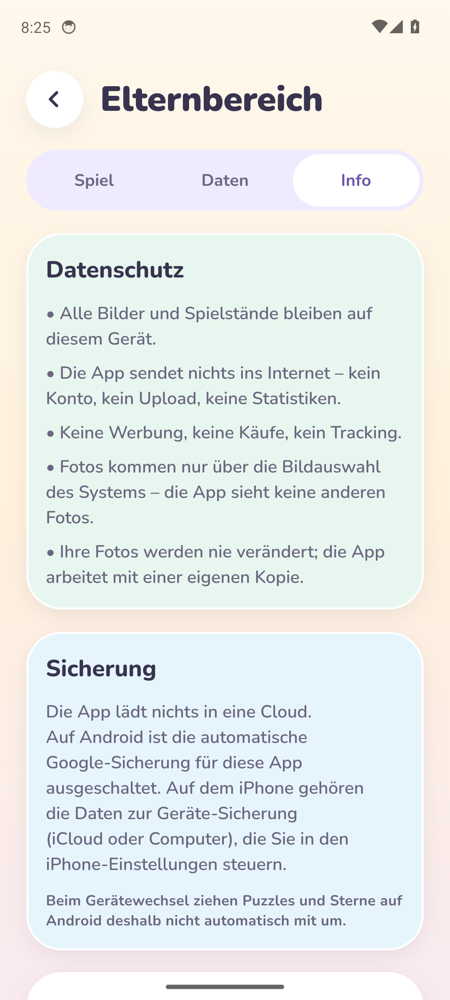 | 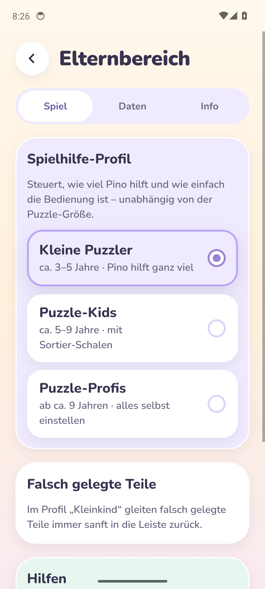 |

Der Test öffnet die Schranke wie ein Erwachsener (liest die Zahlwörter, tippt die Ziffern), prüft im Reiter „Daten“ die Bildanzahl, öffnet „Info“ und von dort Systemcheck und 256-Teile-Test. Nach dem Neustart der App muss die Schranke erneut gelöst werden; das Profil ist erhalten.

## 3. Qualität

| Prüfung                               | Ergebnis                                                                                                                                                                                                                                                 |
| ------------------------------------- | -------------------------------------------------------------------------------------------------------------------------------------------------------------------------------------------------------------------------------------------------------- |
| TypeScript strict / ESLint / Prettier | ✅                                                                                                                                                                                                                                                       |
| Vitest                                | ✅ Engine 89, UI 48, image-processing 21, game-progression 10                                                                                                                                                                                            |
| Jest App                              | ✅ 54 Tests – neu: Schranke (falsch → neue Aufgabe, richtig → offen, Abbrechen), Einstellungen werden gespeichert, Kleinkind ohne Wahl, Löschen nur nach Rückfrage und danach wirklich leer, Elternwahl im Spiel, Tipp-Angebot (Zeit, Pause, aus, Profi) |
| Metro-Bundle Android + iOS            | ✅                                                                                                                                                                                                                                                       |
| Web-Vorschau (Playwright)             | ✅ Tipp-Angebot erscheint nach 45 s und zeigt nach „Ja, bitte“ das Teil; Schranke, alle Reiter, Löschen → Begrüßung – ohne Fehlermeldungen                                                                                                               |

**Behoben beim Testen:** Pinos Sprechblase lag unter der Spielfläche und ließ deshalb keine Knöpfe zu; jetzt ist nur das Angebot antippbar, Tipp- und Jubel-Blasen lassen Berührungen weiter zum Brett durch. Das Ziffernfeld stand in zwei statt drei Spalten.

## 4. Entscheidungen in dieser Phase

| Thema                          | Entscheidung                                                                                                                                              |
| ------------------------------ | --------------------------------------------------------------------------------------------------------------------------------------------------------- |
| Art der Schranke               | Zahlwörter + Ziffernfeld statt Rechenaufgabe: kein Lesen von Formeln, keine Zeitgrenze, für Kinder im Zielalter nicht lösbar, für Erwachsene in Sekunden. |
| Entsperrt bleiben              | Nur solange der Bereich offen ist – keine „5-Minuten-Freigabe“, die ein Kind ausnutzen könnte.                                                            |
| Android-Backup                 | `allowBackup: false` (kein automatischer Upload von Kinderfotos). Nachteil: Beim Gerätewechsel wandern Daten nicht mit – wird im Elternbereich erklärt.   |
| iOS-Backup                     | Bleibt Teil der vom Elternteil gesteuerten Geräte-Sicherung; ein Ausschluss bräuchte eigenen nativen Code (siehe offene Punkte).                          |
| Einstellungen für neue Puzzles | „Falsch gelegte Teile“ und „Vorlage“ gehören zum Spielstand – angefangene Puzzles ändern sich nicht plötzlich. Tipp-Angebot und Bewegung wirken sofort.   |
| Löschen                        | Einzelnes bleibt dort, wo es das Kind sieht (Atelier, Sammlung); der Elternbereich verlinkt dorthin und bietet zusätzlich „alles löschen“.                |

## 5. Offen / Hinweise für den PO

- **Bitte entscheiden – iOS-Sicherung:** so lassen (Daten in der iCloud-/Computer-Sicherung der Eltern, Umzug aufs neue iPhone klappt) **oder** Bilder davon ausschließen (gleiches Verhalten wie Android, braucht ein kleines eigenes natives Modul).
- Wird eine **Export-/Import-Funktion** (z. B. Sicherung als Datei) für den Gerätewechsel gewünscht? Derzeit bewusst nicht enthalten.
- Phase 6 (iOS-Screenshots): weiter abhängig von freien macOS-Rechnern bei GitHub.
- Weiter offen: Töne/Vibration (dann mit Schalter im Elternbereich), Messung auf echten Geräten, EAS/TestFlight.

## 6. Nächster Schritt – Phase 8 (QA & Optimierung)

Geräte-Tests, Performance (256 Teile auf echten Geräten), Barrierefreiheit (Screenreader, Schriftgröße, Kontrast), Security-Review.
