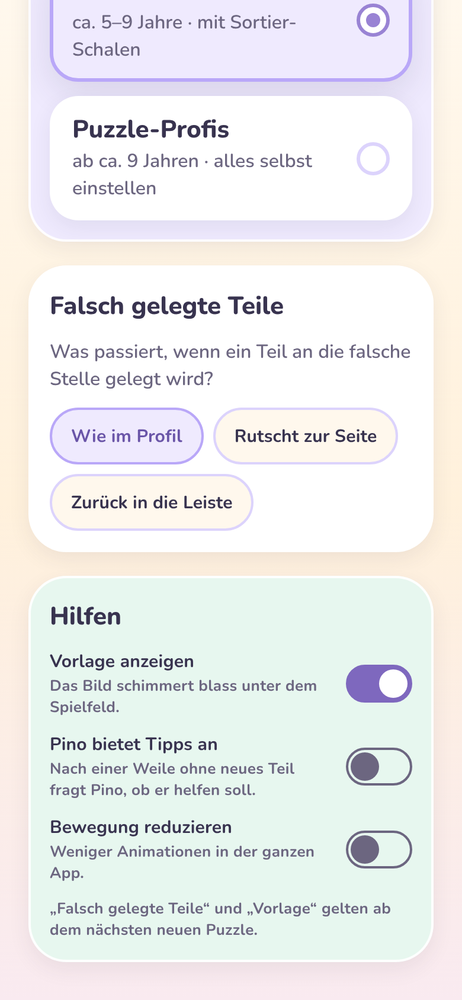
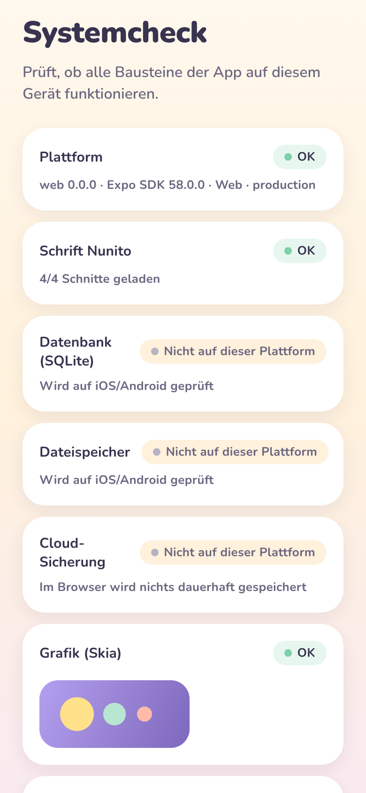
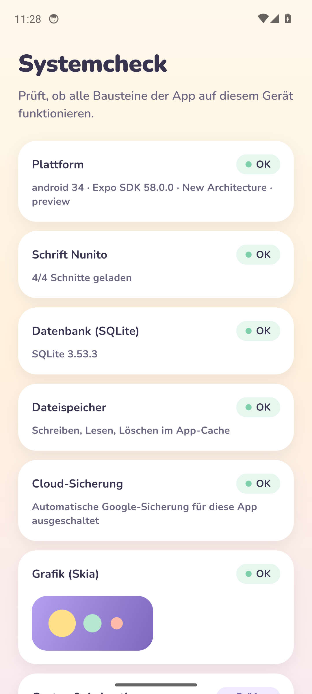
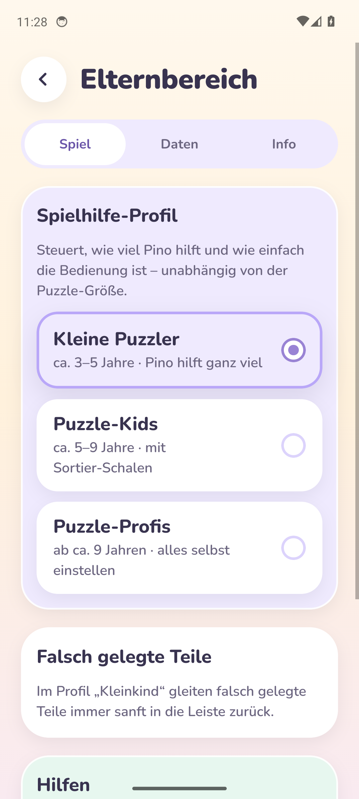
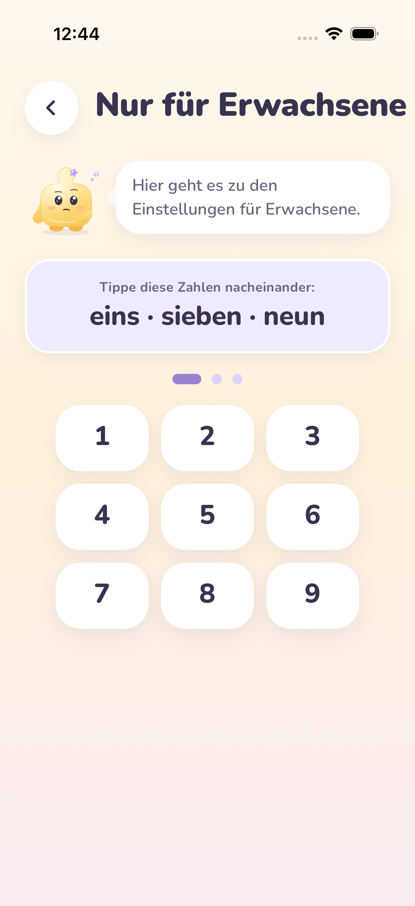
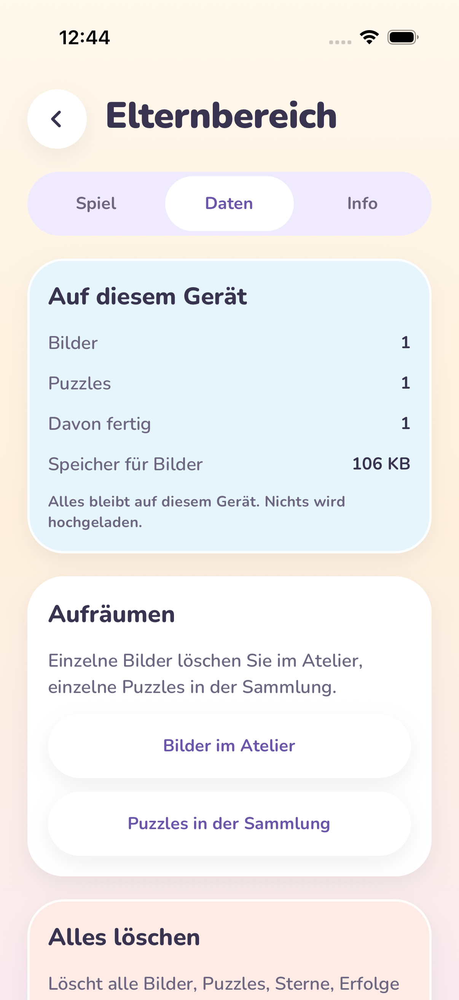
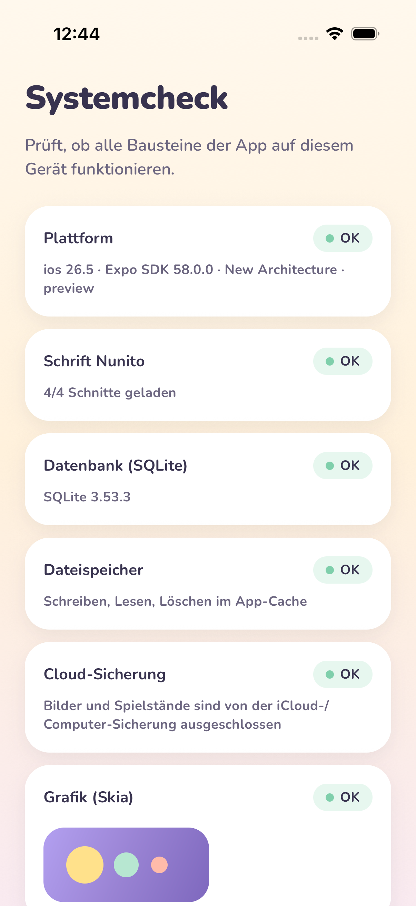

# Milestone 08 – QA & Optimierung (Phase 8)

**Datum:** 2026-11-03 · **Phase:** 8 · **Status:** automatisierbarer Teil umgesetzt, **Tests auf echten Geräten offen**, wartet auf Review durch den PO

> Alle Screenshots stammen aus der **laufenden App** (Android-Emulator via GitHub Actions/Maestro, Web via Chromium).

## 1. Vorab: PO-Entscheidungen aus Phase 7 umgesetzt

| Entscheidung                            | Umsetzung                                                                                                                                                                                                                                                                                                                                                           |
| --------------------------------------- | ------------------------------------------------------------------------------------------------------------------------------------------------------------------------------------------------------------------------------------------------------------------------------------------------------------------------------------------------------------------- |
| Cloud-Sicherung auch auf dem iPhone aus | Kleines eigenes iOS-Modul (`apps/mobile/modules/backup-exclusion`, Swift, keine neue Fremd-Abhängigkeit) schließt bei jedem Start den App-Datenordner (Bilder + Datenbank) von iCloud- und Computer-Sicherung aus. Android war schon aus; CI prüft das jetzt im Manifest. Neue Systemcheck-Zeile **„Cloud-Sicherung“**, von Maestro auf beiden Plattformen geprüft. |
| Keine Export-/Import-Datei              | Nicht gebaut. Der Elternbereich sagt offen: beim Gerätewechsel oder Löschen der App sind die Daten weg.                                                                                                                                                                                                                                                             |

## 2. Ergebnisse Phase 8

Ausführlich im **[Testprotokoll](../../qa/test-protocol.md)**.

| Bereich              | Ergebnis                                                                                                                                                                                                                                                                                     |
| -------------------- | -------------------------------------------------------------------------------------------------------------------------------------------------------------------------------------------------------------------------------------------------------------------------------------------- |
| **Sicherheit**       | Kein Netzwerkzugriff im App-Code · Logs ohne Pfade/Dateinamen (getestet) · alle SQL-Abfragen mit Platzhaltern · Elternbereich nur über die Schranke · `pnpm audit`: 5 Meldungen ausschließlich in Entwicklungswerkzeugen, nichts davon läuft auf dem Handy                                   |
| **Barrierefreiheit** | **Neu:** automatische Prüfung aller Hauptscreens und Eltern-Reiter – jedes antippbare Element hat Rolle und vorlesbaren Namen. **Behoben:** Ein/Aus-Schalter waren kaum erkennbar (1,7–1,9 : 1) → zentral neue Schalter-Farben (≥ 4,1 : 1), Zustand auch an Form und Knopfposition erkennbar |
| **Performance**      | 256-Teile-Puzzle entsteht in ~10 ms, Spielstand speichern + laden < 1 ms, Treffer-Test 8–14 µs – jetzt mit festen Zeitgrenzen in den Tests                                                                                                                                                   |
| **Tests gesamt**     | 238 automatische Tests (vorher 222), alle grün; Typprüfung, Lint, Format, Bundle Android + iOS ✅                                                                                                                                                                                            |

## 3. Screenshots (echt)

| Neue Schalter (Web)                                             | Systemcheck Web                                                            | Systemcheck Android: Cloud-Sicherung OK                                 | Elternbereich Android                                                   |
| --------------------------------------------------------------- | -------------------------------------------------------------------------- | ----------------------------------------------------------------------- | ----------------------------------------------------------------------- |
|  |  |  |  |

> **Android-Emulator ✅** (Lauf 41735946137, alle 23 Bilder des Gesamtablaufs). **iOS-Simulator ✅** (Lauf 41744278567, alle 23 Bilder). Der Lauf davor (41735072320) kam zum ersten Mal bis in den Elternbereich – und der neue Systemcheck fand einen **echten Fehler**: „Cloud-Sicherung: Fehler“. Ursache: Die `.gitignore` schloss alle `ios/`-Ordner aus, dadurch fehlte das Backup-Modul im iOS-Build. Behoben; die CI bricht jetzt ab, wenn das Modul fehlt, und der Systemcheck meldet „Baustein fehlt“ getrennt.

| iOS: Geschafft!                                                    | iOS: Eltern-Schranke                                               | iOS: Reiter „Daten“                                                 | iOS: Cloud-Sicherung OK                                             |
| ------------------------------------------------------------------ | ------------------------------------------------------------------ | ------------------------------------------------------------------- | ------------------------------------------------------------------- |
|  |  |  |  |

## 4. Offen – bitte durch den PO

- **Tests auf echten Geräten** (Checkliste mit 9 Punkten im [Testprotokoll §5](../../qa/test-protocol.md#5-tests-auf-echten-geräten-offen--bitte-durch-den-po)): Bildrate beim 256-Teile-Test, Kaltstart, VoiceOver/TalkBack, größte Schrift, Bewegung reduzieren, Flugmodus, Systemcheck „Cloud-Sicherung“, kleines Display/Tablet.
  - Android: Die Test-App (APK) liegt bei jedem CI-Lauf als Download bereit.
  - iPhone: braucht TestFlight mit Apple-Entwicklerkonto (Teil von Phase 9).
- Weiterhin offen aus früheren Phasen: Töne/Vibration, finale Grafiken (Maskottchen, Rahmen, Sticker).

## 5. Nächster Schritt – Phase 9 (Release)

EAS-Produktions-Builds, TestFlight, Google Play interner Test, finale Icons/Splash, Store-Texte und -Bilder, Datenschutzangaben in den Stores. Dafür werden ein **Apple-Developer-** und ein **Google-Play-Konto** benötigt.
