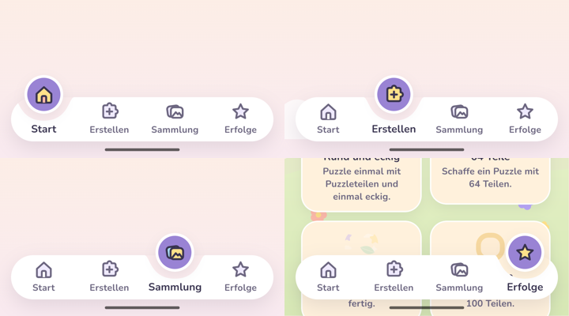
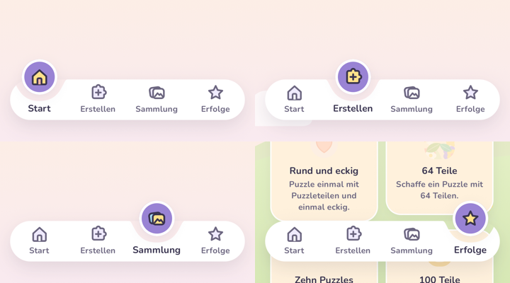

# Änderung 01 – Animierte Tab-Leiste

**Datum:** 2026-11-04 · **Anlass:** Wunsch des PO nach eigener Nutzung („Navbar unten modern und animiert“, Beispielbild) · **Status:** umgesetzt, wartet auf Review

> Bilder stammen aus der **laufenden App** (Web via Chromium; Android-/iOS-Läufe siehe unten).

## Was sich ändert

- Weiße Leiste mit einer **weichen Mulde** unter dem aktiven Tab.
- Der aktive Tab sitzt in einer **runden lila Blase mit weißem Ring**, die über die Leiste hinausragt; darin das farbige Symbol.
- Beim Wechsel **gleiten Mulde und Blase federnd** zum neuen Tab, das Symbol **poppt kurz auf**, der Name des aktiven Tabs wird **fett**.
- „Bewegung reduzieren“ (System oder Elternbereich): Die Blase springt ohne Animation.
- Bedienung unverändert: ganze Tab-Fläche antippbar (≥ 56 dp), VoiceOver/TalkBack lesen „Tab, ausgewählt“.

Farben, Größen und Feder kommen zentral aus dem Designsystem (`color.brand.purple`, `spring.glide`); die Form der Mulde ist eine getestete Funktion (`packages/ui/src/components/navShape.ts`).

## Nachbesserung nach PO-Feedback (2026-11-04)

> „Mir gefällt der Ausschnitt links und rechts nicht … es wirkt so, als wäre die Tableiste erneut dahinter gelegt.“

| Problem                                                                           | Lösung                                                                                                                                                                                                                                                                                      |
| --------------------------------------------------------------------------------- | ------------------------------------------------------------------------------------------------------------------------------------------------------------------------------------------------------------------------------------------------------------------------------------------- |
| Bei „Start“ und „Erfolge“ lief die Mulde in die runde Ecke – wirkte abgeschnitten | Die äußeren Tabs rücken so weit nach innen, dass neben der Mulde **immer ein Stück Leiste (≥ 8 pt) bis zur Ecke** bleibt – wie im Referenzbild. Ecken weicher wie im Referenzbild (`radius.md`). Die Tippfläche der äußeren Tabs reicht trotzdem bis zum Rand.                              |
| In der Mulde lag ein blasser Schleier („Leiste dahinter“)                         | Ursache: der rechteckige Schatten der Leiste und der Schatten der Blase. Jetzt sind Leiste, Ecken und Mulde **eine** Form; ihr Schatten folgt der Form und liegt nur unter der Leiste. In der Mulde ist nur noch der Hintergrund zu sehen (nachgemessen: Farbe in der Mulde = Hintergrund). |
| Fetter Name „Sammlung“ wurde abgeschnitten                                        | Aktiver Name bleibt gleich groß, nur kräftiger und dunkler.                                                                                                                                                                                                                                 |
| Sehr schmale Handys (320 pt)                                                      | Leiste dort mit 8 statt 16 pt Seitenrand, damit jeder Tab ≥ 56 pt breit bleibt (getestet).                                                                                                                                                                                                  |

## Bilder

| Alle Zustände (oben: Start; 2. Bild mitten im Gleiten)         | Animation (Aufnahme, Zeitverlauf nur ungefähr)                    |
| -------------------------------------------------------------- | ----------------------------------------------------------------- |
|  |  |

## Prüfung

TypeScript, ESLint, Prettier ✅ · Tests ✅ (UI 53, App 67, Engine 91 …) · Web ohne Fehlermeldungen ✅ · **Android-Emulator ✅** (erste Fassung: Lauf 41797465551, kompletter Ablauf mit 23 Bildern; Tab-Wechsel per Maestro über die neuen Tabs) · **iOS-Simulator ✅** (erste Fassung: Lauf 41797470037, kompletter Ablauf mit 23 Bildern). Die Nachbesserung läuft gerade auf beiden; die Ausschnitte unten zeigen noch die erste Fassung und werden ersetzt.

| Android-Emulator: Leiste in allen vier Tabs (Ausschnitte aus den Maestro-Bildern 04, 05, 14, 15) |
| ------------------------------------------------------------------------------------------------ |
|                                  |

| iOS-Simulator: Leiste in allen vier Tabs (Ausschnitte aus den Maestro-Bildern 04, 05, 14, 15) |
| --------------------------------------------------------------------------------------------- |
|                                   |
