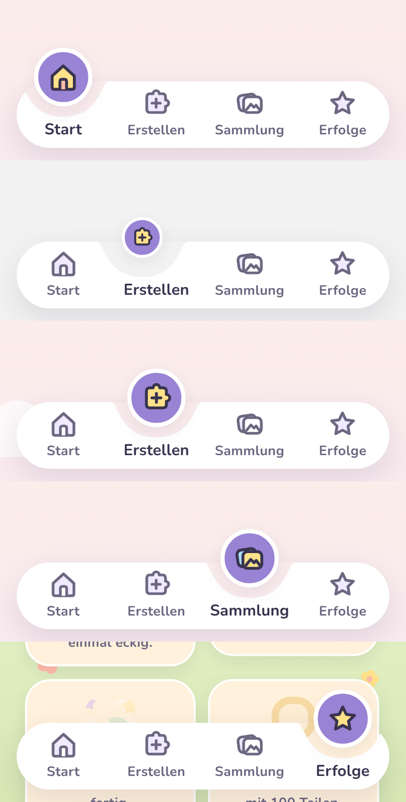
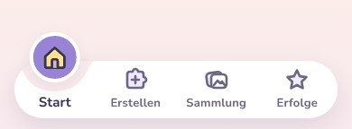

# Änderung 01 – Animierte Tab-Leiste

**Datum:** 2026-11-04 · **Anlass:** Wunsch des PO nach eigener Nutzung („Navbar unten modern und animiert“, Beispielbild) · **Status:** umgesetzt, wartet auf Review

> Bilder stammen aus der **laufenden App** (Web via Chromium; Android-/iOS-Läufe siehe unten).

## Was sich ändert

- Weiße Leiste mit einer **weichen Mulde** unter dem aktiven Tab.
- Der aktive Tab sitzt in einer **runden lila Blase mit weißem Ring**, die über die Leiste hinausragt; darin das farbige Symbol.
- Beim Wechsel **gleiten Mulde und Blase federnd** zum neuen Tab, das Symbol **poppt kurz auf**, der Name des aktiven Tabs wird **fett**.
- „Bewegung reduzieren“ (System oder Elternbereich): Die Blase springt ohne Animation.
- Bedienung unverändert: ganze Tab-Fläche antippbar (≥ 56 dp), VoiceOver/TalkBack lesen „Tab, ausgewählt“.

Farben, Größen und Feder kommen zentral aus dem Designsystem (`color.brand.purple`, `spring.glide`); die Form der Mulde ist eine getestete Funktion (`packages/ui/src/components/navShape.ts`).

## Bilder

| Alle Zustände (oben: Start; 2. Bild mitten im Gleiten)         | Animation (Aufnahme, Zeitverlauf nur ungefähr)                    |
| -------------------------------------------------------------- | ----------------------------------------------------------------- |
|  |  |

## Prüfung

TypeScript, ESLint, Prettier ✅ · Tests ✅ (UI 53, App 67, Engine 91 …) · Web ohne Fehlermeldungen ✅ · Android-Emulator / iOS-Simulator: Läufe gestartet, Ergebnis wird hier nachgetragen.
