# Änderung 02 – Neuer Look: Pino als glänzendes Puzzleteil, Limette → Petrol

**Datum:** 2026-11-04 · **Anlass:** Wunsch des PO – zuerst Stil-Referenz (weiches 3D, Mint), dann **eigenes Konzeptbild des PO**: Pino als glänzendes Puzzleteil mit Limette-Petrol-Verlauf und Neon-Effekten, „genau dieses Maskottchen, Stil auf die ganze App“ · **Status:** umgesetzt; seit 2026-11-05 mit den **ersten Original-Bildern des PO** (Begrüßung, Lupe), übrige Stimmungen vorerst Vektor-Nachzeichnung – wartet auf Review

> Screenshots stammen aus der **laufenden App** (Web via Chromium; Android-/iOS-Läufe siehe unten). Die Pino-Übersicht ist direkt aus dem App-Code (`pinoSvg`) gerendert.

## Was sich ändert

| Bereich                             | Vorher                   | Jetzt                                                                                                                                                                                                                                                                                                    |
| ----------------------------------- | ------------------------ | -------------------------------------------------------------------------------------------------------------------------------------------------------------------------------------------------------------------------------------------------------------------------------------------------------- |
| **Pino**                            | gelbes Quadrat mit Armen | **glänzendes Puzzleteil mit vier Knubbeln** nach dem Konzeptbild des PO: Verlauf Limette → Grün → Petrol, Glanz oben links, dunklere Unterseite, kleine dunkle Augen, schmales Lächeln, leicht schräg; **Neon-Limette-Effekte** je Stimmung (Funkeln, Ring, Fragezeichen, „!“-Striche, Krone, Herz, Zzz) |
| Markenfarben                        | Lavendel / Lila          | **Limette → Grün → Petrol** (`lime`, `leaf`-Skala, `teal`), Neon-Limette (`neon`) als Leuchtakzent, kleiner Markentext tief-petrol (`forest`)                                                                                                                                                            |
| Hintergründe                        | Creme mit Rosa-Hauch     | kühles, weiches **Grau-Grün** (`mist`) wie im Konzeptbild                                                                                                                                                                                                                                                |
| Haupt-Knöpfe                        | gelb, dunkle Schrift     | **tief petrolgrün, glänzend, weiße Schrift**; „Weiter“/„Fertig“ grün                                                                                                                                                                                                                                     |
| Große Aktionskarte                  | Lila-Verlauf             | **Pino-Verlauf Limette → Grün**, dunkle Schrift                                                                                                                                                                                                                                                          |
| Tab-Leiste                          | lila Blase               | Blase im Pino-Verlauf mit weißem Ring und Neon-Schimmer                                                                                                                                                                                                                                                  |
| Text / Schatten                     | Navy                     | grün-getöntes Fast-Schwarz (`ink`), grün-getönte Schatten                                                                                                                                                                                                                                                |
| App-Icon, Startbild, Beispielbilder | alt                      | neu gerendert mit dem neuen Pino                                                                                                                                                                                                                                                                         |

Gelb, Himmelblau, Pfirsich und Rosa bleiben als **Akzente** (Sterne, Belohnungen, Kategorie-Karten).

**Original-Bilder (2026-11-05):** Der PO hat die ersten zwei Bilder geliefert (transparente PNGs). Sie stehen jetzt in der App: **Begrüßung** (Pino mit Funkeln – Willkommen, Profilwahl, App-Icon, Startbild) und **Nachdenklich** (Pino mit Lupe – Eltern-Schranke u. a.). Die Originale liegen unverändert in `docs/design/mascot-art/`. Weitere Stimmungen folgen; bis dahin ist Pino dort eine Vektor-Nachzeichnung im App-Code (`packages/ui/src/mascot/pino.ts`), damit er in allen Größen scharf bleibt und alle 8 Stimmungen funktionieren. Die gelieferten Dateien werden zentral an derselben Stelle eingesetzt – die Screens ändern sich dafür nicht. Lieferformat: siehe [Maskottchen-Richtlinien → Original-Dateien](../../design/mascot-guidelines.md#original-dateien-lieferung-durch-den-po).

**Barrierefreiheit:** Kontraste neu geprüft und als Tests festgeschrieben – Text ≥ 5,3 : 1 auf allen Flächen, dunkle Schrift auf jeder Farbe des Limette-Grün-Verlaufs ≥ 6,4 : 1, weiße Schrift auf jeder Farbe beider Knopf-Verläufe ≥ 4,5 : 1 (der Test hat einen zu hellen Knopf-Verlauf gefunden – korrigiert), Schalter ≥ 4 : 1.

**Zentral umgesetzt:** nur Tokens (`tokens.ts`), Maskottchen (`mascot/theme.ts`, `mascot/pino.ts`) und zwei ui-Komponenten (große Karte, Tab-Blase). Screens nutzen weiter nur Tokens; der Flächen-Ton `lavender` heißt jetzt `leaf`.

## Bilder

| Begrüßung                                                   | Start                                                    | Start mit Puzzle                                                | Atelier                                                     |
| ----------------------------------------------------------- | -------------------------------------------------------- | --------------------------------------------------------------- | ----------------------------------------------------------- |
| 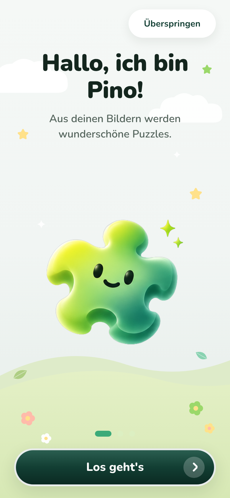 | 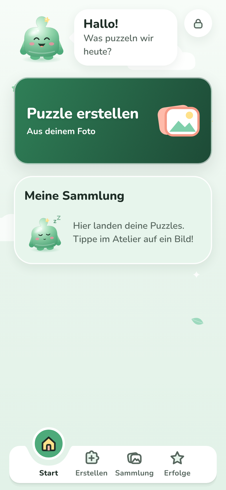 | 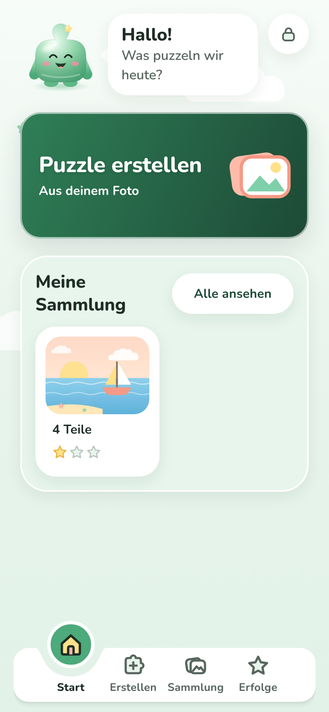 | 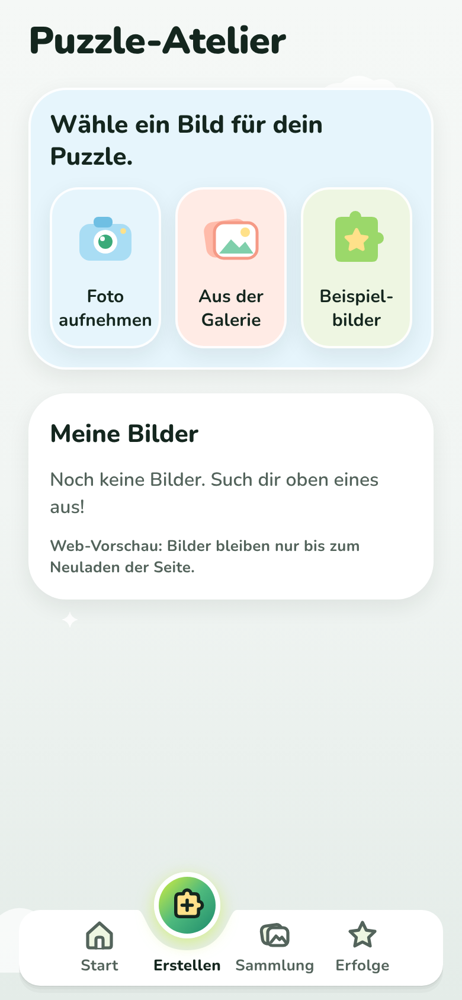 |

| Wer puzzelt?                                                | Neues Puzzle                                            | Geschafft!                                               | Erfolge                                                    |
| ----------------------------------------------------------- | ------------------------------------------------------- | -------------------------------------------------------- | ---------------------------------------------------------- |
| 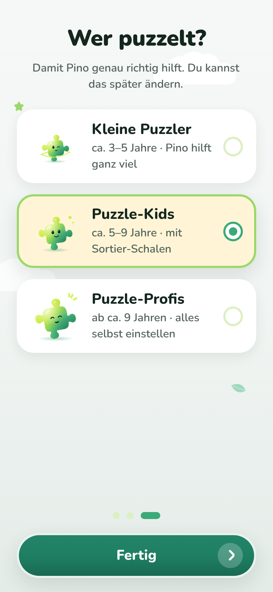 | 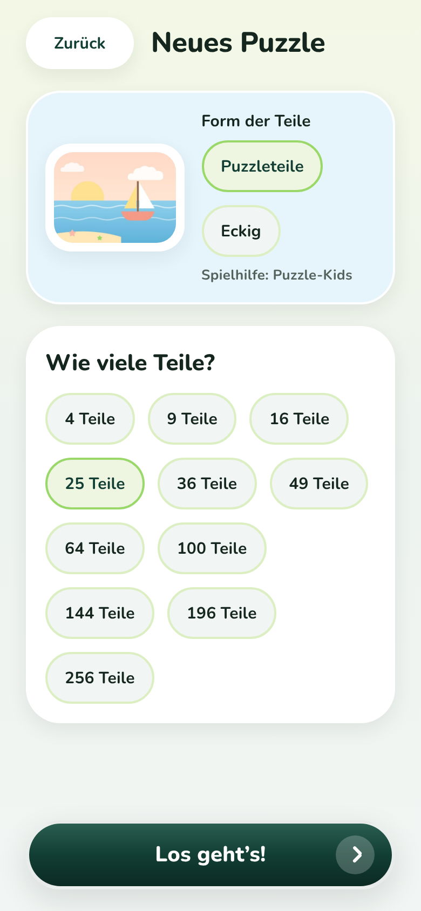 | 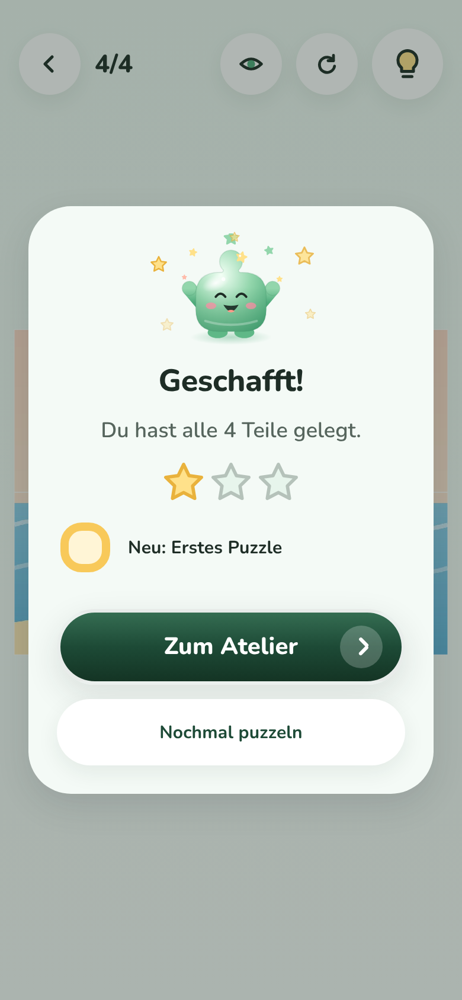 | 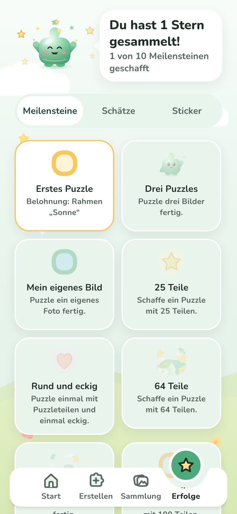 |

**Eltern-Schranke mit dem Lupen-Pino (Original):**

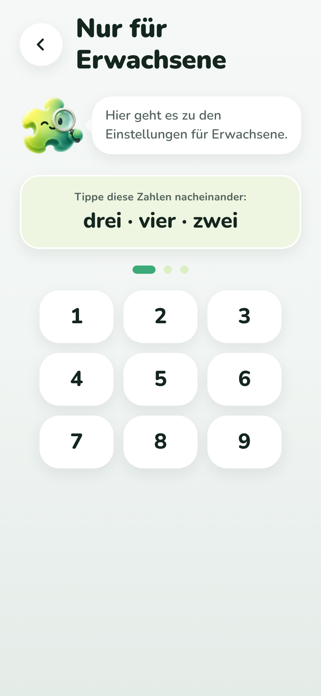

**Vektor-Nachzeichnung in allen 8 Stimmungen** (aus dem App-Code gerendert; `greeting` und `thinking` zeigen in der App inzwischen die Original-Bilder):

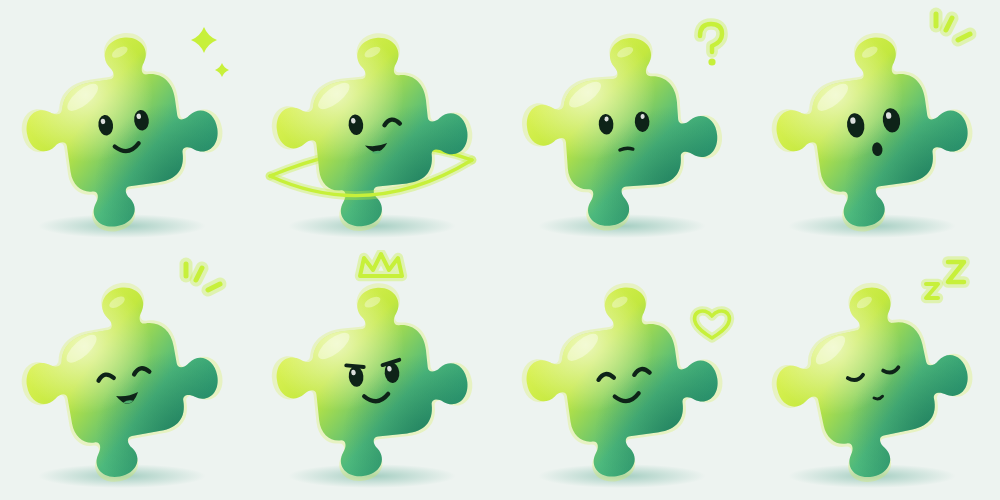

Die Konzept-Mockups unter `docs/design/concept/` sind mit demselben Code neu gerendert (weiterhin als Mockup gekennzeichnet).

## Prüfung

TypeScript, ESLint, Prettier ✅ · Tests ✅ (UI 62, App 67, Engine 91, image-processing 21, game-progression 10) · Web ohne Fehlermeldungen ✅ · **Android-Emulator ✅** (Lauf 41989807706, kompletter Ablauf mit 23 Bildern, mit den Original-Bildern des PO) · **iOS-Simulator ✅** (Lauf 41989811641, kompletter Ablauf mit 23 Bildern).

| Android-Emulator: Willkommen, Profilwahl, Start, Eltern-Schranke (Maestro-Bilder 01, 03, 04, 16) |
| ------------------------------------------------------------------------------------------------ |
| 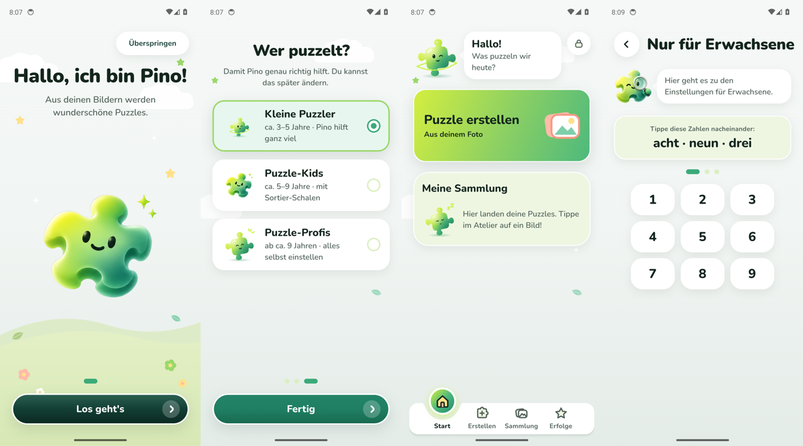                                    |

| iOS-Simulator: Willkommen, Profilwahl, Start, Eltern-Schranke (Maestro-Bilder 01, 03, 04, 16) |
| --------------------------------------------------------------------------------------------- |
| 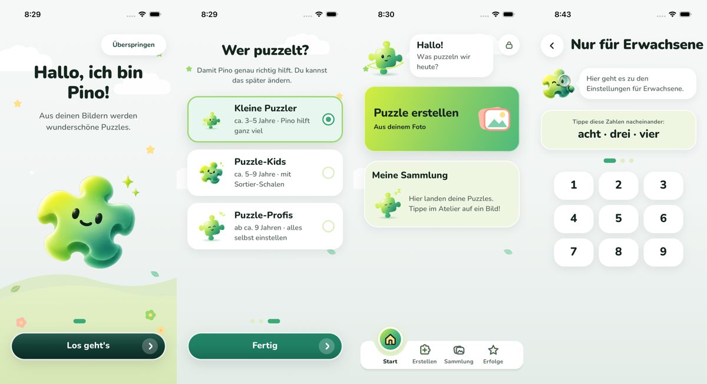                                     |

## Bewusst noch offen

- Milchglas-Effekt (Unschärfe hinter Karten) wie in der Referenz bräuchte eine neue Abhängigkeit (`expo-blur`) – erst auf Wunsch; Karten sind weiß mit weichem grünem Schatten.
- Feinschliff einzelner Screens nach deinem Eindruck.
