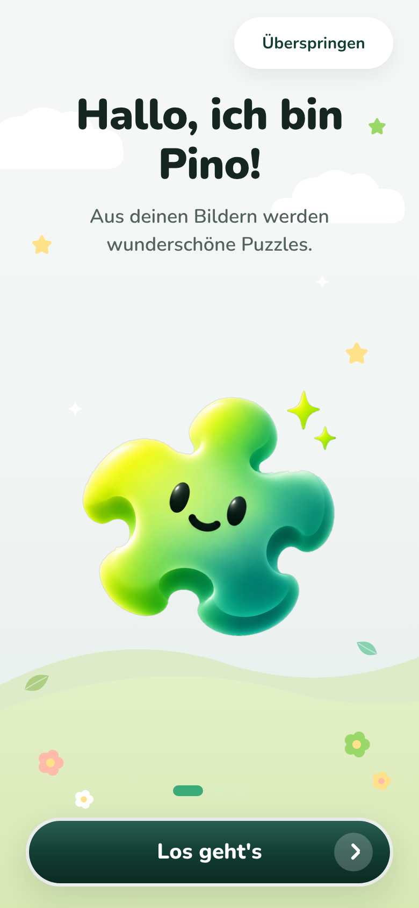
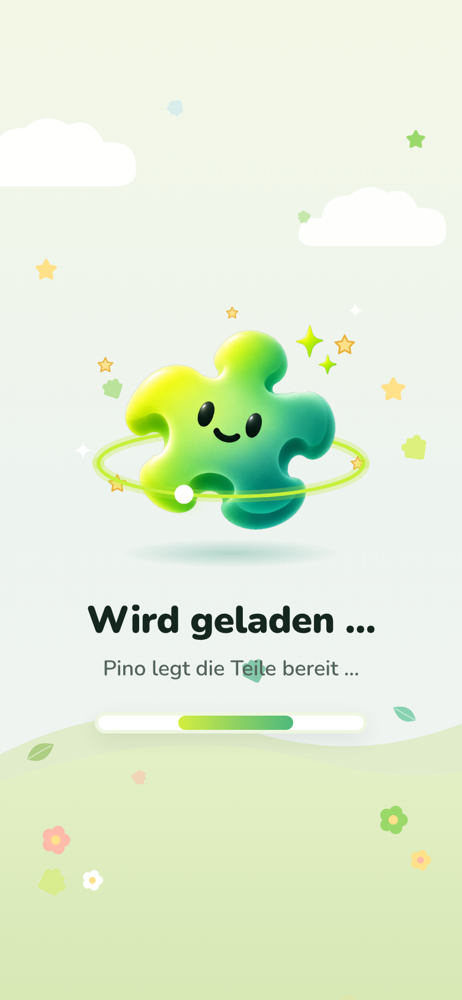
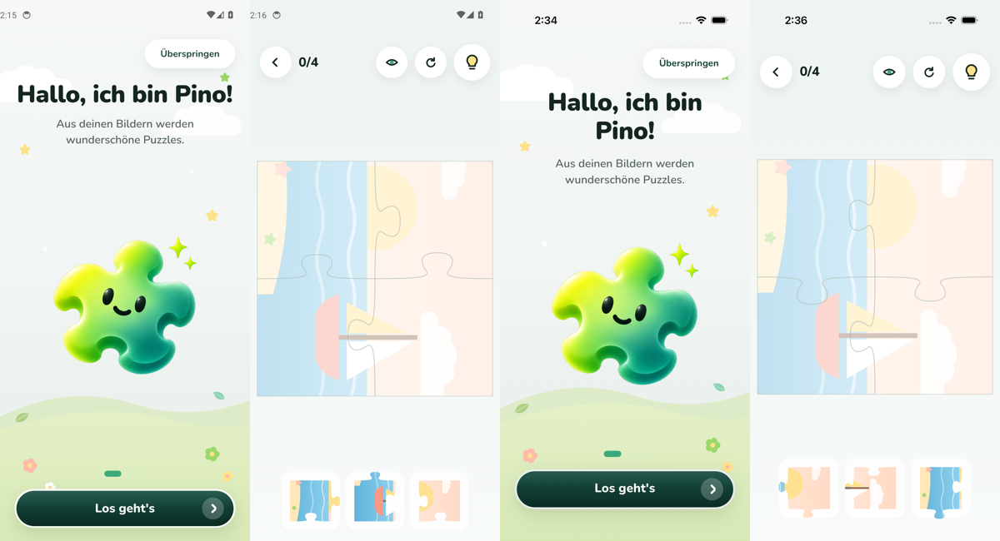

# Änderung 03 – Neues Hauptlogo und Ladescreen im Spiel-Stil

**Datum:** 2026-11-05 · **Anlass:** Wunsch des PO („neues Hauptmaskottchen-Logo austauschen“, Beispiel für einen Ladescreen „mit etwas Animiertem im Hintergrund für Dynamik und Game-Style“) · **Status:** umgesetzt, wartet auf Review

> Bilder stammen aus der **laufenden App** (Web via Chromium; Android-/iOS-Läufe siehe unten).

## 1. Neues Hauptlogo

- Das neue Bild ersetzt den Begrüßungs-Pino (`greeting`) überall: Willkommen, Profilwahl, Ladescreen, **App-Icon** und **Startbild**.
- **Hinweis zur Datei:** Das gelieferte Bild hatte **keinen echten transparenten Hintergrund** – das Karomuster war fest ins Bild eingebrannt (RGB ohne Transparenz). Der Hintergrund wurde deshalb freigestellt: entfernt wird nur, was vom Rand aus farblos (weiß/grau) ist; Glanzpunkte in den Augen bleiben. Kante um 1–2 px nach innen gezogen, damit auf dunklem Grund kein heller Saum bleibt. App-Fassung 1024 × 1024 px.
- Das Original liegt unverändert in `docs/design/mascot-art/2026-11-05-pino-greeting-main-original.webp`.

## 2. Ladescreen

Neue, gemeinsame Komponente `<LoadingScreen>` (in `packages/ui`) – ersetzt die bisherige kleine Lade-Anzeige an allen drei Stellen:

| Wann                              | Text                                                                                   |
| --------------------------------- | -------------------------------------------------------------------------------------- |
| Puzzle wird aufgerufen            | „Pino legt die Teile bereit …“                                                         |
| Spieltisch bereitet die Teile vor | „Pino legt die Teile bereit …“ (deckt den Tisch komplett ab, bis alles gezeichnet ist) |
| Bild wird gespeichert             | „Pino bereitet dein Bild vor …“                                                        |

**Gestaltung nach dem Beispiel des PO** ([Vorlage](../../design/reference/2026-11-05-po-loading-screen-reference.png), keine App-Aufnahme): Wiese mit Wolken im Hintergrund · Pino (Hauptlogo) wippt sanft · **leuchtender Neon-Ring**, der oben hinter und unten vor Pino verläuft, mit einem **kreisenden Lichtpunkt** · funkelnde Sterne · großer Titel „Wird geladen …“ + Pino-Satz · Lichtbalken im Pino-Verlauf.

**Bewegung im Hintergrund (Game-Style):** acht kleine Puzzleteile in den App-Farben **schweben langsam nach oben**, drehen sich und wiegen leicht hin und her; zart, damit der Text lesbar bleibt.

**Bewusst ohne Prozentzahl:** Das Beispiel zeigt „72 %“. Die App kennt an keiner der drei Stellen einen echten Fortschritt – eine Zahl wäre erfunden. Stattdessen läuft ein leuchtendes Stück durch den Balken („es passiert gerade etwas“). Sobald es echten Fortschritt gibt (z. B. beim Laden vieler Bilder), kann die Zahl ergänzt werden.

**Barrierefreiheit:** Für Screenreader als „beschäftigt“ markiert und mit Titel + Pino-Satz angesagt; mit „Bewegung reduzieren“ steht alles still (Ring, Punkt, Teile, Balken, Wippen).

## 3. Bilder

| Willkommen mit neuem Logo                                | Ladescreen (Bild speichern)                              | Ladescreen (Spiel vorbereiten)                                | Animation (Aufnahme, etwas ruckelig wegen verlangsamter Aufnahme)  |
| -------------------------------------------------------- | -------------------------------------------------------- | ------------------------------------------------------------- | ------------------------------------------------------------------ |
|  |  |  |  |

## 4. Prüfung

TypeScript, ESLint, Prettier ✅ · Tests ✅ (neu: Ladescreen sagt Titel + Text an, ist „beschäftigt“, zeigt keine erfundene Prozentzahl) · Metro-Bundle Android + iOS ✅ · Web ohne Fehlermeldungen ✅ · **Android-Emulator ✅** (Lauf 42039782187) und **iOS-Simulator ✅** (Lauf 42039786985), jeweils kompletter Ablauf mit 23 Bildern. Der Ladescreen ist dort nur kurz sichtbar; der Test wartet, bis „Pino legt die Teile bereit …“ verschwunden ist, und prüft danach den Spieltisch.

| Android: Willkommen | Android: Spieltisch nach dem Laden | iOS: Willkommen | iOS: Spieltisch nach dem Laden |
| ------------------- | ---------------------------------- | --------------- | ------------------------------ |

