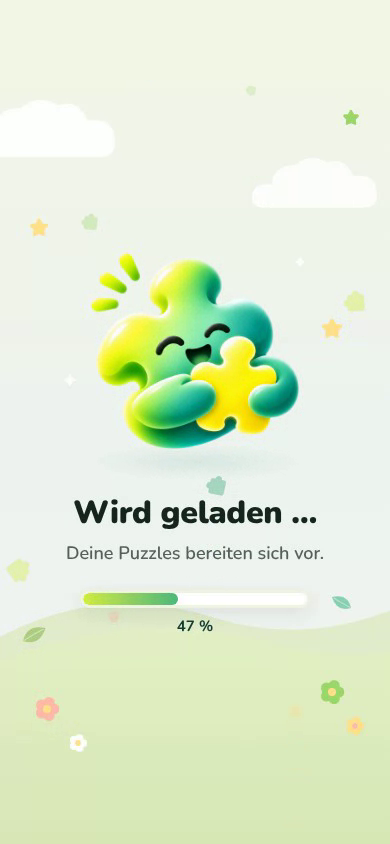
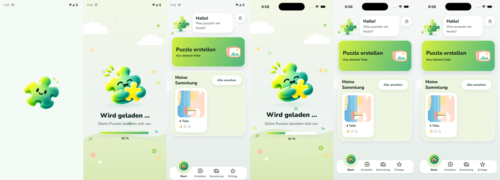

# Änderung 03 – Neues Hauptlogo und Start-Ladescreen (Preloader) im Spiel-Stil

**Datum:** 2026-11-05 · **Anlass:** Wunsch des PO („neues Hauptmaskottchen-Logo austauschen“, Beispiel für einen Ladescreen „mit etwas Animiertem im Hintergrund für Dynamik und Game-Style“) · **Status:** umgesetzt, **korrigiert nach PO-Feedback** (Ladescreen nur beim App-Start, mind. 4–5 s) – wartet auf Review

> Bilder stammen aus der **laufenden App** (Web via Chromium; Android-/iOS-Läufe siehe unten).

## 1. Neues Hauptlogo

- Das neue Bild ersetzt den Begrüßungs-Pino (`greeting`) überall: Willkommen, Profilwahl, Ladescreen, **App-Icon** und **Startbild**.
- **Hinweis zur Datei:** Das gelieferte Bild hatte **keinen echten transparenten Hintergrund** – das Karomuster war fest ins Bild eingebrannt (RGB ohne Transparenz). Der Hintergrund wurde deshalb freigestellt: entfernt wird nur, was vom Rand aus farblos (weiß/grau) ist; Glanzpunkte in den Augen bleiben. Kante um 1–2 px nach innen gezogen, damit auf dunklem Grund kein heller Saum bleibt. App-Fassung 1024 × 1024 px.
- Das Original liegt unverändert in `docs/design/mascot-art/2026-11-05-pino-greeting-main-original.webp`.

## 2. Start-Ladescreen (Preloader)

> PO: „Der Ladebildschirm war als Ladebildschirm beim Starten der App gedacht … als Preloader, um alles im Hintergrund vorzuladen, mindestens 4–5 Sekunden oder so lange wie nötig … flüssig durchlaufen und dann weiter.“

Erste Fassung (zuerst falsch verstanden): Der Ladescreen erschien beim Öffnen eines Puzzles und beim Speichern eines Bilds. **Korrigiert:** Dort ist wieder die ruhige kleine Anzeige; der Ladescreen ist jetzt der **Preloader beim App-Start** – Ablauf, Zeitlogik und Fehlerverhalten: [startup.md](../../product/startup.md).

- Lädt im Hintergrund vor: Einstellungen, Bilder, Puzzles, Sterne/Erfolge, Pino-Bilder, Grafik-Engine des Spieltischs.
- Bleibt **mindestens 4,5 s**, länger wenn nötig; danach blendet er **weich** über den ersten Screen aus.
- **Gestaltung nach dem Beispiel des PO** ([Vorlage](../../design/reference/2026-11-05-po-loading-screen-reference.png), keine App-Aufnahme): Wiese mit Wolken · schwebende Puzzleteile im Hintergrund · „Wird geladen … / Deine Puzzles bereiten sich vor.“
- **Pino (PO-Wunsch, 2026-11-05):** eigene Figur des PO für den Startscreen – Pino umarmt ein Puzzleteil (transparentes PNG vom PO, als Stimmung „Begeistert“ hinterlegt). **Kein Ring, kein Lichtpunkt, keine Funken um ihn** – er **schwebt nur sanft** auf und ab (10 dp, 1,8 s je Richtung), sein Schatten am Boden ist ein breiter, zarter, weich auslaufender Schein (höchstens 14 % Deckkraft, etwa so breit wie Pino) und wird beim Aufsteigen etwas schmaler und blasser.
- **Kein grauer Rand (PO-Feedback):** Beim Verkleinern der Bilder auf 1024 px waren die unsichtbaren schwarzen Pixel in die halbtransparente Kante gerechnet worden (Kante im Mittel Helligkeit 132 statt 193 im Original). Jetzt wird mit vormultiplizierter Transparenz verkleinert – Kante wie im Original. Beim Hauptlogo (Datei mit eingebranntem Karomuster) werden die Kantenpixel zusätzlich mit der Farbe der Figur daneben eingefärbt, damit kein Grau übrig bleibt.
- **Prozentzahl wie im Beispiel** – ehrlich: nie mehr als wirklich geladen ist; sie füllt sich gleichmäßig über die Mindestdauer, der Balken gleitet weich.
- „Bewegung reduzieren“: alles steht still; Screenreader hören „beschäftigt“ und den Fortschritt.

## 3. Bilder

| App-Start (Aufnahme aus der laufenden App: Laden → Begrüßung) | Startscreen                                               | Willkommen mit neuem Logo                                |
| ------------------------------------------------------------- | --------------------------------------------------------- | -------------------------------------------------------- |
|      |  |  |

## 4. Prüfung

TypeScript, ESLint, Prettier ✅ · Tests ✅ (neu: Mindestdauer 4,5 s, erst danach erscheint der erste Screen; Prozentzahl nie höher als wirklich geladen; ohne echten Fortschritt keine Zahl; Ladescreen „beschäftigt“) · Metro-Bundle Android + iOS ✅ · Web ohne Fehlermeldungen ✅ · **Endstand (Pino mit Puzzleteil, schwebend, ohne grauen Rand, weicher Schatten):** Android-Emulator ✅ (Lauf 42109674678) und iOS-Simulator ✅ (Lauf 42109679692), jeweils kompletter Ablauf mit 23 Bildern. Zusätzlich wird die App danach neu gestartet und alle 2 s ein direktes Bildschirmfoto gemacht (Maestro selbst kann den Startscreen nicht lesen, weil seine Endlos-Animationen die Testtechnik nie „zur Ruhe“ kommen lassen):

| Android: Startbild → Startscreen 98 % → Startseite · iOS: Startscreen 40 % → Startseite |
| --------------------------------------------------------------------------------------- |
|                            |

Frühere Fassungen: Android-Läufe 42039782187, 42060584225 und iOS-Läufe 42039786985, 42060589706 (ebenfalls grün).
