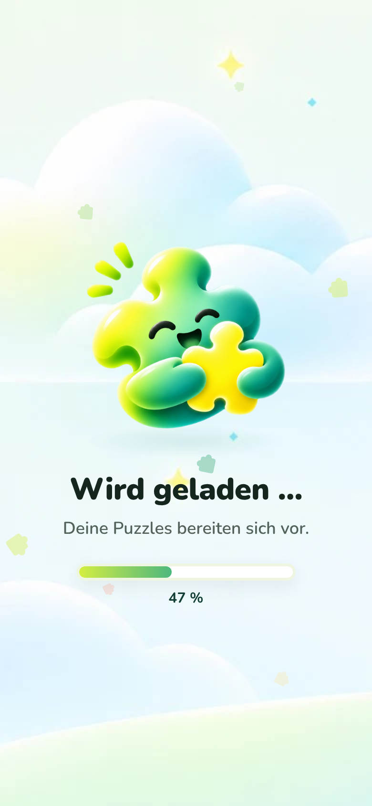
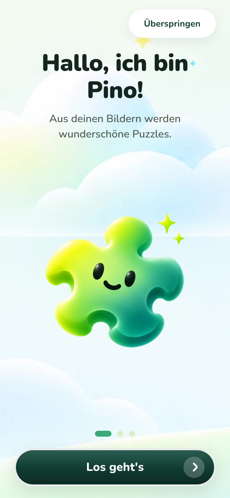
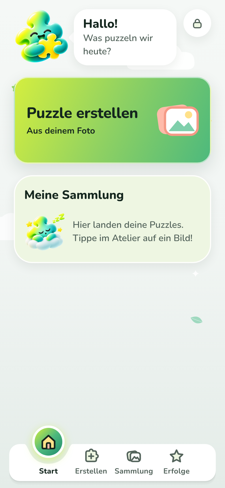
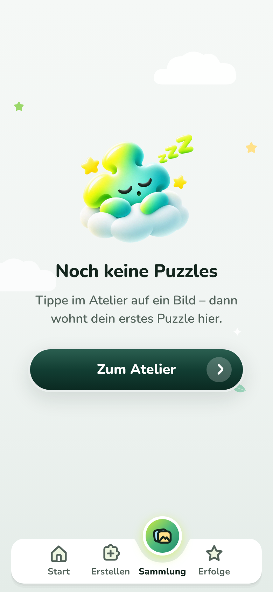
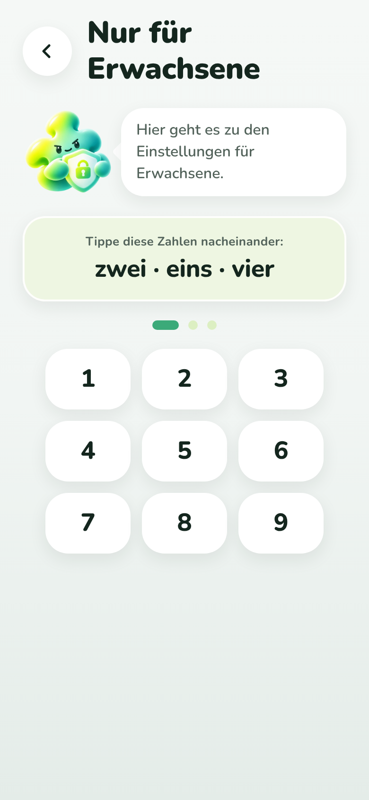

# Änderung 04 – Neue Pino-Bilder und erster gemalter Hintergrund

**Datum:** 2026-11-05 · **Anlass:** neue Bilder des PO („positioniere diese passend in der App, weitere folgen“) · **Status:** umgesetzt, wartet auf Review

> Bilder stammen aus der **laufenden App** (Web via Chromium; Android-/iOS-Läufe siehe unten). Originale unverändert in `docs/design/mascot-art/` und `docs/design/background-art/`.

## Zuordnung

| Bild des PO                          | Wird in der App zu                      | Wo es erscheint                                                              |
| ------------------------------------ | --------------------------------------- | ---------------------------------------------------------------------------- |
| Pino umarmt Puzzleteil (ohne „!“)    | Stimmung **Fröhlich** (`happy`)         | Startseite, Profil „Kleine Puzzler“, Pino-Tipp im Spiel, angefangenes Puzzle |
| Pino mit Schild und Schloss          | **neue Stimmung „Beschützt“** (`guard`) | Eltern-Schranke „Nur für Erwachsene“                                         |
| Pino schläft auf einer Wolke         | Stimmung **Schläft** (`sleeping`)       | leere Sammlung (Startseite und Tab „Sammlung“)                               |
| Pino umarmt Puzzleteil mit „!“       | –                                       | war schon als „Begeistert“ in der App (pixelgleich)                          |
| Himmel mit Wolken, Funkeln und Wiese | Hintergrund **`skyMeadow`**             | Startscreen und Begrüßung                                                    |

- Alle drei Figuren hatten echte Transparenz. Zuschnitt quadratisch, Verkleinerung mit vormultiplizierter Transparenz – **kein grauer Rand** (Kantenhelligkeit wie im Original gemessen).
- **Hintergrund:** Das Bild ist im Querformat (1785 × 881). Auf dem Handy (Hochformat) wird es „cover“ eingesetzt: man sieht die Mitte mit den Wolkenrändern und die Wiese unten; die Wolken links/rechts werden abgeschnitten. Für das Handy wäre eine Hochformat-Fassung **1290 × 2796 px** ideal (Tablet: 2048 × 2732 px) – dann bleiben auch die Wolken sichtbar.
- Bild-Hintergründe sind jetzt zentral möglich: ein Eintrag in `packages/ui/src/illustrations/backgroundArt.ts`, die Screens wählen nur das Preset.

## Bilder

| Startscreen                                                      | Begrüßung                                                   | Startseite (Fröhlich)                                    | Leere Sammlung (Schläft)                                             | Eltern-Schranke (Beschützt)                                     |
| ---------------------------------------------------------------- | ----------------------------------------------------------- | -------------------------------------------------------- | -------------------------------------------------------------------- | --------------------------------------------------------------- |
|  |  |  |  |  |

## Noch offen (Bilder folgen vom PO)

Stimmungen **Geschafft!** (Feier nach dem Puzzle, Erfolge), **Ermutigung** (Erfolge ohne Sterne) und **Überrascht** (derzeit nicht verwendet) – bis dahin Vektor-Nachzeichnung.

## Prüfung

TypeScript, ESLint, Prettier ✅ · Tests ✅ (UI 63 – prüft, dass jede eingetragene Bilddatei existiert und eingebunden ist) · Web ohne Fehlermeldungen ✅ · Android-Emulator / iOS-Simulator: Läufe gestartet, Ergebnis wird hier nachgetragen.
