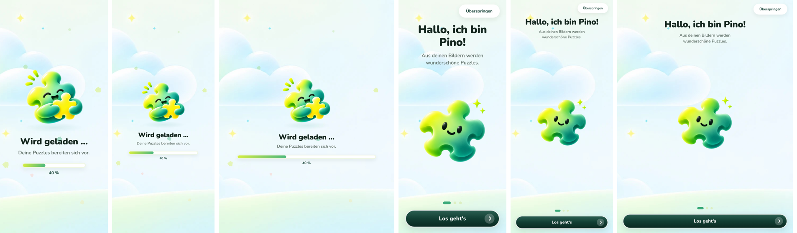
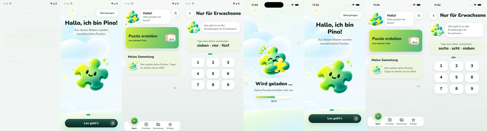

# Änderung 04 – Neue Pino-Bilder und erster gemalter Hintergrund

**Datum:** 2026-11-05 · **Anlass:** neue Bilder des PO („positioniere diese passend in der App, weitere folgen“) · **Status:** umgesetzt, wartet auf Review

> Bilder stammen aus der **laufenden App** (Web via Chromium; Android-/iOS-Läufe siehe unten). Originale unverändert in `docs/design/mascot-art/` und `docs/design/background-art/`.

## Zuordnung

| Bild des PO                          | Wird in der App zu                      | Wo es erscheint                                                              |
| ------------------------------------ | --------------------------------------- | ---------------------------------------------------------------------------- |
| Pino umarmt Puzzleteil (ohne „!“)    | Stimmung **Fröhlich** (`happy`)         | Startseite, Profil „Kleine Puzzler“, Pino-Tipp im Spiel, angefangenes Puzzle |
| Pino mit Schild und Schloss          | **neue Stimmung „Beschützt“** (`guard`) | Eltern-Schranke „Nur für Erwachsene“                                         |
| Pino schläft auf einer Wolke         | Stimmung **Schläft** (`sleeping`)       | leere Sammlung (Startseite und Tab „Sammlung“)                               |
| Pino umarmt Puzzleteil mit „!“       | –                                       | war schon als „Begeistert“ in der App (pixelgleich)                          |
| Himmel mit Wolken, Funkeln und Wiese | Hintergrund **`skyMeadow`**             | Startscreen und Begrüßung                                                    |

- Alle drei Figuren hatten echte Transparenz. Zuschnitt quadratisch, Verkleinerung mit vormultiplizierter Transparenz – **kein grauer Rand** (Kantenhelligkeit wie im Original gemessen).
- **Hintergrund – nachgebessert nach PO-Feedback** („muss besser positioniert werden, responsive funktionieren und sich nicht doppeln“, „unten abgeschnitten“): Im Browser bekam das Bild seine Originalgröße (1785 × 881 px) statt den Bildschirm zu füllen – auf hohen Fenstern endete es nach 881 px. Jetzt misst die App die Fläche und berechnet Größe und Lage selbst (`coverLayout`, getestet für Handy, hohes Fenster, Tablet, Querformat): **immer vollflächig, nie verzerrt, genau ein Bild, unten verankert** (die Wiese bleibt immer am unteren Rand) und **leicht links der Mitte**, damit die große Wolke und die Funkelsterne im Bild sind (die Mitte des Gemäldes ist leerer Himmel).

  

  _Startscreen und Begrüßung, jeweils bei 390 × 844 (Handy), 498 × 1138 (hohes Fenster) und 768 × 1024 (Tablet)._

- Das Bild ist im Querformat (1785 × 881); im Hochformat wird seitlich zugeschnitten. Für das Handy wäre eine Hochformat-Fassung **1290 × 2796 px** ideal (Tablet: 2048 × 2732 px) – dann bleiben auch die Wolken sichtbar.
- Bild-Hintergründe sind jetzt zentral möglich: ein Eintrag in `packages/ui/src/illustrations/backgroundArt.ts`, die Screens wählen nur das Preset.

## Bilder

| Startscreen                                                      | Begrüßung                                                   | Startseite (Fröhlich)                                    | Leere Sammlung (Schläft)                                             | Eltern-Schranke (Beschützt)                                     |
| ---------------------------------------------------------------- | ----------------------------------------------------------- | -------------------------------------------------------- | -------------------------------------------------------------------- | --------------------------------------------------------------- |
|  |  |  |  |  |

## Noch offen (Bilder folgen vom PO)

Stimmungen **Geschafft!** (Feier nach dem Puzzle, Erfolge), **Ermutigung** (Erfolge ohne Sterne) und **Überrascht** (derzeit nicht verwendet) – bis dahin Vektor-Nachzeichnung.

## Prüfung

TypeScript, ESLint, Prettier ✅ · Tests ✅ (UI 64 – u. a. jede eingetragene Bilddatei existiert und ist eingebunden; Hintergrund deckt jede Bildschirmgröße unverzerrt ab und bleibt unten verankert) · Web ohne Fehlermeldungen ✅ · Android-Emulator ✅ (Lauf 42125162761) · iOS-Simulator ✅ (Lauf 42125166570) – jeweils kompletter Ablauf plus Fotos des Startbildschirms.

