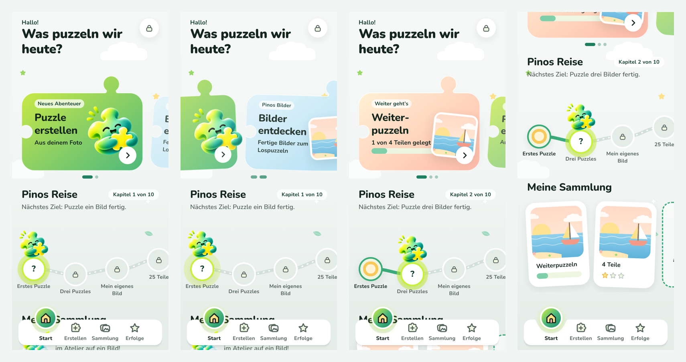

# Änderung 05 – Startseite als Geschichte: „Pinos Reise“

**Datum:** 2026-11-06 · **Anlass:** PO-Wunsch nach einer deutlich moderneren, weniger „eckigen“ Startseite im Behance-/Pinterest-Stil mit Wisch-Interaktion und Storytelling, das sich durch das Spielen zieht · **Status:** umgesetzt, wartet auf Review

> Bilder stammen aus der **laufenden App** (Web via Chromium; Android-/iOS-Läufe siehe unten). Farben, Pino und Schrift sind unverändert – neu sind Aufbau, Formen und Bewegung.

## Idee

Die Beispiele des PO (Spiele-Hub, Lern-Apps, „Numo“-Lernpfad) haben drei Dinge gemeinsam: **große, wischbare Karten mit Figuren, die aus der Karte ragen**, ein **Pfad, auf dem die Figur vorankommt**, und **Regale statt Raster**. Übernommen wurde die Logik, nicht das Aussehen – angepasst an eine Puzzle-App:

1. **Wischbare Geschichten-Karten in Puzzleteil-Form** – jede Karte hat oben eine Nase und links eine Kerbe, wie ein echtes Puzzleteil. Die Karte im Fokus ist groß, die nächste lugt herein; beim Wischen kippen die Nachbarkarten leicht und werden kleiner, Pino bzw. das Bild gleitet etwas langsamer mit (Tiefenwirkung). Punkte unten zeigen die Position.
   - **Weiter geht’s – Weiterpuzzeln** (nur wenn ein Puzzle angefangen ist): Bild, „1 von 4 Teilen gelegt“, Fortschrittsbalken.
   - **Neues Abenteuer – Puzzle erstellen**: Pino springt aus der Karte.
   - **Pinos Bilder – Bilder entdecken**: führt direkt zu den Beispielbildern (neu: ein Tipp weniger).
2. **Pinos Reise** – das Storytelling: Die 10 Meilensteine sind Stationen auf einem geschwungenen Pfad. Pino steht an der nächsten Station (sanftes Leuchten), darüber „Kapitel 2 von 10“ und das nächste Ziel in Kinderworten („Puzzle drei Bilder fertig.“). Der gegangene Weg ist grün, erreichte Stationen zeigen ihre Belohnung, spätere ein Schloss. Jedes fertige Puzzle bringt Pino weiter – **nie zurück**, ohne Zeitdruck. Zur Seite wischbar, startet immer bei Pino; Tipp auf eine Station öffnet „Erfolge“.
3. **Meine Sammlung als Regal** – die letzten Puzzles stehen leicht schräg wie angepinnte Fotos nebeneinander (wischbar), am Ende die Kachel „Alle ansehen“.

Die Begrüßung ist jetzt eine große Überschrift („Hallo! · Was puzzeln wir heute?“) mit dem Schloss für den Elternbereich – Pino selbst lebt in den Karten und auf dem Pfad.

## Bilder

_Von links: erster Start · Karten gewischt (die vorige Karte kippt weg) · nach dem ersten Puzzle mit angefangenem zweiten (Weiterpuzzeln-Karte vorne, Pino in Kapitel 2) · weiter unten: Pfad und Sammlungs-Regal._

## Umsetzung

- Neue Bausteine in `packages/ui`: `StoryCarousel`, `StoryCard` + `StoryPicture`, `JourneyTrail`, `TiltShelf`; Formen (Puzzleteil-Karte, Pfad) in `components/storyShapes.ts` mit Tests. Neue Verläufe `storySky`, `storySun` in den Tokens (dunkle Schrift auf allen Stufen).
- `packages/game-progression`: `nextMilestoneIndex` (nächste Station, getestet).
- Startseite: `features/home/HomeScreen.tsx`, `HomeStory.tsx`, `HomeJourney.tsx`. `FeatureCard` wird nicht mehr gebraucht und ist entfernt.
- **Reduced Motion:** Karten gleiten nur (kein Kippen, keine Parallaxe), Pino schwebt nicht, die Station leuchtet nicht. Das Leuchten läuft auch sonst nur ein paar Mal und ruht dann.
- Bedienung: alle Karten und Stationen sind große Tippflächen (Karten 236 dp hoch, Stationen 60 dp) mit Vorlese-Text („Drei Puzzles – nächstes Ziel“).
- Maestro: neues Bildschirmfoto `15b-home-journey` (Startseite nach dem ersten Puzzle).

## Prüfung

TypeScript, ESLint, Prettier ✅ · Tests ✅ (UI 68, Fortschritt 12, App 72 – u. a. Karten führen zu Atelier/Beispielbildern/angefangenem Puzzle, Kapitel und Stationen, Puzzleteil-Form bleibt in ihrer Fläche) · Android-/iOS-Bundle ✅ · Web ohne Fehlermeldungen ✅ · Android-Emulator / iOS-Simulator: Läufe gestartet, Ergebnis wird hier nachgetragen.

## Ideen für weitere Seiten (noch nicht umgesetzt)

- **Atelier:** Bildquellen ebenfalls als Puzzleteil-Karten; „Meine Bilder“ als Regal.
- **Erfolge:** derselbe Pfad groß, mit Belohnungen zum Antippen statt Kachelraster.
- **Puzzle geschafft:** Pino läuft sichtbar eine Station weiter, wenn ein Meilenstein erreicht ist.
