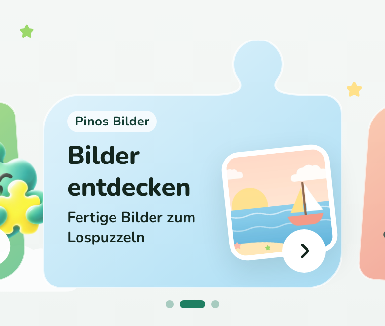
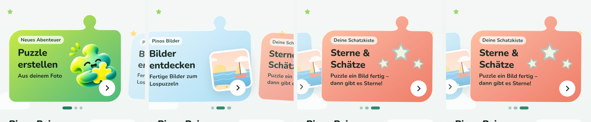
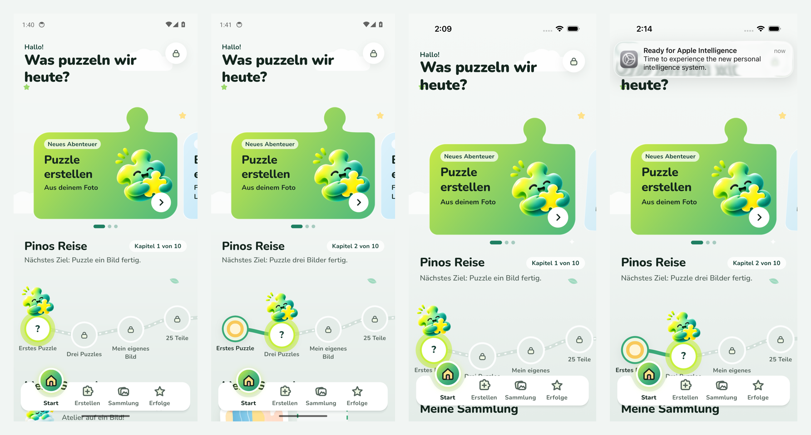

# Änderung 05 – Startseite als Geschichte: „Pinos Reise“

**Datum:** 2026-11-06 · **Anlass:** PO-Wunsch nach einer deutlich moderneren, weniger „eckigen“ Startseite im Behance-/Pinterest-Stil mit Wisch-Interaktion und Storytelling, das sich durch das Spielen zieht · **Status:** umgesetzt, wartet auf Review

> Bilder stammen aus der **laufenden App** (Web via Chromium; Android-/iOS-Läufe siehe unten). Farben, Pino und Schrift sind unverändert – neu sind Aufbau, Formen und Bewegung.

## Idee

Die Beispiele des PO (Spiele-Hub, Lern-Apps, „Numo“-Lernpfad) haben drei Dinge gemeinsam: **große, wischbare Karten mit Figuren, die aus der Karte ragen**, ein **Pfad, auf dem die Figur vorankommt**, und **Regale statt Raster**. Übernommen wurde die Logik, nicht das Aussehen – angepasst an eine Puzzle-App:

1. **Wischbare Geschichten-Karten in Puzzleteil-Form** – jede Karte hat oben eine runde Nase und asymmetrische Ecken, wie ein weich gezeichnetes Puzzleteil. Die Karte im Fokus ist groß, die nächste lugt herein; beim Wischen kippen die Nachbarkarten leicht und werden kleiner, Pino bzw. das Bild gleitet etwas langsamer mit (Tiefenwirkung). Punkte unten zeigen die Position.
   - **Weiter geht’s – Weiterpuzzeln** (nur wenn ein Puzzle angefangen ist): Bild, „1 von 4 Teilen gelegt“, Fortschrittsbalken.
   - **Neues Abenteuer – Puzzle erstellen**: Pino springt aus der Karte.
   - **Pinos Bilder – Bilder entdecken**: führt direkt zu den Beispielbildern (neu: ein Tipp weniger).
   - **Deine Schatzkiste – Sterne & Schätze** (Rot-Orange, nachgereicht): Sterne und Meilensteine, führt zu „Erfolge“.
2. **Pinos Reise** – das Storytelling: Die 10 Meilensteine sind Stationen auf einem geschwungenen Pfad. Pino steht an der nächsten Station (sanftes Leuchten), darüber „Kapitel 2 von 10“ und das nächste Ziel in Kinderworten („Puzzle drei Bilder fertig.“). Der gegangene Weg ist grün, erreichte Stationen zeigen ihre Belohnung, spätere ein Schloss. Jedes fertige Puzzle bringt Pino weiter – **nie zurück**, ohne Zeitdruck. Zur Seite wischbar, startet immer bei Pino; Tipp auf eine Station öffnet „Erfolge“.
3. **Meine Sammlung als Regal** – die letzten Puzzles stehen leicht schräg wie angepinnte Fotos nebeneinander (wischbar), am Ende die Kachel „Alle ansehen“.

Die Begrüßung ist jetzt eine große Überschrift („Hallo! · Was puzzeln wir heute?“) mit dem Schloss für den Elternbereich – Pino selbst lebt in den Karten und auf dem Pfad.

## Bilder

_Von links: erster Start · Karten gewischt (die vorige Karte kippt weg) · nach dem ersten Puzzle mit angefangenem zweiten (Weiterpuzzeln-Karte vorne, Pino in Kapitel 2) · weiter unten: Pfad und Sammlungs-Regal._

## Nachbesserung nach PO-Feedback (Kachelform, vierte Kachel)

> „Das links gezeigte Puzzle-Loch entfernen … das oben rechts besser darstellen, schönere Rundung … die Kachel evtl. asymmetrisch … füge eine weitere Kachel ein, z. B. in Rot/Orange.“

- **Kerbe links entfernt** – die linke Kante läuft jetzt durchgehend.
- **Nase oben rechts neu geformt:** runder Kopf auf einem sanft ausschwingenden Hals; die Kurven gehen tangential in den Kopf über und laufen flach in die Kante aus – keine Ecken mehr wo Nase und Karte sich treffen.
- **Asymmetrische Form:** große, weiche Rundungen oben links und unten rechts, engere Ecken oben rechts (bei der Nase) und unten links – wirkt organischer und weniger wie eine Box.
- **Vierte Kachel „Deine Schatzkiste – Sterne & Schätze“** in Rot-Orange: drei Sterne auf einem kleinen Podest, die mit den gesammelten Sternen aufleuchten; Untertitel mit echten Zahlen („5 Sterne · 2 von 10 Meilensteinen“), vor dem ersten Puzzle „Puzzle ein Bild fertig – dann gibt es Sterne!“. Führt zu „Erfolge“. Neuer Verlauf `storyEmber` (dunkle Schrift auf allen Stufen, getestet).
- Die Wisch-Animationen sind unverändert.
- **Einrasten (zweite Nachbesserung):** Nach dem Wischen bleibt jede Karte **genau mittig** stehen, links und rechts schauen die Nachbarn gleich weit herein. Vorher konnte die letzte Karte nicht ganz einrasten (der Rand rechts war kleiner als links) und im Browser rastete gar nichts. Jetzt: feste Rastpunkte für jede Karte (Android/iOS) und CSS-Scroll-Snapping im Web; pro Wisch höchstens eine Karte weiter.
- **Nase größer und weicher (zweite Nachbesserung):** Kopf ca. 40 % größer, breiterer, länger ausschwingender Hals – passt besser zur Kartengröße.

  

_Die vier Karten nacheinander gewischt (Web, Chromium)._

## Umsetzung

- Neue Bausteine in `packages/ui`: `StoryCarousel`, `StoryCard` + `StoryPicture` + `StoryStars`, `JourneyTrail`, `TiltShelf`; Formen (asymmetrische Puzzleteil-Karte mit runder Nase, Pfad) in `components/storyShapes.ts` mit Tests. Neue Verläufe `storySky`, `storySun`, `storyEmber` in den Tokens (dunkle Schrift auf allen Stufen).
- `packages/game-progression`: `nextMilestoneIndex` (nächste Station, getestet).
- Startseite: `features/home/HomeScreen.tsx`, `HomeStory.tsx`, `HomeJourney.tsx`. `FeatureCard` wird nicht mehr gebraucht und ist entfernt.
- **Reduced Motion:** Karten gleiten nur (kein Kippen, keine Parallaxe), Pino schwebt nicht, die Station leuchtet nicht. Das Leuchten läuft auch sonst nur ein paar Mal und ruht dann.
- Bedienung: alle Karten und Stationen sind große Tippflächen (Karten 236 dp hoch, Stationen 60 dp) mit Vorlese-Text („Drei Puzzles – nächstes Ziel“).
- Maestro: neues Bildschirmfoto `15b-home-journey` (Startseite nach dem ersten Puzzle).

## Prüfung

TypeScript, ESLint, Prettier ✅ · Tests ✅ (UI 70, Fortschritt 12, App 72 – u. a. Karten führen zu Atelier/Beispielbildern/Erfolgen/angefangenem Puzzle, Kapitel und Stationen, Puzzleteil-Form bleibt in ihrer Fläche) · Android-/iOS-Bundle ✅ · Web ohne Fehlermeldungen ✅ · Android-Emulator ✅ · iOS-Simulator ✅ – erste Fassung (Läufe 42214840599 / 42214844836) und Endstand mit eingerasteten Karten und größerer Nase (Läufe 42224584297 / 42224588398), jeweils kompletter Ablauf.

_Je Gerät: erster Start (Kapitel 1) und Startseite nach dem ersten Puzzle (Kapitel 2, erste Station mit Belohnung). Die Karte steht mittig, die Nachbarkarte schaut herein. Der Hinweis oben im letzten Bild ist eine Systemmeldung des iOS-Simulators, nicht Teil der App._

## Ideen für weitere Seiten (noch nicht umgesetzt)

- **Atelier:** Bildquellen ebenfalls als Puzzleteil-Karten; „Meine Bilder“ als Regal.
- **Erfolge:** derselbe Pfad groß, mit Belohnungen zum Antippen statt Kachelraster.
- **Puzzle geschafft:** Pino läuft sichtbar eine Station weiter, wenn ein Meilenstein erreicht ist.
