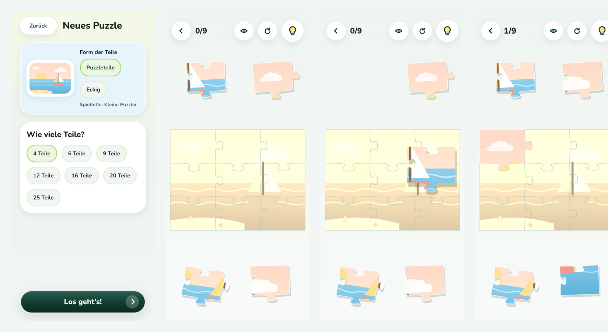
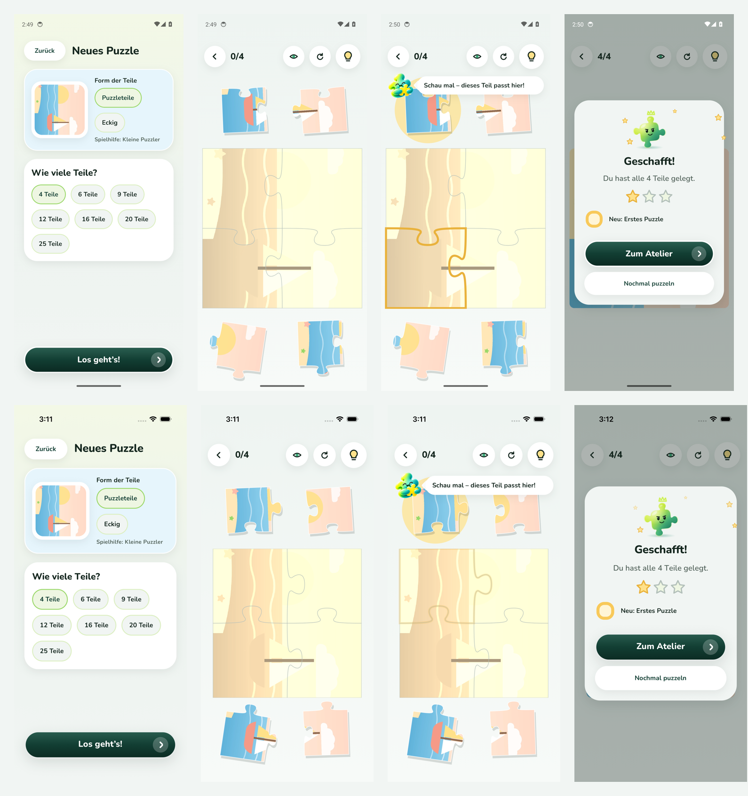

# Konzept 2 · Schritt K1 – Kleine Puzzles mit lebendigen Teilen

**Datum:** 2026-11-09 · **Grundlage:** [Konzept 2 – Pino für die Kleinsten](../../product/concept-v2-toddler.md) (vom PO freigegeben) und die Beispielvideos des PO · **Status:** umgesetzt, wartet auf Review

> Bilder aus der **laufenden App** (Web via Chromium). Android-/iOS-Läufe siehe unten.

## Was sich ändert

| Vorher                            | Jetzt                                                                                                                                                                |
| --------------------------------- | -------------------------------------------------------------------------------------------------------------------------------------------------------------------- |
| 4 bis 256 Teile                   | **4, 6, 9, 12, 16, 20, 25 Teile** (Standard: 4 für Kleinkinder, 9 / 16 für die anderen Profile – die Profile entfallen in Schritt K4)                                |
| blasse Vorlage                    | Das Bild liegt als **deutliches Sepia-Schattenbild** auf dem Brett, mit Umrissen jedes Teils – wie im Beispiel des PO                                                |
| Ablage-Leiste unter dem Brett     | Die losen Teile liegen **locker in zwei Stapeln oberhalb und unterhalb des Bretts**, leicht verdreht und mit weichem Schatten – wie auf einem echten Tisch           |
| Teil folgte dem Finger starr      | **Lebendiges Ziehen:** Das Teil richtet sich beim Anheben auf, wird mit kleinem Federn etwas größer, **neigt sich in Zugrichtung** und wirft einen tieferen Schatten |
| Einrasten: Gleiten + Sterne       | zusätzlich **weiches Eindrücken** (kurz kleiner, federt zurück) und **helles Aufblitzen** des Teils                                                                  |
| Falsch gelegt: Teil sprang zurück | Teil **schwebt sanft zurück** an seinen Platz im Stapel und dreht sich wieder in seine Lage                                                                          |
| Fertiges Puzzle mit feinen Fugen  | Beim letzten Teil **verschwinden die Fugen** – ein ganzes Bild                                                                                                       |

Mit „Bewegung reduzieren“ bewegen sich die Teile ohne Federn, Neigen und Aufblitzen.

## Bilder

_Von links: Teilezahl wählen (4–25) · Spieltisch mit Sepia-Schattenbild und Teile-Stapeln · ein Teil wird gezogen (angehoben, mit Schatten) · ein Teil ist eingerastet und blitzt auf._

## Bewusst noch nicht in K1

- Pinos Reise mit Welten und Stationen, Sticker-Album → **K2**
- Minispiele → **K3**
- Entfernen von Profilen, Schalen, Häppchen, Zoom → **K4** (bei bis zu 25 Teilen erscheinen sie kaum noch; Häppchen nur noch für Kleinkinder bei 25 Teilen)
- Töne und Haptik beim Anheben/Einrasten → **K5**

## Prüfung

TypeScript, ESLint, Prettier ✅ · Tests ✅ (Engine 91, UI 70, Fortschritt 12, App 72 – u. a. nur noch 4–25 Teile wählbar, Stapel-Plätze oben/unten, stabil zwischen Renderings, Treffer auf dem obersten Teil) · Android-/iOS-Bundle ✅ · Web ohne Fehlermeldungen ✅ · Android-Emulator ✅ (Lauf 42635277557) · iOS-Simulator ✅ (Lauf 42635283491) – jeweils kompletter Ablauf.

_Je Gerät: Teilezahl 4–25 · Spieltisch mit Sepia-Schattenbild und Teile-Stapeln oben und unten · Pinos Tipp (Teil im Stapel leuchtet, Zielplatz umrandet) · fertiges Puzzle._
