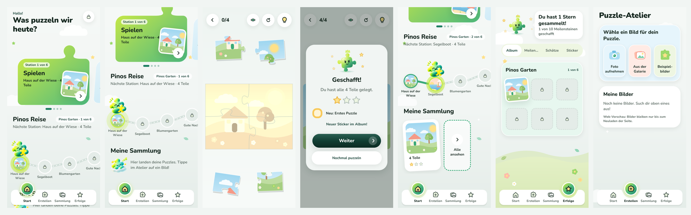
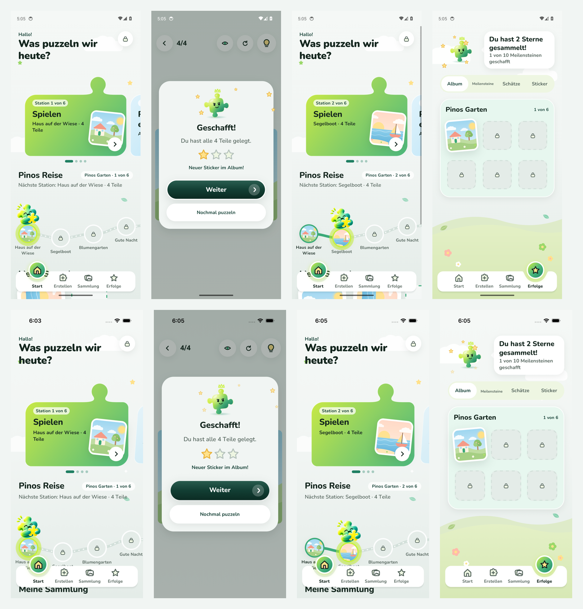

# Konzept 2 · Schritt K2 – Pinos Reise als Hauptweg

**Datum:** 2026-11-10 · **Grundlage:** [Konzept 2](../../product/concept-v2-toddler.md) §3 (vom PO freigegeben) · **Status:** umgesetzt, wartet auf Review

> Bilder aus der **laufenden App** (Web via Chromium). Android-/iOS-Läufe siehe unten.

## Die Abfolge

1. **Start:** Die erste Karte heißt **„Spielen“** – „Station 1 von 6 · Haus auf der Wiese · 4 Teile“ – mit dem Bild der Station.
2. Darunter **Pinos Reise**: die Stationen der Welt „Pinos Garten“ auf dem Pfad. Pino steht an der nächsten Station, sie zeigt schon ihr Bild; spätere Stationen warten mit Schloss.
3. **Spielen** öffnet das Puzzle der Station (kleines Puzzle mit Teile-Stapeln aus K1).
4. **Geschafft!** – Sterne, „Neuer Sticker im Album!“ und ein großer **„Weiter“**-Knopf.
5. **Zurück auf der Startseite:** Pino ist eine Station weiter, der gegangene Weg ist grün, die geschaffte Station zeigt ihr Bild. „Spielen“ zeigt jetzt Station 2.
6. **Album** (Tab „Erfolge“, jetzt als erster Bereich): das Bild jeder geschafften Station als leicht schräger Sticker, offene Plätze mit Schloss.

Geschaffte Stationen lassen sich auf dem Pfad antippen und **nochmal spielen**; spätere Stationen reagieren noch nicht.

## Eigene Bilder bleiben getrennt (PO-Vorgabe)

- Die Bilder der Reise erscheinen **nicht** unter „Meine Bilder“ im Atelier.
- Die Karte „Eigene Bilder – Puzzle erstellen“ bleibt im Karussell, ebenso „Weiterpuzzeln“ für ein angefangenes eigenes Puzzle.

## Bilder

_Von links: Startseite mit „Spielen“ · Pinos Reise (Pino an Station 1) · Puzzle der Station · Geschafft mit neuem Sticker · zurück: Pino an Station 2 · Album · Atelier ohne Reise-Bilder._

## Platzhalter-Inhalt

Bis die Bilder des PO kommen, besteht Welt 1 aus den **vier mitgelieferten Beispielbildern** (Haus, Segelboot, Blumengarten, Gute Nacht), zwei davon kommen später mit mehr Teilen noch einmal (4 → 6 → 9 Teile). Neue Welten und Bilder sind ein Eintrag in `packages/game-progression/src/journey.ts` plus das Bild.

## Technik

- `packages/game-progression/src/journey.ts`: Welten, Stationen, `journeyPosition`, `isPlayable`, `findStation` (rein, 6 neue Tests).
- `apps/mobile/store/journey.tsx`: Fortschritt im Schlüssel/Wert-Speicher (SQLite), robust gegen kaputte Werte; „Alles löschen“ setzt die Reise zurück.
- `apps/mobile/features/journey/useStartStation.ts`: importiert das Stationsbild einmal (ganzes Bild), setzt ein angefangenes Stationspuzzle fort oder erstellt ein neues.
- Ein fertiges Stationspuzzle schließt die Station ab (`useCompletion`).
- Maestro: neue Bildschirmfotos `15b` (Reise), `15c` (Station geschafft), `15d` (Pino an Station 2), `15e` (Album).

## Prüfung

TypeScript, ESLint, Prettier ✅ · Tests ✅ (Fortschritt 18, App 76 – u. a. „Spielen“ startet die nächste Station, Pino rückt weiter, spätere Stationen sind gesperrt, Album zeigt geschaffte Stationen, kaputte gespeicherte Werte) · Android-/iOS-Bundle ✅ · Web ohne Fehlermeldungen ✅ · Android-Emulator ✅ (Lauf 42857818003) · iOS-Simulator ✅ (Lauf 42868386761) – jeweils kompletter Ablauf inkl. Reise.

_Je Gerät: Startseite mit „Spielen“ und Pino an Station 1 · Geschafft mit „Neuer Sticker im Album!“ · zurück: Pino an Station 2 (Segelboot) · Album mit dem ersten Sticker._

Zwei Korrekturen nur am **Testablauf** (nicht an der App): Der Tab „Erfolge“ merkt sich den zuletzt gewählten Bereich – der Test tippt jetzt erst auf „Album“ (erster Android-Lauf 42848229336 stoppte daran). Auf iOS sind die Texte einer Karte nur als ein gemeinsamer Knopf-Text lesbar – der Test wartet jetzt auf die Zeile „Pinos Garten · 1 von 6“. Nebenbei lesen die Karten für Screenreader jetzt auch ihre kleine Überschrift vor („Station 1 von 6, Spielen, …“).
